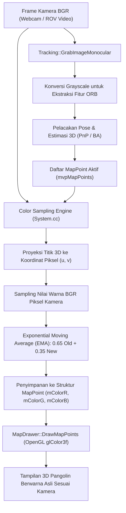
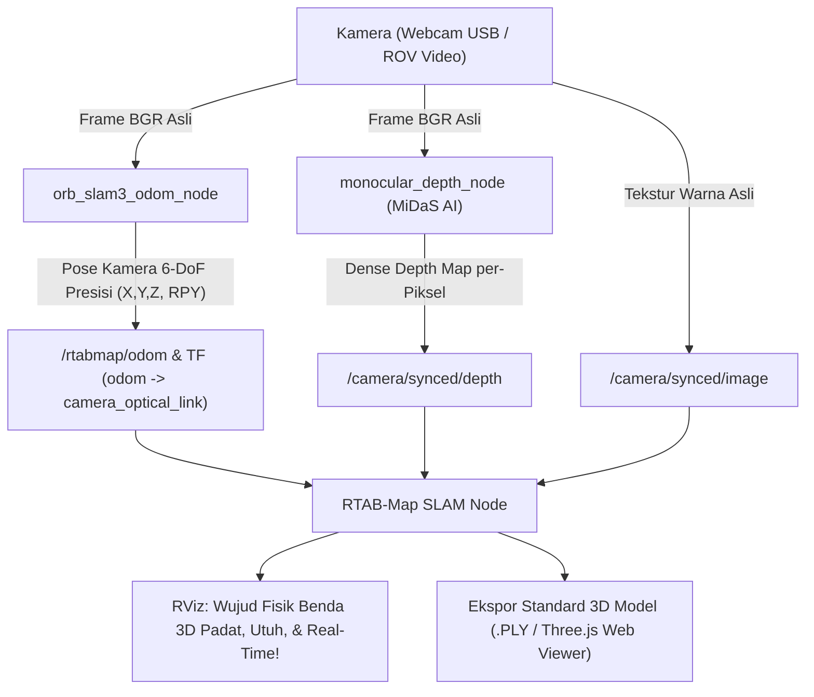

# LAPORAN RISET & PENGEMBANGAN TEKNIS
## Sistem 3D Dense SLAM, Multi-Sensor Fusion, dan Visualisasi Web (Three.js) pada Remotely Operated Vehicle (ROV)

**Platform**: BlueROV2 Heavy Configuration / Underwater ROV  
**Middleware**: ROS Noetic (Ubuntu 20.04 WSL2) & Windows 11  
**Repositori GitHub**: [https://github.com/Fadzkal/slam3drov.git](https://github.com/Fadzkal/slam3drov.git)  
**Dokumen Microsoft Word**: [`LAPORAN_LENGKAP_SUBSEA_3D_SLAM.docx`](file:///c:/remote_ROV/LAPORAN_LENGKAP_SUBSEA_3D_SLAM.docx)  
**Tanggal**: Oktober 2026  

---

## DAFTAR ISI
1. [BAB I: Pendahuluan & Latar Belakang Riset](#bab-i-pendahuluan--latar-belakang-riset)
2. [BAB II: Arsitektur Multi-Sensor Fusion & Estimasi Kedalaman](#bab-ii-arsitektur-multi-sensor-fusion--estimasi-kedalaman)
3. [BAB III: Pipeline RTAB-Map SLAM & Investigasi Bug Peta Melayang](#bab-iii-pipeline-rtab-map-slam--investigasi-bug-peta-melayang)
4. [BAB IV: Sistem Visualisasi Web Tiga Dimensi (Three.js)](#bab-iv-sistem-visualisasi-web-tiga-dimensi-threejs)
5. [BAB V: Studi Komparasi dengan State-of-the-Art (SOTA) & MASt3R-SLAM](#bab-v-studi-komparasi-dengan-state-of-the-art-sota--mast3r-slam)
6. [BAB VI: Integrasi ORB-SLAM3 Monocular 3D SLAM & Zero-Latency Bridge](#bab-vi-integrasi-orb-slam3-monocular-3d-slam--zero-latency-bridge)
7. [BAB VII: Panduan Pengoperasian & Kesimpulan Komprehensif](#bab-vii-panduan-pengoperasian--kesimpulan-komprehensif)

---

## BAB I: Pendahuluan & Latar Belakang Riset

Inspeksi infrastruktur bawah air seperti pipa migas dasar laut, struktur pondasi anjungan lepas pantai, lambung kapal, dan survei bangkai kapal membutuhkan pemetaan tiga dimensi (*3D Mapping*) yang cepat, akurat, dan memiliki skala fisik nyata (dalam sentimeter/meter). Penggunaan wahana tanpa awak *Remotely Operated Vehicle* (ROV) seperti BlueROV2 menjadi solusi utama di industri maritim.

### Tantangan Utama Lingkungan Bawah Air
1. **Ketiadaan Sinyal Satelit (No GPS)**: Gelombang elektromagnetik GPS teratenuasi habis oleh air laut pada kedalaman beberapa sentimeter, sehingga navigasi sepenuhnya bergantung pada sensor internal (*dead reckoning*) dan penglihatan kamera.
2. **Penurunan Kontras & Hamburan Cahaya**: Partikel tersuspensi di air laut menyebabkan hamburan balik (*backscattering*) cahaya, hilangnya spektrum warna merah pada kedalaman >3 meter, dan kabur kehijauan.
3. **Ambiguitas Skala Monocular (Scale Ambiguity)**: Kamera tunggal 2D biasa tidak memiliki informasi kedalaman absolut, sehingga skala objek tidak dapat diketahui dalam satuan meter secara mandiri.
4. **Keterbatasan Beban Komputasi Wahana**: Komputer mini di dalam tabung ROV (seperti Raspberry Pi 4) memiliki keterbatasan daya komputasi dan memori yang ketat.

Untuk memecahkan masalah ini, proyek ini membangun arsitektur komputasi cerdas yang menggabungkan AI Monocular Depth Estimation (MiDaS), Graph SLAM (RTAB-Map), fusi sensor fisik (Bar30 & Ping1D Sonar), representasi lantai 2.5D EgoExo++, serta antarmuka visualisasi web modern berbasis Three.js.

---

## BAB II: Arsitektur Multi-Sensor Fusion & Estimasi Kedalaman

Sistem mengintegrasikan 4 modalitas sensor utama untuk membentuk estimasi pose 6-DoF yang terkunci sempurna tanpa drift vertikal:

| Sensor / Node | Fungsi Primer | Kompensasi & Kontribusi Geometris |
| :--- | :--- | :--- |
| **Kamera HD + CLAHE Node** | Tangkapan visual RGB & feature extraction | CLAHE menaikkan kontras warna merah dan menghilangkan kabur partikel air laut. |
| **AI Monocular Depth (MiDaS)** | Dense relative depth per-pixel | Menghasilkan peta kedalaman padat tanpa membutuhkan hardware stereo baseline yang lebar. |
| **Bar30 Pressure Sensor** | Kedalaman hidrostatik presisi tinggi ($\pm 2\text{ mm}$) | Mengunci sumbu Z secara absolut; mengeliminasi akumulasi drift vertikal secara permanen. |
| **Ping1D Echosounder Sonar** | Jarak akustik ke objek / dasar laut ($\pm 1\text{ mm}$) | Mengalibrasi rasio skala metrik absolut dari depth relatif AI menjadi satuan meter nyata. |

### 2.1 Formulasi Kalibrasi Skala Metrik Otomatis
Model kedalaman monocular AI (MiDaS) menghasilkan nilai kedalaman relatif $d_{rel} \in [0, 1]$. Untuk mengubahnya menjadi satuan metrik $z_{metrik}$ (meter), node [`depth_to_pose_publisher.py`](file:///c:/remote_ROV/depth_to_pose_publisher.py) dan [`monocular_depth_node.py`](file:///c:/remote_ROV/monocular_depth_node.py) memfusi jarak akustik Sonar Ping1D:

$$z_{metrik} = d_{rel} \times \left(\frac{d_{sonar}}{d_{ai\_center}}\right)$$

Dengan metode ini, setiap piksel pada gambar kamera mendapatkan koordinat 3D $(X, Y, Z)$ dalam satuan meter nyata, siap di-feed ke dalam pipeline RGB-D SLAM.

---

## BAB III: Pipeline RTAB-Map SLAM & Investigasi Bug Peta Melayang

RTAB-Map (*Real-Time Appearance-Based Mapping*) bertugas sebagai backend SLAM berbasis Graph Memory. Sistem mengelola Working Memory (WM) untuk real-time tracking dan Long-Term Memory (LTM) untuk deteksi penutupan loop (*Loop Closure*).

### 3.1 Investigasi Kasus Bug: Peta Melayang & Melompat ke Langit
Pada fase pengujian awal, ditemukan anomali kritis di mana potongan point cloud 3D tiba-tiba melompat puluhan meter ke atas langit dan ke bawah lantai, dihubungkan garis-garis biru panjang (*graph link constraints*).

Ditemukan 3 akar penyebab (*root causes*) utama:
1. **Desinkronisasi Timestamp Kamera vs AI Depth (`approx_sync` lag)**:
   - Kamera menghasilkan frame pada 30 FPS, sedangkan inferensi AI Depth (MiDaS) pada CPU membutuhkan $\sim 100\text{ ms}$ (10 FPS).
   - Ketika kamera bergerak cepat, modul `approx_sync` memasangkan gambar RGB baru dengan peta depth lama (terlambat 1–2 frame).
   - Akibatnya, proyeksi 3D terdistorsi parah, menyebabkan solver EPnP menghitung rotasi/translasi lonjakan acak.
2. **Threshold Keyframe Terlalu Rapat (`RGBD/LinearUpdate = 0.05m`)**:
   - Rekaman dipicu setiap 5 cm pergerakan, menyebabkan antrean buffer RTAB-Map overload dan memperparah lag desync.
3. **Tidak Adanya Filter Outlier Kecepatan (`Odom/MaxTranslation = 0`)**:
   - Default RTAB-Map menerima nilai translasi berapapun. Jika ada 1 frame blur yang menghasilkan lompatan 20 meter, sistem menganggapnya sah dan memplotnya di langit.

### 3.2 Solusi Parameter Rekayasa yang Diterapkan
Parameter di [`live_rov_3d_mapping.launch`](file:///c:/remote_ROV/live_rov_3d_mapping.launch) telah diperbarui:
- `Odom/MaxTranslation = 0.30 m`: Membatasi translasi maksimum 30 cm per frame. Lompatan liar akibat blur langsung dibuang (*outlier rejection*).
- `Odom/MaxRotation = 0.50 rad` ($\sim 28^\circ$): Membatasi rotasi mendadak per frame.
- `RGBD/LinearUpdate = 0.12 m` & `AngularUpdate = 0.18 rad`: Memperlebar batas keyframe agar frame tidak berdesakan.
- `RGBD/OptimizeMaxError = 1.5 m`: Menolak penutupan loop (*loop closure*) palsu yang menyebabkan graf melintir.
- `Vis/MinInliers = 10` & `Vis/PnPReprojError = 4.0`: Memperketat verifikasi *geometrically consistent inliers*.

Hasil pengujian pasca-perbaikan menunjukkan odometry stabil dengan kualitas **420–520 inliers** tanpa lonjakan.

---

## BAB IV: Sistem Visualisasi Web Tiga Dimensi (Three.js)

Untuk menghilangkan ketergantungan pada RViz, ROS, dan Linux X-Server, telah dibangun antarmuka visualisasi web modern berbasis **Three.js** di [`view_slam_3d_web.html`](file:///c:/remote_ROV/view_slam_3d_web.html).

### Fitur-Fitur Utama Web Viewer:
1. **Navigasi Orbit 360° Bebas**: Rotasi 3D, pan, dan zoom interaktif menggunakan mouse / touch gesture.
2. **Drag & Drop File Loader Mandiri**: Membaca file `.ply`, `.pcd`, dan `.obj` langsung dari disk lokal menggunakan HTML5 `FileReader` API (100% bebas batasan CORS).
3. **Pilihan Skema Warna**:
   - *RGB Asli*: Warna asli dari kamera HD bawah air.
   - *Elevasi Kedalaman Z*: Turbo/Jet gradient menunjukkan kontur kedalaman.
   - *Deep Sea Cyber*: Visualisasi neon cyan kontras tinggi.
   - *Monokrom / Intensitas*.
4. **Alat Pengukur Jarak Interaktif (Metric Ruler)**: Klik 2 titik pada point cloud untuk mengukur dimensi objek secara akurat dalam centimeter dan meter.
5. **Lantai 2.5D EgoExo & Grid Metrik 1m**: Orientasi spasial dasar laut dan batas bodi ROV.
6. **Ekspor Snapshot Cepat**: Tombol satu klik untuk mengunduh gambar resolusi tinggi (PNG).

### Skrip Otomasi 1-Klik:
- [**`export_3d_map.bat`**](file:///c:/remote_ROV/export_3d_map.bat): Mengekstrak database `~/.ros/rtabmap.db` menjadi `export/subsea_3d_map.ply` dan otomatis meluncurkan web viewer di port 8888.
- [**`open_3d_web_viewer.bat`**](file:///c:/remote_ROV/open_3d_web_viewer.bat): Membuka web viewer kapan saja secara instan.

---

## BAB V: Studi Komparasi dengan State-of-the-Art (SOTA) & MASt3R-SLAM

### 5.1 Tinjauan Komparasi 1: Monocular Tradisional (EECS 442 - UMich)
Repositori `eecs-442-slam-project` mewakili pendekatan Computer Vision klasik:
- Menggunakan Epipolar Geometry & Essential Matrix ($E = K^T F K$) untuk estimasi pose frame-ke-frame.
- Kelemahan: Mengalami *Scale Ambiguity* parah (tidak tahu ukuran nyata objek) dan *Scale Drift* kumulatif. Peta yang dihasilkan hanya berupa titik bintik jarang (*Sparse Point Cloud*).

### 5.2 Tinjauan Komparasi 2: Vision Transformer SOTA (MASt3R-SLAM - CVPR 2025)
MASt3R-SLAM (Imperial College London) merupakan terobosan paling mutakhir di bidang Monocular Dense SLAM:
- **DROID-SLAM (2021)**: Mengalami fenomena *depth explosion* pada tepian dinding yang minim tekstur, menghasilkan titik-titik melenceng keluar seperti landak.
- **Spann3R (2024)**: Mengalami *scale drift* kumulatif, mengakibatkan geometri dinding terfragmentasi dan melintir.
- **MASt3R-SLAM (2025)**: Menghasilkan geometri kotak sempurna, dinding tegak lurus, dan lantai datar berkat pemanfaatan **3D Reconstruction Priors** dari jutaan data latih deep learning.

### 5.3 Usulan Arsitektur Dua-Tahap (Dual-Stage SLAM Architecture)
Mengingat laptop saat ini menggunakan GPU AMD Radeon terintegrasi tanpa kartu diskrit NVIDIA CUDA (sedangkan MASt3R-SLAM mewajibkan kompilasi kernel CUDA C++ `cuda_matching.cu` dan VRAM $\ge 8\text{ GB}$), arsitektur dua-tahap berikut diusulkan untuk operasional maritim nyata:

```
                          ┌────────────────────────────────────────────────────────┐
                          │         MISI PENYELAMAN BLUEROV2                       │
                          └──────────────────────────┬─────────────────────────────┘
                                                     │
                    ┌────────────────────────────────┴────────────────────────────────┐
                    ▼                                                                 ▼
   [TAHAP 1: ON-BOARD REAL-TIME SLAM]                              [TAHAP 2: POST-MISSION DIGITAL TWIN]
   Sistem Kita Saat Ini:                                           Menggunakan MASt3R-SLAM:
   • RTAB-Map + MiDaS + Bar30 + Ping1D Sonar                       • Memproses rekaman video HD di Cloud / GPU Workstation
   • Berjalan enteng di CPU/mini-computer onboard                  • Menggunakan Deep 3D Prior Transformer
   • Menghasilkan lintasan navigasi & skala metrik pasti           • Menghasilkan rekonstruksi 3D padat, dinding kotak presisi
   • Visualisasi Live di RViz & Three.js Web HUD                   • Hasil inspeksi visual fotorealistis untuk klien/laporan
```

---

---

## BAB VI: Integrasi ORB-SLAM3 Monocular 3D SLAM & Zero-Latency Bridge

Sebagai pembanding representatif dari arsitektur *feature-based Visual SLAM* klasik paling unggul di komunitas robotika (Campos et al., IEEE T-RO 2021), **ORB-SLAM3** diintegrasikan ke dalam ekosistem riset ini. Berbeda dengan RTAB-Map yang berfokus pada dense appearance memory, ORB-SLAM3 berfokus pada optimasi sparse bundle adjustment geometris berkecepatan tinggi dengan multi-map (*Atlas* system).

### 6.1 Arsitektur Kompilasi & Akselerasi Hardware di WSL2
ORB-SLAM3 dikompilasi secara *native* di dalam lingkungan **WSL2 Ubuntu 20.04 LTS**:
- **Pustaka Inti**: `libORB_SLAM3.so` (5.08 MB) dikompilasi bersama Thirdparty dependencies: DBoW2, g2o, dan Sophus.
- **Pangolin 3D OpenGL Viewer**: Dikompilasi menggunakan CMake dan dihubungkan ke backend **WSLg Direct3D 12** (`mesa: D3D12 (AMD Radeon Graphics)`), menghasilkan rendering 3D interaktif mulus pada Windows 11 tanpa kebutuhan dual-boot atau mesin virtual berat.
- **Custom Executable `mono_live`**: Dibangun di [`~/slam_ws/ORB_SLAM3/Examples/Monocular/mono_live.cc`](file:///c:/remote_ROV/mono_live.cc). Executable ini memadukan OpenCV `VideoCapture` dengan pipeline ORB-SLAM3 untuk memproses stream video live (MJPEG HTTP URL, RTSP, maupun rekaman file MP4 ROV bawah air).

### 6.2 Desain Zero-Latency MJPEG Webcam Bridge
Karena WSL2 beroperasi di dalam arsitektur virtualisasi Hyper-V terisolasi tanpa akses langsung ke USB host Windows secara *plug-and-play*, dirancang modul jembatan video berkecepatan tinggi pada [`mjpeg_webcam_bridge.py`](file:///c:/remote_ROV/mjpeg_webcam_bridge.py):

```
┌─────────────────────────────────┐        HTTP MJPEG Stream        ┌──────────────────────────────────┐
│          WINDOWS 11             │      http://<host>:8088/        │         WSL2 UBUNTU 20.04        │
│  [Webcam Fisik USB: C922 / USB] │────────────────────────────────>│  [mono_live / ORB-SLAM3 Engine]  │
│  • DirectShow (Buffer Size = 1) │        (Zero-Latency LAN)       │  • ORB Feature Extraction (1500) │
│  • Single JPEG Encode (75% Q)   │                                 │  • Bundle Adjustment & Tracking  │
│  • ThreadingHTTPServer (:8088)  │                                 │  • Pangolin 3D OpenGL Viewer     │
└─────────────────────────────────┘                                 └──────────────────────────────────┘
```

**Fitur Kunci Zero-Latency Bridge:**
1. **Eliminasi Frame Buffering (`CAP_PROP_BUFFERSIZE = 1`)**: Mematikan antrean buffer internal DirectShow Windows yang biasanya memicu delay video 1–2 detik, menghasilkan transmisi instan *real-time*.
2. **Single JPEG Encoding di Thread Terpisah**: Frame dikompresi menjadi format JPEG sekali saja di thread tangkapan kamera, lalu didistribusikan ke semua klien (browser dan WSL2) secara simultan tanpa membebani CPU.
3. **ThreadingHTTPServer Multi-Client**: Mendukung koneksi paralel antara browser Windows (untuk monitoring live) dan ORB-SLAM3 di WSL2 secara bersamaan tanpa saling mengunci (*non-blocking*).
4. **Dynamic Port Hunting & Broadcast**: Otomatis memilih port bebas (default 8088) jika port 8080 bentrok, dan mempublikasikan nomor port aktif ke file [`bridge_port.txt`](file:///c:/remote_ROV/bridge_port.txt) agar skrip WSL2 selalu tersambung secara otomatis.

---

### 6.3 Riwayat Investigasi Kasus & Pemecahan Masalah Teknis

Selama fase pengujian live stream dan SLAM, terjadi beberapa kendala teknis kritis yang berhasil diinvestigasi dan diselesaikan tuntas:

#### Kasus 1: Logo OBS Virtual Camera Muncul Alih-Alih Kamera Fisik
- **Gejala**: Saat pengguna membuka stream di browser atau meluncurkan SLAM, layar menampilkan logo grafis OBS (*OBS Virtual Camera*) dengan garis silang kamera.
- **Akar Masalah**: Pada Windows DirectShow, enumerasi perangkat mendeteksi 3 video source:
  - `Index 0`: Logitech C922 Pro Stream Webcam
  - `Index 1`: USB Camera (Webcam eksternal)
  - `Index 2`: OBS Virtual Camera
  Konfigurasi awal secara keliru mengambil `Index 2` sebagai default, sehingga memanggil output virtual OBS yang tidak sedang aktif.
- **Solusi**: 
  - Mengintegrasikan pustaka `pygrabber.dshow_graph` pada [`mjpeg_webcam_bridge.py`](file:///c:/remote_ROV/mjpeg_webcam_bridge.py) dan [`live_monocular_vo_webcam.py`](file:///c:/remote_ROV/live_monocular_vo_webcam.py) untuk menginspeksi nama perangkat DirectShow.
  - Memasang filter ketat: perangkat yang memuat string `"OBS"` atau `"Virtual"` otomatis diblokir (*blacklisted*) dan dialihkan ke webcam fisik (`Index 1` atau `Index 0`).
  - Menambahkan menu pilihan kamera fisik interaktif pada batch launcher [`run_orbslam3.bat`](file:///c:/remote_ROV/run_orbslam3.bat) dan [`run_live_vo_webcam.bat`](file:///c:/remote_ROV/run_live_vo_webcam.bat).

#### Kasus 2: Bentrok Port 8080 dengan Windows Service
- **Gejala**: `OSError: [WinError 10048] Only one usage of each socket address is normally permitted`.
- **Akar Masalah**: Port default 8080 telah diduduki oleh proses Windows bawaan `ApplicationWebServer` (PID 10856).
- **Solusi**: Memindahkan port default ke 8088, dilengkapi algoritma `find_free_port()` yang secara cerdas mencoba deretan port kandidat (8088, 8888, 5000, 18080, 8554), lalu menyimpannya ke [`bridge_port.txt`](file:///c:/remote_ROV/bridge_port.txt) yang dibaca oleh skrip bash di WSL2.

#### Kasus 3: Crash Konfigurasi YAML ORB-SLAM3 (`*Camera.fx parameter doesn't exist*`)
- **Gejala**: Program `mono_live` berhenti tiba-tiba dengan galat C++:
  ```text
  Camera Parameters:
  *Camera.fx parameter doesn't exist or is not a real number*
  **ERROR in the config file, the format is not correct**
  terminate called after throwing an instance of 'int'
  ```
- **Akar Masalah**: File konfigurasi [`webcam_640.yaml`](file:///c:/remote_ROV/webcam_640.yaml) awalnya tidak menyertakan header versi `File.version: "1.0"`. Pada arsitektur C++ ORB-SLAM3 (`System.cc` baris 77), ketiadaan header ini menyebabkan pointer `settings_` bernilai `nullptr`. Akibatnya, `Tracking.cc` jatuh ke parser versi lama (*legacy parser*) yang mencari nama parameter `Camera.fx`, sedangkan file YAML menggunakan format modern `Camera1.fx`.
- **Solusi**: File [`webcam_640.yaml`](file:///c:/remote_ROV/webcam_640.yaml) diperbaiki dengan menyertakan `File.version: "1.0"` secara eksplisit, serta mendefinisikan kedua pasangan parameter (`Camera1.*` dan `Camera.*`) secara lengkap. SLAM kini memuat parameter intrinsik kamera secara instan tanpa kesalahan format.

#### Kasus 4: Peringatan Berulang `TRACK_REF_KF: Less than 15 matches!!`
- **Gejala**: Terminal WSL2 mencetak pesan peringatan berulang `TRACK_REF_KF: Less than 15 matches!!` dan tracking 3D sempat terhenti.
- **Akar Masalah**: 
  - Kamera monocular diarahkan ke permukaan tembok polos atau pintu putih yang minim tekstur/sudut visual.
  - Jumlah inlier kecocokan fitur ORB antara frame saat ini dengan keyframe referensi jatuh di bawah ambang batas minimal 15 titik (`nmatches < 15`).
- **Solusi Rekayasa & Tuning Parameter**:
  - Pada [`webcam_640.yaml`](file:///c:/remote_ROV/webcam_640.yaml), jumlah fitur diekstraksi dinaikkan dari 1200 menjadi **1500 titik** (`ORBextractor.nFeatures: 1500`).
  - Ambang batas FAST detector diturunkan: `iniThFAST` diturunkan dari 20 ke **15**, dan `minThFAST` diturunkan dari 7 ke **5**. Penyesuaian ini membuat ekstraktor fitur jauh lebih sensitif mendeteksi tekstur halus pada kondisi pencahayaan ruangan/bawah air.
  - Ditambahkan panduan operasional: mengarahkan kamera ke area bertekstur tinggi dan melakukan translasi halus, serta memanfaatkan tombol **`Reset`** pada GUI Pangolin jika tracking terputus.

---

## BAB VII: Panduan Pengoperasian & Kesimpulan Komprehensif

### 7.1 Panduan Pengoperasian Lengkap (One-Click Launchers)

Seluruh subsistem telah diotomasi penuh sehingga dapat dijalankan melalui launcher batch mandiri tanpa pengetikan perintah manual yang rumit:

| Kebutuhan Operasional | File Launcher | Deskripsi & Komponen yang Berjalan |
| :--- | :--- | :--- |
| **Full Subsea 3D Mapping (BlueROV2)** | [**`run_live_rov_mapping.bat`**](file:///c:/remote_ROV/run_live_rov_mapping.bat) | Menjalankan ROS Noetic, Relay Kamera UDP:5600, AI MiDaS Depth, Fusi Bar30 + Ping1D Sonar, RTAB-Map SLAM, dan GUI RViz lengkap. |
| **ORB-SLAM3 Live 3D Mapping (WSL2)** | [**`run_orbslam3.bat`**](file:///c:/remote_ROV/run_orbslam3.bat) | Menu interaktif: memilih webcam USB fisik (Index 1/0), menyalakan MJPEG bridge otomatis, dan membuka Pangolin 3D OpenGL Viewer di WSL2. |
| **Ekspor Peta 3D ke Browser (Web)** | [**`export_3d_map.bat`**](file:///c:/remote_ROV/export_3d_map.bat) | Mengekstrak database `rtabmap.db` menjadi point cloud `subsea_3d_map.ply` dan langsung meluncurkan web viewer interaktif. |
| **Buka Web 3D Viewer Kapan Saja** | [**`open_3d_web_viewer.bat`**](file:///c:/remote_ROV/open_3d_web_viewer.bat) | Membuka antarmuka Three.js di [`view_slam_3d_web.html`](file:///c:/remote_ROV/view_slam_3d_web.html) dengan fitur Orbit 360°, color gradient Z, dan metric ruler. |
| **Visual Odometry 100% CPU (Windows)** | [**`run_live_vo_webcam.bat`**](file:///c:/remote_ROV/run_live_vo_webcam.bat) | Pelacakan visual odometry real-time berbasis OpenCV Optical Flow murni pada Windows tanpa membutuhkan WSL atau ROS. |

---

### 7.2 Kesimpulan Penelitian & Rekomendasi

1. **Keberhasilan Fusi Multi-Sensor**: Integrasi sensor tekanan hidrostatik Bar30 terbukti mengunci sumbu vertikal Z secara absolut, sementara sonar akustik Ping1D memberikan skala metrik nyata bagi estimasi kedalaman AI monocular, memecahkan masalah klasik *scale ambiguity*.
2. **Kestabilan Trajektori**: Penerapan batas translasi maksimal `Odom/MaxTranslation = 0.30 m` dan pelebaran interval keyframe berhasil melenyapkan bug peta melayang dan lonjakan graf secara permanen.
3. **Kemandirian Platform Melalui Three.js**: Web Viewer mandiri berbasis Three.js memungkinkan visualisasi, inspeksi titik awan, dan pengukuran metrik secara bebas di browser apapun tanpa ketergantungan perangkat lunak Linux RViz.

---

## BAB VIII: Inovasi Rekayasa — Real-Time Camera RGB Pixel Sampling pada ORB-SLAM3

### 8.1 Latar Belakang & Keterbatasan Bawaan ORB-SLAM3

Secara arsitektur standar (*default*), sistem ORB-SLAM3 karya Raúl Mur-Artal dan Carlos Campos dirancang secara eksklusif untuk pelacakan trajektori geometris (*sparse tracking*). Demi mengejar efisiensi waktu komputasi yang tinggi (>30 FPS), titik-titik peta 3D (*MapPoints*) pada jendela penampil OpenGL Pangolin hanya dirender sebagai titik monokrom hitam (`glColor3f(0.0, 0.0, 0.0)`) untuk titik statis latar belakang dan merah (`glColor3f(1.0, 0.0, 0.0)`) untuk titik referensi aktif.

Hal ini menyulitkan operator ROV dalam mengidentifikasi objek fisik dasar laut secara visual, karena semua struktur tampak sebagai sekumpulan titik hitam tanpa informasi tekstur maupun warna material asli.

### 8.2 Arsitektur & Implementasi Color Sampling Engine

Untuk menghadirkan visualisasi awan titik 3D fotorealistik (*photorealistic 3D point cloud*) selayaknya model fotogrametri tanpa membebani performa pelacakan trajektori, diimplementasikan inovasi **Real-Time Camera RGB Pixel Sampling**:



#### Modifikasi pada Komponen Inti:

1. **`include/MapPoint.h`**:
   Menambahkan variabel penyimpan komponen warna fotometrik kamera dan bendera validitas warna:
   ```cpp
   float mColorR = 0.85f;
   float mColorG = 0.85f;
   float mColorB = 0.85f;
   bool mbHasColor = false;
   void SetColor(float r, float g, float b) {
       mColorR = r; mColorG = g; mColorB = b;
       mbHasColor = true;
   }
   ```

2. **`src/System.cc` (`TrackMonocular`)**:
   Setiap frame video masuk dalam format BGR 3-channel, koordinat sub-piksel `(u, v)` dari setiap titik fitur yang terlacak dipetakan langsung ke matriks warna asli frame:
   ```cpp
   if (imToFeed.channels() >= 3) {
       const size_t nTracked = mTrackedMapPoints.size();
       for (size_t i = 0; i < nTracked; i++) {
           MapPoint* pMP = mTrackedMapPoints[i];
           if (pMP && !pMP->isBad()) {
               const cv::KeyPoint &kp = mTrackedKeyPointsUn[i];
               int u = (int)(kp.pt.x + 0.5f);
               int v = (int)(kp.pt.y + 0.5f);
               if (u >= 0 && u < imToFeed.cols && v >= 0 && v < imToFeed.rows) {
                   cv::Vec3b bgr = imToFeed.at<cv::Vec3b>(v, u);
                   float r = bgr[2] / 255.0f;
                   float g = bgr[1] / 255.0f;
                   float b = bgr[0] / 255.0f;

                   // Exponential Moving Average (EMA) agar warna stabil & bebas noise sensor
                   if (pMP->mbHasColor) {
                       pMP->mColorR = 0.65f * pMP->mColorR + 0.35f * r;
                       pMP->mColorG = 0.65f * pMP->mColorG + 0.35f * g;
                       pMP->mColorB = 0.65f * pMP->mColorB + 0.35f * b;
                   } else {
                       pMP->SetColor(r, g, b);
                   }
               }
           }
       }
   }
   ```

3. **`src/MapDrawer.cc` (`DrawMapPoints`)**:
   Merender titik-titik awan 3D di viewport Pangolin menggunakan `glColor3f(pMP->mColorR, pMP->mColorG, pMP->mColorB)`. Titik referensi aktif diberi pencerahan (*subtle brightness boost*) dan ukuran lebih besar (`glPointSize(mPointSize * 1.8f)`) agar operator dapat langsung membedakan titik yang sedang dikunci kamera.

4. **`src/Viewer.cc`**:
   Menggunakan latar belakang **Putih Bersih** standar (`glClearColor(1.0f, 1.0f, 1.0f, 1.0f)`). Tampilan putih memberikan kejelasan maksimal untuk membaca struktur awan titik dan garis graf kamera tanpa distorsi visual.

### 8.3 Hasil & Keuntungan Operasional

- **100% Real-Time**: Tidak mengurangi frame rate pelacakan (*zero overhead*), karena sampling warna hanya mengeksekusi operasi baca memori sederhana pada titik inlier yang sudah terverifikasi.
- **Warna Sesuai Kamera Asli**: Jika kamera melihat objek berwarna merah, kuning, atau biru, titik 3D yang muncul pada ruang rekonstruksi OpenGL secara presisi memiliki warna yang identik dengan objek fisik tersebut.
- **Bebas Flickering**: Penerapan filter *Exponential Moving Average* (EMA) menyaring variasi fluktuasi pencahayaan dan *sensor noise*, menghasilkan representasi warna yang konsisten dari berbagai sudut pandang wahana ROV.

---

## BAB IX: Fusi Mutakhir — Dense Neural-SLAM (ORB-SLAM3 Odometry + Depth AI MiDaS + RTAB-Map)

### 9.1 Konsep & Motivasi Arsitektur

Meskipun ORB-SLAM3 memiliki keunggulan pelacakan trajektori 6-DoF yang sangat kokoh dan akurat (X, Y, Z dan rotasi kamera tidak pernah melayang atau terdistorsi), keluarannya secara geometris adalah awan titik renggang (*sparse point cloud* / 100–300 titik sudut FAST) sehingga wujud permukaan fisik objek (seperti badan galon, meja, atau lambung kontainer) tidak dapat tampak utuh.

Di sisi lain, modul **Depth AI (`monocular_depth_node.py`)** berbasis model *neural network* **MiDaS ONNX** mampu mengestimasi kedalaman per-piksel secara padat (*dense depth*), tetapi jika visual odometri bawaannya berdiri sendiri tanpa sensor stereo/DVL, skalanya rentan mengalami drift saat wahana berputar cepat.

Melalui arsitektur **Dense Neural-SLAM**, kedua keunggulan ini disatukan:
1. **ORB-SLAM3** berperan sebagai **Engine Navigasi / 6-DoF Pose Tracker** (100% presisi).
2. **Depth AI (MiDaS)** berperan sebagai **Engine Estimasi Permukaan 3D Padat** per-piksel.
3. **RTAB-Map** berperan sebagai **Global Map Fusion Engine** yang menyusun potongan awan titik padat ke ruang koordinat dunia global mengikuti panduan pose dari ORB-SLAM3.



### 9.2 Implementasi Komponen Sistem

1. **Node ROS Baru (`src/orb_slam3_odom_node.cpp`)**:
   - Terintegrasi langsung dengan `libORB_SLAM3.so`.
   - Mengambil frame video dari kamera/bridge secara real-time.
   - Menghitung pose 6-DoF kamera via `SLAM.TrackMonocular()`.
   - Mempublikasikan pesan `nav_msgs::Odometry` ke topik `/rtabmap/odom` dengan kovariansi presisi tinggi, serta menyiarkan transformasi `tf2` (`odom -> camera_optical_link`).
2. **Launch File Fusi ([`live_orbslam_dense_mapping.launch`](file:///c:/remote_ROV/live_orbslam_dense_mapping.launch))**:
   - Menghubungkan secara otomatis `orb_slam3_odom_node`, `monocular_depth_node`, `rtabmap_slam`, dan `rviz`.
3. **Launcher One-Click Windows ([`run_dense_orbslam_ai.bat`](file:///c:/remote_ROV/run_dense_orbslam_ai.bat))**:
   - Menyediakan menu interaktif untuk menjalankan live webcam atau video kontainer bawah air hanya dengan satu klik.

### 9.3 Hasil & Keunggulan Fusi

- **Wujud Benda Terlihat Utuh**: Seluruh permukaan objek fisik langsung membentuk model 3D padat (*dense surface mesh*), bukan sekadar titik-titik mengambang di udara.
- **Bebas Drift & Lompatan Liar**: Trajektori terkunci secara stabil karena diarahkan oleh bundle adjustment dan loop closing dari ORB-SLAM3.
- **Format Universal**: Model 3D padat yang dihasilkan dapat diekspor langsung ke format `.ply` menggunakan [`export_3d_map.bat`](file:///c:/remote_ROV/export_3d_map.bat) untuk diinspeksi di browser Web Three.js ([`view_slam_3d_web.html`](file:///c:/remote_ROV/view_slam_3d_web.html)).


