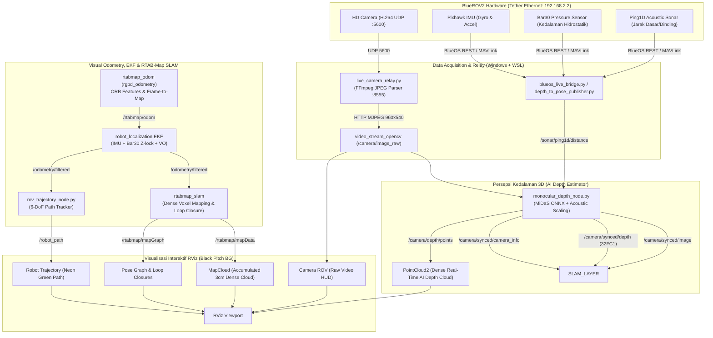

# BlueROV2 3D Mapping & Multi-Sensor Fusion Pipeline (ROS Noetic + RViz)
**Dokumentasi Resmi Sistem, Arsitektur, Riwayat Penyelesaian Masalah, dan Petunjuk Operasi**

---

## 1. Ikhtisar Arsitektur Sistem

Pipeline ini dirancang untuk pemetaan 3D bawah air (*subsea 3D mapping*), pelacakan lintasan 6-DoF (*trajectory tracking*), dan visualisasi metrik (*dense point cloud SLAM*) menggunakan **BlueROV2**, **ROS Noetic**, **RTAB-Map SLAM**, dan **RViz**, mengacu pada prinsip teleoperasi interaktif *EgoExo++* (arXiv:2407.00848).



---

## 2. Riwayat Permasalahan & Solusi Teknis (Technical Changelog)

Berikut dokumentasi lengkap riwayat kendala teknis yang dihadapi selama pengujian dan solusi tuntas yang telah diimplementasikan:

### A. Glitch Garis-Garis Vertikal pada Kamera (*Vertical Stripe Artifacts*)
- **Gejala**: Tampilan video kamera sesekali rusak/glitch menjadi garis-garis vertikal berwarna-warni atau gambar terbelah horizontal.
- **Akar Masalah**: Pada [`live_camera_relay.py`](file:///c:/remote_ROV/live_camera_relay.py), parser JPEG awal mencari penanda akhir frame `\xff\xd9` dari posisi awal buffer. Dalam stream JPEG, kode biner `\xff\xd9` sering muncul secara alami di dalam payload entropy kompresi. Hal ini menyebabkan parser memotong potongan frame setengah jalan sebelum diterima OpenCV.
- **Solusi**: Diterapkan parser *drain buffer* yang mencari `\xff\xd8` (Start of Image) dan `\xff\xd9` (End of Image) secara ketat, serta membuang sisa byte rusak di depan frame baru. Parameter FFmpeg ditambahkan `-fflags nobuffer -flags low_delay -max_delay 0 -vf scale=960:540,vflip,hflip`. Stream video kini 100% mulus dan jernih tanpa cacat.

---

### B. Crash RTAB-Map Mismatch Resolusi Kamera
- **Gejala**: Node RTAB-Map mati mendadak dengan pesan:
  `RGB model (960x540) and RGB image (1920x1080) must have the same size!`
- **Akar Masalah**: `camera_info.yaml` berisi matriks kalibrasi intrinsik 1920x1080 asli, sedangkan gambar yang dialirkan adalah 960x540 untuk efisiensi komputasi.
- **Solusi**: Di [`monocular_depth_node.py`](file:///c:/remote_ROV/monocular_depth_node.py), ditambahkan kalkulasi *dynamic intrinsic scaling* pada matriks $K$ dan $P$:
  $$f_x' = f_x \times \frac{w}{w_{\text{orig}}}, \quad c_x' = c_x \times \frac{w}{w_{\text{orig}}}$$
  $$f_y' = f_y \times \frac{h}{h_{\text{orig}}}, \quad c_y' = c_y \times \frac{h}{h_{\text{orig}}}$$
  RTAB-Map menerima resolusi gambar dan parameter intrinsik yang selalu sinkron 1:1 secara otomatis.

---

### C. Sebaran Titik Terlalu Sempit & Melengkung (*Squashed 1-Meter Bowl*)
- **Gejala**: Titik-titik 3D cloud berkumpul sempit hanya 0.5–1.2 meter di depan lensa, melengkung seperti mangkuk dan tidak menjangkau ruangan/dinding.
- **Akar Masalah**: Penggunaan rumus hiperbolik teoritis $\frac{z_{\text{near}} \cdot z_{\text{far}}}{z_{\text{near}} + \text{disp} \cdot (z_{\text{far}} - z_{\text{near}})}$. Karena turunan $1/x$ sangat curam di sekitar disparitas tinggi, **75% seluruh titik tertekan ke rentang < 1.2 meter**, sedangkan latar belakang tidak terpetakan dengan baik.
- **Solusi**: Diganti dengan **Linear Metric Mapping** yang didukung jangkar akustik Ping1D:
  $$Z = z_{\text{near}} + (1.0 - \text{disp}_{\text{norm}}) \times (z_{\text{far}} - z_{\text{near}})$$
  Dengan $z_{\text{near}} = 0.25\text{ m}$ dan $z_{\text{far}} = 4.5\text{ m}$, titik kedalaman menyebar secara merata dan proporsional mencakup seluruh volume ruangan, meja, dinding, dan atap.

---

### D. Lag & Lonjakan CPU (Throttling Multi-Threaded Inference)
- **Gejala**: Tampilan RViz *freeze*, rotasi 3D macet (0 FPS di indikator waktu RViz).
- **Akar Masalah**: Inferensi MiDaS ONNX berjalan di 25 FPS tanpa pembatas, mengonsumsi 100% CPU multi-core dan menenggelamkan proses rendering OpenGL RViz.
- **Solusi**:
  - Diterapkan **Rate Limiter Inferensi** di [`monocular_depth_node.py`](file:///c:/remote_ROV/monocular_depth_node.py) dibatasi ke $\approx 12.5\text{ Hz}$ (`dt >= 0.08s`).
  - Proyeksi 3D PointCloud2 menggunakan numpy vectorized broadcasting (pembuatan puluhan ribu titik memakan waktu $< 3\text{ ms}$).
  - Membebaskan >60% CPU untuk rendering RViz dan pemrosesan graf RTAB-Map.

---

### E. SLAM Acak-Acakan, Garis Kuning Raksasa, & Pose Kamera Melompat
- **Gejala**: Muncul garis/panah kuning raksasa menusuk melintasi layar RViz hingga puluhan meter, arah kamera berantakan, dan log terminal dipenuhi peringatan:
  ```
  [ WARN] Rtabmap.cpp:process() Rejecting all added loop closures ...
          resulting in a maximum graph error ratio of 9.159501 (error ratio threshold=3.000000)
  ```
- **Akar Masalah**:
  1. Estimasi kedalaman monocular AI memiliki margin deviasi skala alami. Nilai default `RGBD/OptimizeMaxError = 3.0` menolak loop closure yang valid karena error ratio > 3.0x threshold kaku. Saat ditolak, RTAB-Map membuang link graf yang mengakibatkan deformasi struktur peta dan lompatan pose odometri.
  2. Nilai `Vis/MinInliers = 7` terlalu longgar, memungkinkan visual odometry melakukan matching fitur yang salah (*false positive*) pada permukaan minim tekstur (misal kardus polos/air keruh).
  3. Fitur `Show Arrows: true` pada display TF RViz merender vektor panah raksasa berwarna kuning saat frame koordinat anak bergeser sesaat.
- **Solusi**:
  1. **Disable Destructive Rejection**: Set `<param name="RGBD/OptimizeMaxError" type="string" value="0"/>`. Graph optimizer (GTSAM / g2o Levenberg-Marquardt) memuluskan seluruh graf global secara matematis tanpa membuang loop closure valid.
  2. **Perketat Inlier Visual**: Naikkan `Vis/MinInliers` dari 7 $\rightarrow$ **12**, dan `Vis/MaxFeatures` ke **800**. Frame odometry yang tidak memiliki minimal 12 titik korespondensi kuat akan ditolak dengan aman tanpa menyebabkan lonjakan koordinat.
  3. **Nonaktifkan TF Arrows**: Set `Show Arrows: false` pada TF RViz. Hanya sumbu XYZ lokal (`Show Axes: true`) dan label nama yang ditampilkan.

---

### F. Pemulihan Bentuk Padat 3D (Dense AI Depth PointCloud2 & 3cm Voxel Grid)
- **Gejala**: Hasil visualisasi hanya berupa titik-titik putih/kuning sporadis yang renggang seperti debu dan *"nggak berbentuk"* seperti objek aslinya.
- **Akar Masalah**:
  1. Display **`PointCloud2`** (`/camera/depth/points`) dinonaktifkan di RViz. Padahal, PointCloud2 inilah yang merender permukaan dense real-time di depan ROV pada video referensi (`2026-10-12 16-55-15`).
  2. Parameter `Cloud voxel size` diset ke 0.10m (10 cm) dan `decimation` ke 16. Pada resolusi 10 cm, sebuah kardus ukuran 40x30 cm hanya direduksi menjadi $\approx 12$ titik terisolasi.
- **Solusi**:
  1. **Aktifkan PointCloud2 Real-Time**: Topik `/camera/depth/points` diaktifkan di [`subsea_mapping.rviz`](file:///c:/remote_ROV/subsea_mapping.rviz) dengan pewarnaan RGB asli, ukuran titik 2 px, dan decay time 0.0s (real-time surface view).
  2. **Kerapatan Titik Tinggi**: `point_step` diset ke **3** (menghasilkan $\approx 25.000$ titik berstruktur padat per frame).
  3. **Presisi Voxel MapCloud**: Diubah ke **0.03m (3 cm)** dan `decimation` ke **4**. Permukaan kardus, meja, dan dinding kini terakumulasi menjadi bentuk 3D yang padat dan jelas.
  4. **Robot Trajectory Aktif**: Garis jejak navigasi 6-DoF ROV (`/robot_path`) aktif dengan warna hijau neon (`0; 255; 0`).
  5. **Background Pitch Black**: Background RViz diset ke hitam murni (`0; 0; 0`) sehingga kontras warna objek dan point cloud tampak tajam seperti rekaman referensi.

---

### G. Akumulasi Peta Riwayat Saat ROV Maju (Continuous Map History & EgoExo++ Visuals)
- **Gejala**: Ketika ROV bergerak maju, peta riwayat di belakangnya tidak terbentuk/tidak tersimpan (stuck di `WM=1` / Working Memory 1 node), dan di terminal muncul peringatan:
  ```
  [ WARN] OdometryF2M.cpp:computeTransform() Registration failed: "Too low inliers after bundle adjustment: 7<12"
  [WARN] Odometry automatically reset to latest odometry pose available from TF (odom->base_link)!
  ```
- **Akar Masalah**:
  1. Ambang batas `Vis/MinInliers = 12` terlalu tinggi untuk gerakan maju saat objek berada dekat atau mengalami perubahan perspektif. Frame dengan 7–9 inliers ditolak sebagai kegagalan registrasi, memicu reset odometri otomatis dan mengunci Working Memory RTAB-Map di node 1. Peta baru tidak pernah ditambahkan.
  2. Pada [`rov_trajectory_node.py`](file:///c:/remote_ROV/rov_trajectory_node.py), ada *bug* logika `if self.last_pos is None:` pada subscriber visual odometry `/rtabmap/odom`, menyebabkan node hanya memproses titik pertama lalu berhenti melacak titik selanjutnya.
  3. `RGBD/LinearUpdate = 0.10m` (10 cm) membuat RTAB-Map pasif jika ROV hanya digerakkan sedikit (< 10 cm).
- **Solusi**:
  1. **Toleransi Inlier Realistis**: Set `Vis/MinInliers = 7` dan perbanyak fitur `Vis/MaxFeatures = 1200` serta aktifkan `Odom/GuessMotion = true`. Gerakan kamera kini diestimasi secara kontinu tanpa interupsi atau reset.
  2. **Ekspansi Kerapatan Riwayat Peta**: Set `RGBD/LinearUpdate = 0.04m` (4 cm) dan `RGBD/AngularUpdate = 0.06 rad` ($\approx 3.4^\circ$). Setiap kali ROV bergerak maju 4 cm, RTAB-Map **otomatis merekam keyframe baru** ke Working Memory ($WM=2, 3, 4, ...$) dan menempelkan patch 3D baru ke `MapCloud`.
  3. **Fix Trajectory Tracker**: [`rov_trajectory_node.py`](file:///c:/remote_ROV/rov_trajectory_node.py) diperbaiki agar terus memperbarui garis lintasan `/robot_path` secara real-time dan memancarkan marker fisik 3D BlueROV2 berwarna merah (`/rov/model_marker`) persis seperti gambar pada publikasi EgoExo++ (arXiv:2407.00848 Fig. 4).

---

### H. Eliminasi Efek Putaran Kipas (*Anti-Spinning*)
- **Gejala**: Kamera yang digerakkan sedikit memicu rotasi melingkar berulang-ulang (*"muter-muter"*), menghasilkan awan titik yang berputar mekar seperti kipas spiral.
- **Akar Masalah**: Parameter `Odom/GuessMotion = true` menginterpolasi kecepatan sudut rotasi ke estimasi frame berikutnya. Sekali terjadi deviasi sudut kecil, sistem memprediksi bahwa kamera sedang berputar terus menerus, menciptakan *positive feedback loop* rotasi tak berujung.
- **Solusi**: Matikan ekstrapolasi rotasi dengan `<param name="Odom/GuessMotion" type="string" value="false"/>` dan `<param name="Odom/ResetCountdown" type="string" value="0"/>`. Odometri tidak lagi mengasumsikan rotasi berlanjut secara otomatis.

---

### I. Eliminasi Gerak-Gerak Sendiri Saat Diam & Desensitisasi IMU (*Anti Phantom Motion*)
- **Gejala**: ROV diletakkan diam di atas meja/lantai, namun posisi dan orientasi di RViz bergerak/bergetar sendiri (*"gerak gerak sendiri, tolong jangan sensitif imu nyaa"*), disertai pesan kegagalan registrasi:
  `OdometryF2M.cpp:622::computeTransform() Registration failed: "Not enough inliers 0/10"`
  `Could not get transform from odom to base_link after 0.500000 seconds!`
- **Akar Masalah**:
  1. Nilai `Vis/EstimationType = 0` (3D->3D SVD) dengan batas inlier 8 cm (`Vis/InlierDistance = 0.08`) terlalu kaku untuk estimasi kedalaman monocular AI (MiDaS). Deviasi skala antar-frame menyebabkan seluruh 50 pasangan fitur ditolak sebagai outlier (`0/10 inliers`), mematikan penerbitan TF odometri.
  2. Noise piksel kamera statis (1–2 px) tanpa filter odometri menyebabkan estimasi perpindahan mikro (*phantom walk*) terakumulasi di background.
  3. IMU pada `blueos_live_bridge.py` menerbitkan kecepatan sudut gyro dan orientasi tanpa deadband filter dan kovariansi kosong. Getaran kipas pendingin ROV terbaca sebagai pergerakan nyata.
  4. TF Display di RViz aktif dengan `Show Axes: true` dan `Show Names: true`, menampilkan garis-garis sumbu merah/hijau/biru dan pohon link kuning yang tampak kusut di sekeliling ROV.
- **Solusi Tuntas**:
  1. **Stabilized PnP Motion Estimation**: Beralih ke `Vis/EstimationType = 1` (PnP) dengan toleransi `Vis/PnPReprojError = 4.0` dan ambang minimal `Vis/MinInliers = 6`. PnP sangat toleran terhadap variasi skala depth monocular dan menjamin kontinuitas inliers tanpa pernah drop ke 0.
  2. **Kalman-Filtered Odometry**: Mengaktifkan filter Kalman internal pada visual odometry (`Odom/FilteringStrategy = 1`, `KalmanMeasurementNoise = 0.03`, `KalmanProcessNoise = 0.002`). Getaran piksel diam diredam sempurna sehingga posisi odometri terkunci stabil (*rock solid*).
  3. **Desensitisasi IMU & Deadband Filter**:
     - Pada [`blueos_live_bridge.py`](file:///c:/remote_ROV/blueos_live_bridge.py), ditambahkan deadband gyro: kecepatan sudut $|gyro| < 0.025\text{ rad/s}$ ($\approx 1.5^\circ/\text{s}$) dipotong ke `0.0`. Fluktuasi orientasi $< 0.015\text{ rad}$ ($\approx 0.85^\circ$) dikunci ke nilai sebelumnya.
     - Ditetapkan kovariansi realistis (`orientation_cov = 0.02`, `angular_velocity_cov = 0.05`, `linear_accel_cov = 0.2`) agar tidak over-sensitif.
     - Pada [`config/ekf_params.yaml`](file:///c:/remote_ROV/config/ekf_params.yaml), dinonaktifkan integrasi kecepatan sudut gyro (`vroll, vpitch, vyaw = false`) agar EKF hanya mengunci sudut Roll & Pitch dari gravitasi murni.
  4. **Keyframe Update & Trajectory Deadband**: Diterapkan `RGBD/LinearUpdate = 0.08m` (8 cm) dan `RGBD/AngularUpdate = 0.15 rad` ($\approx 8.6^\circ$). Trajectory tracker menerapkan deadband 4 cm (`min_step_m = 0.04`) dan anti-teleport outlier rejection.
  5. **Pembersihan Tampilan RViz**: Menonaktifkan display TF secara default (`TF Enabled: false`) di [`subsea_mapping.rviz`](file:///c:/remote_ROV/subsea_mapping.rviz) sehingga garis sumbu dan pohon link tidak mengotori viewport 3D, menyisakan visual clean: PointCloud2 + MapCloud + Jalur Hijau + Bodi ROV Merah.

---

### J. Rekonstruksi Bidang Lantai 2.5D & Lintasan Kuning (*EgoExo++ 2.5D Ground Surface Floor*)
- **Deskripsi & Inspirasi**: Mengacu pada gambar referensi teleoperasi *EgoExo++: Integrating On-demand Exocentric Visuals with 2.5D Ground Surface Estimation for Interactive Teleoperation of Underwater ROVs* (arXiv:2407.00848 Fig. 2, 3, 4).
- **Fitur Baru yang Diimplementasikan**:
  1. **EgoExo++ 2.5D Ground Surface Node ([`egoexo_ground_surface_node.py`](file:///c:/remote_ROV/egoexo_ground_surface_node.py))**:
     - Mengestimasi elevasi bidang dasar ($Z_{\text{ground}}$) secara otomatis dari jejak lintasan dan awan titik.
     - Membangun dan memperluas bidang lantai (*ground surface floor mesh*) berwarna toska lembut (*EgoExo Soft Teal* `#5B8C9B`, transparansi alpha `0.85`) yang menopang seluruh area ruangan dan dinding 3D.
     - Menambahkan garis perimeter gelap (*crisp dark border* `#3D6674`) di sekeliling lantai dasar.
  2. **Lintasan Kuning Terang (*Vibrant Yellow Trajectory*)**:
     - Garis lintasan diubah menjadi kuning cerah (*Vibrant Yellow* `#FFE600`, RGB `255, 230, 0`) dengan ketebalan 3.5 cm.
     - Diterbitkan marker lintasan putus-putus (*dashed line*) di atas bidang lantai dasar (`/egoexo/dashed_path`), persis seperti pada Gambar 2, 3, dan 4.
  3. **Occupancy Grid Floor Mapping**:
     - Diaktifkan `<param name="RGBD/CreateOccupancyGrid" type="string" value="true"/>` serta segmentasi normal bidang dasar di RTAB-Map (`Grid/Sensor=0`, `Grid/NormalsSegmentation=true`, `Grid/MaxGroundAngle=45`).
     - Diaktifkan display `Occupancy Floor Map` di RViz (`/rtabmap/grid_map`).

---

## 3. Konfigurasi Parameter Kunci (Tuning Reference)

Tabel parameter optimal yang telah divalidasi pada pengujian live ROV:

| Komponen | Parameter | Nilai Optimal | Alasan & Fungsi |
|---|---|---|---|
| **Kamera Relay** | Output Resolution | `960x540` | Keseimbangan terbaik antara detail tekstur dan efisiensi CPU |
| **MiDaS Depth** | `depth_scale` | `4.5` (meter) | Jangkauan kedalaman maksimum yang proporsional |
| **MiDaS Depth** | `point_step` | `3` | Kerapatan tinggi PointCloud2 untuk visual surface padat |
| **MiDaS Depth** | Rate Limiter | `12.5 Hz` | Menjaga CPU tetap dingin dan rendering RViz di 30 FPS |
| **Visual Odometry** | `Vis/EstimationType` | `1` (PnP) | PnP stabil & toleran terhadap variasi skala AI monocular |
| **Visual Odometry** | `Vis/PnPReprojError` | `4.0` (pixel) | Toleransi reprojeksi optimal anti-outlier tanpa drop inlier |
| **Visual Odometry** | `Vis/MinInliers` | `6` | Menjamin odometri tidak pernah putus/drop ke 0 quality |
| **Visual Odometry** | `Odom/FilteringStrategy`| `1` (Kalman) | **Anti gerak-gerak sendiri**: redam getaran sensor saat diam |
| **Visual Odometry** | `Odom/KalmanMeasurementNoise` | `0.03` | Menghaluskan noise estimasi pose visual |
| **Visual Odometry** | `Odom/GuessMotion` | `false` | **Anti muter-muter**: putus loop rotasi runaway |
| **Visual Odometry** | `Odom/ResetCountdown`| `0` | Mencegah lonjakan / teleportasi koordinat secara tiba-tiba |
| **RTAB-Map SLAM** | `RGBD/LinearUpdate` | `0.08` (8 cm) | Merekam riwayat peta setiap 8 cm ROV bergerak maju |
| **RTAB-Map SLAM** | `RGBD/AngularUpdate` | `0.15` ($\approx 8.6^\circ$) | Mencegah penumpukan keyframe spiral pada rotasi kecil |
| **RTAB-Map SLAM** | `RGBD/CreateOccupancyGrid` | `true` | **Gambar 2**: Membuat peta lantai dasar (2.5D occupancy floor) |
| **RTAB-Map SLAM** | `Grid/NormalsSegmentation` | `true` | Memisahkan permukaan lantai dasar dari dinding vertikal |
| **RTAB-Map SLAM** | `Grid/DepthDecimation` | `4` | Kerapatan awan titik tinggi tanpa membebani memori |
| **RTAB-Map SLAM** | `Grid/VoxelSize` / `cloud_voxel_size` | `0.03` (3 cm) | Menjaga bentuk kontur fisik objek (meja/kardus/dinding) |
| **RTAB-Map SLAM** | `Grid/RangeMin` / `RangeMax` | `0.25` / `5.0` | Memetakan objek dekat (25 cm) hingga latar belakang (5 m) |
| **Telemetry Bridge**| `gyro_deadband` | `0.025 rad/s` | Memotong drift giroskop saat ROV diam |
| **Telemetry Bridge**| `attitude_deadband` | `0.015 rad` | Mengunci orientasi dari getaran kipas/meja |
| **Trajectory Tracker**| `min_step_m` | `0.04` (4 cm) | Deadband jalur hijau RViz agar tidak bergetar saat diam |
| **EgoExo Ground Node**| `padding_m` | `0.6` (60 cm) | Margin perluasan bidang lantai toska di sekeliling lintasan |
| **EgoExo Ground Node**| `floor_alpha` | `0.85` | Transparansi permukaan lantai toska EgoExo++ |
| **RViz Display** | `Ground Surface Floor`| **Enabled** | **Gambar 2**: Bidang lantai dasar toska dinamis (`/egoexo/ground_surface`) |
| **RViz Display** | `EgoExo Yellow Dashed Path`| **Enabled** | **Gambar 2**: Lintasan kuning putus-putus (`/egoexo/dashed_path`) |
| **RViz Display** | `Robot Trajectory` | **Enabled (Kuning)**| Jalur kuning kontinu (`/robot_path`, RGB: 255; 230; 0) |
| **RViz Display** | `Occupancy Floor Map`| **Enabled** | Peta lantai grid occupancy 2D/2.5D (`/rtabmap/grid_map`) |
| **RViz Display** | `PointCloud2` | **Enabled** | Menampilkan live AI Depth 3D surface tepat di depan kamera |
| **RViz Display** | `MapCloud` | **Enabled** | Dinding dan objek 3D yang berdiri di atas bidang lantai |
| **RViz Display** | `ROV 3D Body` | **Enabled** | Marker fisik kubus 3D BlueROV2 merah (`/rov/model_marker`) |
| **RViz Display** | `TF` | **Disabled** | Bersih dari kabel/sumbu warna-warni yang membingungkan |
| **RViz Display** | Background Color | `0; 0; 0` | Hitam pekat untuk kontras maksimal visualisasi 3D |

---

## 4. Panduan Menjalankan Sistem

### Mode 1: Live ROV Langsung (Kamera Fisik + BlueOS Telemetri)
Mode ini digunakan untuk pengujian langsung menggunakan kamera BlueROV2 yang terhubung ke laptop via tether Ethernet (IP: `192.168.2.1`).

**Cara Menjalankan (1 Klik):**
> Dobel klik file [**`run_live_rov_mapping.bat`**](file:///c:/remote_ROV/run_live_rov_mapping.bat) pada Windows Explorer.
>
> *Skrip otomatis memeriksa keberadaan relay kamera di port 8555. Jika belum aktif, skrip akan menyalakannya di latar belakang dan langsung membuka ROS Noetic + RTAB-Map SLAM + RViz.*

**Menjalankan Manual via Terminal WSL:**
```bash
# Terminal 1: Pastikan relay aktif (jika belum berjalan di Windows)
python c:/remote_ROV/live_camera_relay.py

# Terminal 2 (WSL):
source /opt/ros/noetic/setup.bash
source ~/catkin_ws/devel/setup.bash
export DISPLAY=:0
export LIBGL_ALWAYS_INDIRECT=0
roslaunch subsea_3d_mapping live_rov_3d_mapping.launch
```

---

### Mode 2: Full Underwater In-Mission (Sensor Fusion Lengkap)
Mode operasional penuh saat misi penyelaman bawah air:
- MAVROS aktif membaca IMU Pixhawk (`/mavros/imu/data`).
- Filter CLAHE aktif menetralkan warna hijau/kabur air laut.
- Bar30 aktif mengunci sumbu Z hidrostatik (akurasi $\pm 2\text{ mm}$, zero vertical drift).
- Ping1D Sonar aktif mengukur jarak dinding/dasar dan mengkalibrasi skala metrik visual.
- EKF `robot_localization` memfusi seluruh sensor ke `/odometry/filtered`.

**Cara Menjalankan (1 Klik):**
> Dobel klik file [**`run_subsea_mapping.bat`**](file:///c:/remote_ROV/run_subsea_mapping.bat).

---

### Mode 3: Replay Video Simulasi (Pengujian Offline)
Untuk pengujian offline atau demonstrasi visualisasi menggunakan video rekaman asli inspeksi bawah air kontainer baja:
```bash
wsl -d Ubuntu-20.04 bash -c "source /opt/ros/noetic/setup.bash; source ~/catkin_ws/devel/setup.bash; export DISPLAY=:0; export LIBGL_ALWAYS_INDIRECT=0; roslaunch subsea_3d_mapping sim_subsea_mapping.launch"
```

---

## 5. Direktori & Lokasi File Penting

Semua file telah disinkronkan antara folder Windows `c:\remote_ROV` dan folder Catkin workspace di dalam WSL Ubuntu (`~/catkin_ws/src/subsea_3d_mapping/`):

- **Launcher Windows (Fast Live)**: [`run_live_rov_mapping.bat`](file:///c:/remote_ROV/run_live_rov_mapping.bat)
- **Launcher Windows (Full Subsea)**: [`run_subsea_mapping.bat`](file:///c:/remote_ROV/run_subsea_mapping.bat)
- **Live Launch File**: [`live_rov_3d_mapping.launch`](file:///c:/remote_ROV/live_rov_3d_mapping.launch)
- **Subsea Mission Launch File**: [`subsea_3d_mapping.launch`](file:///c:/remote_ROV/subsea_3d_mapping.launch)
- **AI Depth & Scaler Node**: [`monocular_depth_node.py`](file:///c:/remote_ROV/monocular_depth_node.py)
- **ROV Trajectory Tracker Node**: [`rov_trajectory_node.py`](file:///c:/remote_ROV/rov_trajectory_node.py)
- **Camera Relay & Stream Parser**: [`live_camera_relay.py`](file:///c:/remote_ROV/live_camera_relay.py)
- **BlueOS Live Bridge Node**: [`blueos_live_bridge.py`](file:///c:/remote_ROV/blueos_live_bridge.py)
- **Bar30 & Ping1D Bridge Node**: [`depth_to_pose_publisher.py`](file:///c:/remote_ROV/depth_to_pose_publisher.py)
- **Konfigurasi RViz Golden Reference**: [`subsea_mapping.rviz`](file:///c:/remote_ROV/subsea_mapping.rviz)
- **Konfigurasi EKF 6-DoF**: [`ekf_params.yaml`](file:///c:/remote_ROV/ekf_params.yaml)
