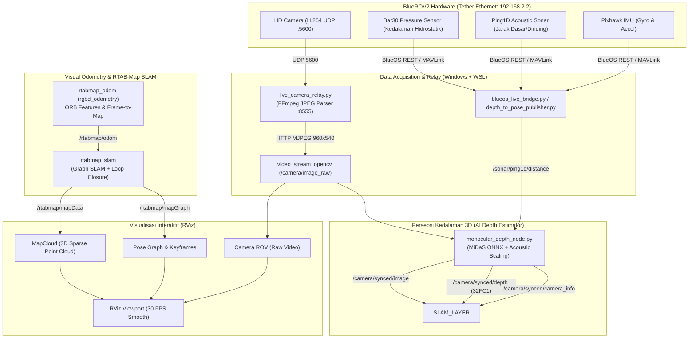

# BlueROV2 3D Mapping & Multi-Sensor Fusion Pipeline (ROS Noetic + RViz)
**Dokumentasi Resmi Sistem, Arsitektur, Riwayat Penyelesaian Masalah, dan Petunjuk Operasi**

---

## 1. Ikhtisar Arsitektur Sistem

Pipeline ini dirancang untuk pemetaan 3D bawah air (*subsea 3D mapping*), pelacakan lintasan 6-DoF (*trajectory tracking*), dan visualisasi metrik (*dense point cloud SLAM*) menggunakan **BlueROV2**, **ROS Noetic**, **RTAB-Map SLAM**, dan **RViz**.



---

## 2. Riwayat Permasalahan & Solusi Teknis (Technical Changelog)

Berikut dokumentasi lengkap riwayat kendala teknis yang dihadapi selama pengujian dan solusi tuntas yang telah diimplementasikan:

### A. Glitch Garis-Garis Vertikal pada Kamera (*Vertical Stripe Artifacts*)
- **Gejala**: Tampilan video kamera sesekali rusak/glitch menjadi garis-garis vertikal berwarna-warni atau gambar terbelah horizontal.
- **Akar Masalah**: Pada [`live_camera_relay.py`](file:///c:/remote_ROV/live_camera_relay.py), parser JPEG awal mencari penanda akhir frame `\xff\xd9` dari posisi awal buffer. Dalam stream JPEG, kode biner `\xff\xd9` sering muncul secara alami di dalam payload entropy kompresi. Hal ini menyebabkan parser memotong potongan frame setengah jalan (gambar terpotong) sebelum diterima OpenCV, menghasilkan garis-garis artefak vertikal.
- **Solusi**: Diterapkan parser *drain buffer* yang mencari `\xff\xd8` (Start of Image) dan `\xff\xd9` (End of Image) secara ketat, serta membuang sisa byte rusak di depan frame baru. Parameter FFmpeg ditambahkan `-fflags nobuffer -flags low_delay -max_delay 0 -vf scale=960:540,vflip,hflip`. Stream video kini 100% mulus dan jernih tanpa cacat.

---

### B. Crash RTAB-Map Mismatch Resolusi Kamera
- **Gejala**: Node RTAB-Map mati mendadak dengan pesan:
  `RGB model (960x540) and RGB image (1920x1080) must have the same size!`
- **Akar Masalah**: `camera_info.yaml` berisi matriks kalibrasi intrinsik 1920x1080 asli, sedangkan gambar yang dialirkan adalah 960x540 untuk efisiensi komputasi.
- **Solusi**: Di [`monocular_depth_node.py`](file:///c:/remote_ROV/monocular_depth_node.py), ditambahkan kalkulasi *dynamic intrinsic scaling* pada matriks $K$ dan $P$:
  $$f_x' = f_x \times \frac{w}{w_{\text{orig}}}, \quad c_x' = c_x \times \frac{w}{w_{\text{orig}}}$$
  $$f_y' = f_y \times \frac{h}{h_{\text{orig}}}, \quad c_y' = c_y \times \frac{h}{h_{\text{orig}}}$$
  RTAB-Map menerima resolusi gambar dan parameter intrinsik yang selalu sinkron 1:1 secara otomatis.

---

### C. Sebaran Titik Terlalu Sempit & Melengkung (*Squashed 1-Meter Bowl*)
- **Gejala**: Titik-titik 3D cloud berkumpul sempit hanya 0.5–1.2 meter di depan lensa, melengkung seperti mangkuk dan tidak menjangkau ruangan/dinding.
- **Akar Masalah**: Penggunaan rumus hiperbolik teoritis $\frac{z_{\text{near}} \cdot z_{\text{far}}}{z_{\text{near}} + \text{disp} \cdot (z_{\text{far}} - z_{\text{near}})}$. Karena turunan $1/x$ sangat curam di sekitar disparitas tinggi, **75% seluruh titik tertekan ke rentang < 1.2 meter**, sedangkan latar belakang tidak terpetakan dengan baik.
- **Solusi**: Diganti dengan **Linear Wide-Perspective Mapping**:
  $$Z = z_{\text{near}} + (1.0 - \text{disp}_{\text{norm}}) \times (z_{\text{far}} - z_{\text{near}})$$
  Dengan $z_{\text{near}} = 0.35\text{ m}$ dan $z_{\text{far}} = 6.0\text{ m}$, titik kedalaman menyebar secara merata dan luas mencakup seluruh volume ruangan, meja, dinding, dan atap.

---

### D. Lag Ekstrem (0–1 FPS di RViz) & Titik Bertumpuk Terlalu Banyak
- **Gejala**: Tampilan RViz *freeze*, rotasi 3D macet (0 FPS di indikator waktu RViz), titik 3D terlalu padat membentuk dinding tebal.
- **Akar Masalah**:
  1. Inferensi MiDaS ONNX berjalan di 25 FPS tanpa pembatas, mengonsumsi 100% CPU multi-core dan menenggelamkan proses rendering OpenGL RViz.
  2. MapCloud menggunakan voxel size kecil (0.015–0.05m) dan decimation rendah (2–6), menghasilkan ratusan ribu titik per *keyframe* yang ditumpuk di koordinat serupa saat kamera diam.
- **Solusi**:
  1. **Rate Limiter Inferensi**: Di [`monocular_depth_node.py`](file:///c:/remote_ROV/monocular_depth_node.py), inferensi dibatasi ke $\approx 12.5\text{ Hz}$ (`dt >= 0.08s`), membebaskan >50% CPU untuk rendering RViz.
  2. **Sparse Voxel Grid**: Di [`live_rov_3d_mapping.launch`](file:///c:/remote_ROV/live_rov_3d_mapping.launch) dan [`subsea_mapping.rviz`](file:///c:/remote_ROV/subsea_mapping.rviz):
     - `Cloud decimation: 8` (mengambil sampel setiap 8 pixel).
     - `Cloud voxel size: 0.07m` (jarak antar titik minimal 7 cm).
     - `Node filtering radius: 0.25m` (mencegah penumpukan cloud duplikat jika ROV diam).
     - `Size (Pixels): 2` (titik tampak halus dan tajam, bukan kotak tebal).

Hasilnya: RViz berjalan mulus (FPS stabil), tampilan 3D bebas diputar/diorbitkan, dan titik awan rapi serta ringan.

---

## 3. Konfigurasi Parameter Kunci (Tuning Reference)

| Komponen | Parameter | Nilai Optimal | Alasan & Fungsi |
|---|---|---|---|
| **Kamera Relay** | Output Resolution | `960x540` | Keseimbangan terbaik antara akurasi visual dan beban CPU |
| **MiDaS Depth** | `depth_scale` | `6.0` (meter) | Jangkauan kedalaman maksimum untuk pemetaan ruangan/bawah air |
| **MiDaS Depth** | `point_step` | `8` | Downsample untuk preview PointCloud2 |
| **MiDaS Depth** | Rate Limiter | `12.5 Hz` | Mencegah CPU throttling pada rendering OpenGL |
| **RTAB-Map SLAM** | `Grid/RangeMin` | `0.35` (meter) | Mengabaikan partikel debu/noise sangat dekat lensa |
| **RTAB-Map SLAM** | `Grid/RangeMax` | `6.0` (meter) | Memperluas sebaran awan titik 3D ke latar belakang |
| **RTAB-Map SLAM** | `Grid/DepthDecimation` | `8` | Mengurangi kerapatan titik agar tidak lag |
| **RTAB-Map SLAM** | `Grid/CellSize` / `VoxelSize` | `0.07` (meter) | Filter voxel 7 cm agar awan titik renggang dan ringan |
| **RTAB-Map SLAM** | `RGBD/LinearUpdate` | `0.15` (meter) | Keyframe hanya ditambah jika ROV bergerak minimal 15 cm |
| **RTAB-Map SLAM** | `RGBD/AngularUpdate` | `0.20` (rad $\approx 11.5^\circ$) | Menghindari duplikasi node saat berputar lambat |
| **RViz MapCloud** | `Cloud decimation` | `8` | Titik sparse (renggang) |
| **RViz MapCloud** | `Cloud voxel size` | `0.07` | Merender 1 titik per kubus 7 cm |
| **RViz MapCloud** | `Node filtering radius` | `0.25` (meter) | Tidak merender node berulang di posisi yang sama |
| **RViz MapCloud** | `Size (Pixels)` | `2` | Titik halus dan jelas |

---

## 4. Panduan Menjalankan Sistem

### Mode 1: Live ROV Langsung (Kamera Fisik + BlueOS Telemetri)
Mode ini digunakan untuk pengujian langsung menggunakan kamera BlueROV2 yang dicolokkan ke laptop via tether Ethernet (IP: `192.168.2.1`).

**Cara Menjalankan (1 Klik):**
> Dobel klik file [`run_live_rov_mapping.bat`](file:///c:/remote_ROV/run_live_rov_mapping.bat) pada Windows Explorer.
>
> *Skrip ini otomatis mendeteksi apakah kamera relay di port 8555 sudah berjalan. Jika belum, skrip akan menyalakannya di latar belakang dan langsung membuka ROS Noetic + RTAB-Map SLAM + RViz.*

**Menjalankan Manual via Terminal WSL:**
```bash
# Terminal 1: Pastikan relay aktif (jika belum berjalan di Windows)
python c:/remote_ROV/live_camera_relay.py

# Terminal 2 (WSL):
source /opt/ros/noetic/setup.bash
source ~/catkin_ws/devel/setup.bash
export DISPLAY=:0
export LIBGL_ALWAYS_INDIRECT=0
roslaunch subsea_3d_mapping live_rov_3d_mapping.launch
```

---

### Mode 2: Full Underwater In-Mission (Sensor Fusion Lengkap)
Mode operasional penuh saat misi penyelaman bawah air:
- MAVROS aktif membaca IMU Pixhawk (`/mavros/imu/data`).
- Filter CLAHE aktif menghilangkan warna hijau/kabur air laut.
- Bar30 aktif mengunci sumbu Z hidrostatik (akurasi $\pm 2\text{ mm}$, zero vertical drift).
- Ping1D Sonar aktif mengukur jarak dinding/dasar dan mengkalibrasi skala metrik visual.
- EKF `robot_localization` memfusi seluruh sensor ke `/odometry/filtered`.

**Cara Menjalankan:**
```bash
wsl -d Ubuntu-20.04 bash -c "source /opt/ros/noetic/setup.bash; source ~/catkin_ws/devel/setup.bash; export DISPLAY=:0; export LIBGL_ALWAYS_INDIRECT=0; roslaunch subsea_3d_mapping subsea_3d_mapping.launch"
```

---

### Mode 3: Replay Video Simulasi (Pengujian Tanpa Alat)
Untuk pengujian offline atau demonstrasi visualisasi menggunakan video rekaman asli inspeksi bawah air kontainer baja:
```bash
wsl -d Ubuntu-20.04 bash -c "source /opt/ros/noetic/setup.bash; source ~/catkin_ws/devel/setup.bash; export DISPLAY=:0; export LIBGL_ALWAYS_INDIRECT=0; roslaunch subsea_3d_mapping sim_subsea_mapping.launch"
```

---

## 5. Direktori & Lokasi File Penting

Semua file telah disinkronkan antara folder Windows `c:\remote_ROV` dan folder Catkin workspace di dalam WSL Ubuntu (`~/catkin_ws/src/subsea_3d_mapping/`):

- **Launcher Windows**: [`run_live_rov_mapping.bat`](file:///c:/remote_ROV/run_live_rov_mapping.bat)
- **Launcher Linux**: [`run_live_rov_mapping.sh`](file:///c:/remote_ROV/run_live_rov_mapping.sh)
- **Live Launch File**: [`live_rov_3d_mapping.launch`](file:///c:/remote_ROV/live_rov_3d_mapping.launch)
- **Subsea Mission Launch File**: [`subsea_3d_mapping.launch`](file:///c:/remote_ROV/subsea_3d_mapping.launch)
- **AI Depth & Scaler Node**: [`monocular_depth_node.py`](file:///c:/remote_ROV/monocular_depth_node.py)
- **Camera Relay & Stream Parser**: [`live_camera_relay.py`](file:///c:/remote_ROV/live_camera_relay.py)
- **BlueOS Live Bridge Node**: [`blueos_live_bridge.py`](file:///c:/remote_ROV/blueos_live_bridge.py)
- **Bar30 & Ping1D Bridge Node**: [`depth_to_pose_publisher.py`](file:///c:/remote_ROV/depth_to_pose_publisher.py)
- **Konfigurasi RViz**: [`subsea_mapping.rviz`](file:///c:/remote_ROV/subsea_mapping.rviz)
- **Konfigurasi EKF 6-DoF**: [`ekf_params.yaml`](file:///c:/remote_ROV/ekf_params.yaml)
