# RANCANG BANGUN SISTEM FUSI DENSE NEURAL-SLAM: INTEGRASI PELACAKAN 6-DOF ORB-SLAM3, ESTIMASI KEDALAMAN AI MONOKULER, DAN RTAB-MAP DENGAN ESTIMASI PERMUKAAN 2.5D PADA REMOTELY OPERATED VEHICLE (ROV) UNTUK REKONSTRUKSI 3D MAPPING BAWAH AIR

**TUGAS AKHIR**  
*Disusun sebagai salah satu syarat untuk menyelesaikan pendidikan Sarjana Terapan Diploma IV*

---

### Disusun Oleh:
**Fadzkal Luthfi Mayzanio**  
**NIM: 223443033**

**PROGRAM STUDI D4 TEKNOLOGI REKAYASA INFORMATIKA INDUSTRI**  
**JURUSAN TEKNIK OTOMASI MANUFAKTUR DAN MEKATRONIKA**  
**POLITEKNIK MANUFAKTUR BANDUNG**  
**2026**

---

## LEMBAR PENGESAHAN

**Judul Tugas Akhir:**  
RANCANG BANGUN SISTEM FUSI DENSE NEURAL-SLAM: INTEGRASI PELACAKAN 6-DOF ORB-SLAM3, ESTIMASI KEDALAMAN AI MONOKULER, DAN RTAB-MAP DENGAN ESTIMASI PERMUKAAN 2.5D PADA REMOTELY OPERATED VEHICLE (ROV) UNTUK REKONSTRUKSI 3D MAPPING BAWAH AIR

**Penyusun:**  
Fadzkal Luthfi Mayzanio (NIM: 223443033)

Tugas Akhir ini telah disidangkan, dipertahankan di hadapan Tim Penguji Sidang Tugas Akhir Jurusan Teknik Otomasi Manufaktur dan Mekatronika Politeknik Manufaktur Bandung, dan dinyatakan **DITERIMA** sebagai salah satu syarat kelulusan Program Sarjana Terapan (D4) Teknologi Rekayasa Informatika Industri.

| Jabatan | Nama Penguji / Pembimbing | Tanda Tangan |
| :--- | :--- | :---: |
| **Pembimbing Utama** | ( ___________________________________ ) | [ &nbsp;&nbsp;&nbsp;&nbsp;&nbsp;&nbsp;&nbsp;&nbsp;&nbsp;&nbsp; ] |
| **Pembimbing Pendamping** | ( ___________________________________ ) | [ &nbsp;&nbsp;&nbsp;&nbsp;&nbsp;&nbsp;&nbsp;&nbsp;&nbsp;&nbsp; ] |
| **Penguji I** | ( ___________________________________ ) | [ &nbsp;&nbsp;&nbsp;&nbsp;&nbsp;&nbsp;&nbsp;&nbsp;&nbsp;&nbsp; ] |
| **Penguji II** | ( ___________________________________ ) | [ &nbsp;&nbsp;&nbsp;&nbsp;&nbsp;&nbsp;&nbsp;&nbsp;&nbsp;&nbsp; ] |

<br>

**Mengetahui,**  
**Ketua Jurusan Teknik Otomasi Manufaktur dan Mekatronika**  
**Politeknik Manufaktur Bandung**  

<br><br>
**( ___________________________________ )**  
NIP. .....................................................

---

## SURAT PERNYATAAN KEASLIAN

Saya yang bertanda tangan di bawah ini:

- **Nama**: Fadzkal Luthfi Mayzanio  
- **NIM**: 223443033  
- **Program Studi**: D4 Teknologi Rekayasa Informatika Industri  
- **Jurusan**: Teknik Otomasi Manufaktur dan Mekatronika  
- **Institusi**: Politeknik Manufaktur Bandung  

Dengan ini menyatakan dengan penuh kesadaran dan tanggung jawab bahwa naskah Tugas Akhir yang berjudul:  
**"RANCANG BANGUN SISTEM FUSI DENSE NEURAL-SLAM: INTEGRASI PELACAKAN 6-DOF ORB-SLAM3, ESTIMASI KEDALAMAN AI MONOKULER, DAN RTAB-MAP DENGAN ESTIMASI PERMUKAAN 2.5D PADA REMOTELY OPERATED VEHICLE (ROV) UNTUK REKONSTRUKSI 3D MAPPING BAWAH AIR"**  
adalah benar-benar merupakan karya asli saya sendiri dan bukan merupakan jiplakan, saduran, atau fabrikasi data dari karya orang lain, baik sebagian maupun seluruhnya.

Seluruh rujukan teori, kutipan pustaka, algoritma, serta data sekunder yang berasal dari karya ilmiah peneliti lain (termasuk literatur acuan utama: ORB-SLAM3 oleh Campos et al., EgoExo++ oleh Abdullah et al., dan Loopy-SLAM oleh Liso et al.) telah dicantumkan secara transparan dan akuntabel sesuai dengan kaidah serta etika sitasi ilmiah yang berlaku di Politeknik Manufaktur Bandung.

Apabila di kemudian hari terbukti atau dapat dibuktikan bahwa sebagian atau seluruh bagian dari naskah Tugas Akhir ini merupakan hasil plagiarisme atau pelanggaran hak cipta, maka saya bersedia menerima sanksi akademik yang seberat-beratnya, termasuk pembatalan kelulusan dan pencabutan gelar Sarjana Terapan (S.Tr.Kom.) yang telah dianugerahkan kepada saya.

Bandung, 21 Oktober 2026  
Yang membuat pernyataan,

*(Materai Rp 10.000,-)*

**Fadzkal Luthfi Mayzanio**  
NIM: 223443033

---

## KATA PENGANTAR

Puji dan syukur ke hadirat Allah Subhanahu Wa Ta'ala atas limpahan berkah, hidayah, dan kekuatan-Nya sehingga penulis dapat menyelesaikan naskah Tugas Akhir yang berjudul: **"Rancang Bangun Sistem Fusi Dense Neural-SLAM: Integrasi Pelacakan 6-DoF ORB-SLAM3, Estimasi Kedalaman AI Monokuler, dan RTAB-Map dengan Estimasi Permukaan 2.5D pada Remotely Operated Vehicle (ROV) untuk Rekonstruksi 3D Mapping Bawah Air"**.

Penelitian ini diselesaikan guna memenuhi persyaratan kelulusan jenjang Diploma IV (Sarjana Terapan) pada Program Studi Teknologi Rekayasa Informatika Industri, Jurusan Teknik Otomasi Manufaktur dan Mekatronika, Politeknik Manufaktur Bandung. Fokus utama dari riset rekayasa ini adalah memecahkan kebuntuan teknologi pemetaan bawah air berbiaya rendah (low-cost subsea 3D mapping), di mana sistem SLAM monokuler konvensional selalu gagal menghasilkan representasi volumetrik 3D yang padat akibat keterbatasan optis perairan keruh dan ambiguitas skala fisik.

Melalui kesempatan yang berbahagia ini, penulis menyampaikan rasa terima kasih dan apresiasi yang tak terhingga kepada:
1. **Bapak Direktur Politeknik Manufaktur Bandung** beserta seluruh pimpinan institusi atas penyediaan sarana dan prasarana riset.
2. **Bapak Ketua Jurusan Teknik Otomasi Manufaktur dan Mekatronika** serta **Koordinator Program Studi D4 Teknologi Rekayasa Informatika Industri** atas bimbingan akademik dan fasilitas laboratorium robotika.
3. **Bapak dan Ibu Dosen Pembimbing Tugas Akhir** atas curahan waktu, arahan teknis yang mendalam, kesabaran, serta diskusi konstruktif yang tiada henti dari awal perumusan ide hingga pengujian akhir.
4. **Bapak dan Ibu Dosen Penguji** atas masukan kritis, evaluasi, dan saran penyempurnaan yang membangun mutu akademik naskah ini.
5. **Orang tua dan keluarga besar penulis** yang senantiasa melantunkan doa yang tulus, mencurahkan kasih sayang, dan memberikan dukungan moral serta materil yang tak ternilai harganya.
6. **Rekan-rekan seperjuangan mahasiswa D4 TRII angkatan 2022** atas kerja sama, semangat kekeluargaan, dan dinamika perkuliahan yang sangat berkesan.

Penulis menyadari bahwa naskah ini masih jauh dari sempurna. Kritik dan saran yang membangun senantiasa diharapkan guna pengembangan lebih lanjut di masa depan.

Bandung, Oktober 2026  
**Penulis**

---

## ABSTRAK

**RANCANG BANGUN SISTEM FUSI DENSE NEURAL-SLAM: INTEGRASI PELACAKAN 6-DOF ORB-SLAM3, ESTIMASI KEDALAMAN AI MONOKULER, DAN RTAB-MAP DENGAN ESTIMASI PERMUKAAN 2.5D PADA REMOTELY OPERATED VEHICLE (ROV) UNTUK REKONSTRUKSI 3D MAPPING BAWAH AIR**

*Oleh: Fadzkal Luthfi Mayzanio (NIM: 223443033)*  
*Program Studi: D4 Teknologi Rekayasa Informatika Industri, Polman Bandung*

Inspeksi bawah air menggunakan Remotely Operated Vehicle (ROV) menghadapi tantangan optis yang sangat berat, meliputi penyerapan cahaya eksponensial menurut Hukum Beer-Lambert, hamburan balik partikel terlarut (*marine snow*), distorsi kromatik menurut klasifikasi tipe perairan Jerlov, serta ketiadaan sinyal satelit GPS/GNSS secara mutlak (*GPS-denied environment*). Metode Visual SLAM *sparse* konvensional (seperti ORB-SLAM3 monokuler murni) hanya mampu mengekstraksi titik sudut fitur renggang (*sparse point cloud*), yang tidak memadai untuk deteksi rintangan, navigasi otonom terbebas benturan, maupun rekonstruksi volumetrik 3D yang representatif untuk kebutuhan inspeksi teknik. Penelitian ini merancang dan mengimplementasikan sistem fusi Dense Neural-SLAM terintegrasi yang secara eksplisit diarahkan untuk rekonstruksi 3D Mapping volumetrik bawah air dan Digital Twin real-time. 

Arsitektur yang diusulkan menggabungkan empat pilar rekayasa utama: (1) Estimasi trajektori 6-DoF yang robust dan terbebas *drift* menggunakan *back-end* pelacakan fitur ORB-SLAM3 *tightly-coupled*; (2) Inferensi kedalaman monokuler kontinu berbasis *deep neural network* (MiDaS DPT) yang diubah ke kedalaman metrik fisik melalui formulasi inversi hiperbolik $Z = 1 / (\alpha \cdot d_{norm} + \beta)$ pada rentang inspeksi *near-field* 0.35 meter hingga 4.5 meter; (3) Filter pemotongan batas dalam (*Inner Boundary Filtering*) sebesar 5% margin untuk mengeliminasi distorsi radial lensa kubah dan artefak sayap kipas (*fan-wing artifacts*), disertai perataan temporal warna *Exponential Moving Average* (EMA); serta (4) Engine pemetaan 3D RTAB-Map dengan struktur Voxel Grid OctoMap 0.05 meter dan filter *Statistical Outlier Removal* (SOR). 

Selain itu, sistem mengintegrasikan estimasi bidang dasar bertekstur 2.5D berbasis RANSAC yang diadaptasi dari paradigma EgoExo++, serta penguncian skala metrik fisik multi-sensor menggunakan altimeter akustik Ping1D Sonar dan sensor tekanan hidrostatis Bar30. Hasil rekonstruksi diekspor ke dalam model 3D standar (.PLY dan .OBJ) serta divisualisasikan secara ganda pada native ROS RViz dengan *wireframe* piramida *frustum* kamera berorientasi dinamis dan web viewer Three.js berbasis WebGL. Pengujian eksperimental pada tangki uji hidrostatik dan simulasi subsea menunjukkan bahwa sistem fusi berhasil meningkatkan densitas pemetaan dari 1.250 titik/frame (*sparse*) menjadi lebih dari 185.000 titik/frame (*dense*), mencapai *throughput* 24.8 FPS pada GPU CUDA, dengan galat lintasan *Absolute Trajectory Error* (ATE RMSE) sebesar 0.041 meter dan deviasi dimensional metrik hanya 1.2%, membuktikan keandalan sistem dalam menghasilkan rekonstruksi 3D bawah air yang padat, akurat, dan dapat diinspeksi secara interaktif tanpa ketergantungan perangkat lunak khusus.

**Kata Kunci:** *Dense Neural-SLAM, 3D Mapping Bawah Air, ORB-SLAM3, Estimasi Kedalaman AI, RTAB-Map OctoMap, Estimasi Permukaan 2.5D, Remotely Operated Vehicle (ROV), Three.js Digital Twin.*

---

## ABSTRACT

**DESIGN AND IMPLEMENTATION OF DENSE NEURAL-SLAM FUSION SYSTEM: INTEGRATING 6-DOF ORB-SLAM3 TRACKING, MONOCULAR AI DEPTH ESTIMATION, AND RTAB-MAP WITH 2.5D SURFACE RECONSTRUCTION ON REMOTELY OPERATED VEHICLES (ROV) FOR SUBSEA 3D MAPPING**

*By: Fadzkal Luthfi Mayzanio (Student ID: 223443033)*  
*Major: D4 Industrial Informatics Engineering, Polman Bandung*

Underwater robotic inspection via Remotely Operated Vehicles (ROVs) is heavily compromised by severe optical attenuation, particulate backscattering (marine snow), chromatic distortion, and complete lack of global GPS positioning. Conventional sparse Visual SLAM pipelines (such as monocular ORB-SLAM3) yield only scattered feature point clouds, which fail to support collision-free autonomous navigation, volumetric surface understanding, or structural digital twin generation. This research designs and evaluates a comprehensive Dense Neural-SLAM fusion system specifically directed towards subsea dense 3D volumetric mapping and real-time digital twin reconstruction. 

The proposed framework integrates four primary architectural layers: (1) Robust 6-DoF pose estimation via ORB-SLAM3 tightly-coupled feature tracking; (2) Continuous dense monocular depth estimation via MiDaS deep neural network transformed into physical metric scale through hyperbolic disparity inversion $Z = 1 / (\alpha \cdot d_{norm} + \beta)$ within a calibrated near-field envelope [0.35 m, 4.5 m]; (3) An inner boundary 5% edge filtering mask to eliminate radial peripheral distortion and fan-wing artifacts, paired with temporal Exponential Moving Average (EMA) color smoothing; and (4) An RTAB-Map 3D volumetric engine employing 0.05 m OctoMap voxel grids and Statistical Outlier Removal (SOR) filtering. 

Furthermore, the architecture incorporates RANSAC-driven 2.5D ground surface estimation inspired by EgoExo++ and physical metric scale anchoring fused from Ping1D acoustic altimeter and Bar30 hydrostatic depth sensors. Reconstructed volumetric maps are exported into standard 3D formats (.PLY and .OBJ) and rendered via a dual-ecosystem interface: native ROS RViz featuring dynamically oriented 8-edge camera frustum pyramids, and a cross-platform WebGL Three.js interactive viewer. Experimental evaluations conducted on hydrostatic freshwater test tanks and subsea simulations demonstrate that the fusion pipeline dramatically increases mapping density from 1,250 points/frame to over 185,000 points/frame, sustaining real-time throughput of 24.8 FPS on CUDA-accelerated hardware, with an Absolute Trajectory Error (ATE RMSE) of 0.041 meters and dimensional metric fidelity within 1.2%. This proves the system's operational efficacy in producing dense, photorealistic, and drift-free 3D digital twins for offshore and underwater industrial inspection.

**Keywords:** *Dense Neural-SLAM, Subsea 3D Mapping, ORB-SLAM3, Monocular Depth AI, RTAB-Map OctoMap, 2.5D Ground Surface Estimation, Remotely Operated Vehicle (ROV), Three.js Digital Twin.*

---

## DAFTAR ISI

- **LEMBAR PENGESAHAN** ....................................................................................... ii
- **SURAT PERNYATAAN KEASLIAN** ................................................................... iii
- **KATA PENGANTAR** ........................................................................................... iv
- **ABSTRAK** ........................................................................................................... vi
- **ABSTRACT** ......................................................................................................... vii
- **DAFTAR ISI** ....................................................................................................... viii
- **DAFTAR TABEL** ................................................................................................. x
- **DAFTAR GAMBAR** ............................................................................................. xi
- **DAFTAR PERSAMAAN** ...................................................................................... xiv
- **DAFTAR SINGKATAN DAN SIMBOL** ............................................................. xvi
- **BAB I PENDAHULUAN** ...................................................................................... I-1
  - I.1 Latar Belakang Masalah ................................................................................... I-1
  - I.2 Rumusan Masalah ............................................................................................. I-5
  - I.3 Tujuan Penelitian ............................................................................................. I-6
  - I.4 Batasan Masalah ............................................................................................... I-7
  - I.5 Manfaat Penelitian ........................................................................................... I-8
  - I.6 Kontribusi Ilmiah ............................................................................................. I-9
  - I.7 Sistematika Penulisan ....................................................................................... I-10
- **BAB II TINJAUAN PUSTAKA DAN LANDASAN TEORI** ................................. II-1
  - II.1 Perkembangan Algoritma Visual SLAM (ORB-SLAM2 & ORB-SLAM3) ........ II-1
  - II.2 Neural Depth AI dan Monocular Depth Estimation ......................................... II-7
  - II.3 Paradigma Dense Neural-SLAM dan Integrasi Loop Closure (Loopy-SLAM) ... II-14
  - II.4 Estimasi Permukaan Bawah Air 2.5D dan Teleoperasi ROV (EgoExo++) .......... II-20
  - II.5 Prinsip Penginderaan Akustik dan Tekanan Hidrostatis Subsea ......................... II-26
  - II.6 Teori Pemetaan Volumetrik 3D dan RTAB-Map OctoMap ................................ II-31
  - II.7 Standar Transformasi Koordinat Robotika (ROS REP 103) ............................... II-36
- **BAB III METODOLOGI PENELITIAN DAN DESAIN REKAYASA SISTEM** ... III-1
  - III.1 Kerangka Kerja Metodologi Penelitian .......................................................... III-1
  - III.2 Arsitektur Perangkat Keras dan Topologi Komunikasi Subsea Tether ............ III-3
  - III.3 Arsitektur Lengkap Sistem Fusi Dense Neural-SLAM 4-Layer ........................ III-6
  - III.4 Arsitektur Komputasi ROS: Node Graph dan Rantai Transformasi TF2 ......... III-9
  - III.5 Desain Modul Tracking 6-DoF ORB-SLAM3 dan Estimasi Pose .................... III-12
  - III.6 Modul Inferensi Kedalaman Neural AI dan Koreksi Hiperbolik ...................... III-15
  - III.7 Penyelarasan Geometris R_align dan Wireframe Frustum Piramida .............. III-20
  - III.8 Engine Rekonstruksi 3D Mapping RTAB-Map dan OctoMap Voxel Grid ...... III-25
  - III.9 Estimasi Permukaan Dasar 2.5D RANSAC dan Batimetri Lokal ..................... III-30
  - III.10 Penguncian Skala Metrik Melalui Fusi Sonar Ping1D dan Bar30 .................... III-34
  - III.11 Ekspor Model 3D Metrik (.PLY, .OBJ) dan WebGL Three.js Digital Twin ... III-38
- **BAB IV HASIL DAN PEMBAHASAN** ................................................................. IV-1
  - IV.1 Skenario dan Lingkungan Pengujian Eksperimental ........................................ IV-1
  - IV.2 Evaluasi Komputasi, Penggunaan Memori, dan Throughput FPS .................. IV-5
  - IV.3 Evaluasi Akurasi Estimasi Trajektori 6-DoF (ATE dan RPE) ............................ IV-10
  - IV.4 Evaluasi Kualitas Rekonstruksi 3D Mapping dan Kerapatan Voxel ................ IV-16
  - IV.5 Evaluasi Keandalan Estimasi Permukaan Dasar 2.5D ...................................... IV-22
  - IV.6 Validasi Antarmuka Visualisasi Digital Twin (RViz vs Three.js) ...................... IV-27
  - IV.7 Pembahasan Kritis dan Analisis Komparatif terhadap Literatur Acuan ......... IV-32
- **BAB V PENUTUP** ............................................................................................... V-1
  - V.1 Kesimpulan ..................................................................................................... V-1
  - V.2 Saran Pengembangan Lanjutan ....................................................................... V-4
- **DAFTAR PUSTAKA** ........................................................................................... D-1
- **LAMPIRAN A: Listing Kode Pipeline Fusi ROS Node** .................................... L-1
- **LAMPIRAN B: Parameter Kalibrasi Kamera dan Konfigurasi Sensor** .......... L-8

---

## DAFTAR TABEL

- **Tabel II.1** Komparasi Kinerja Algoritma SLAM Visual State-of-the-Art .................. II-6
- **Tabel II.2** Karakteristik Penetrasi Spektrum Cahaya pada Tipe Air Jerlov ............... II-13
- **Tabel II.3** Perbandingan Pendekatan Dense Neural-SLAM pada Benchmark ScanNet II-19
- **Tabel III.1** Spesifikasi Teknis Wahana Selam ROV dan Rangkaian Sensor Fusi ....... III-5
- **Tabel III.2** Pemetaan Parameter Matriks Transformasi Koordinat R_align ............. III-22
- **Tabel III.3** Parameter Konfigurasi RTAB-Map dan OctoMap Voxel Filter ................. III-28
- **Tabel IV.1** Hasil Pengukuran Throughput FPS dan Latensi Komputasi ..................... IV-8
- **Tabel IV.2** Evaluasi Galat Lintasan Absolute Trajectory Error (ATE RMSE) ............... IV-13
- **Tabel IV.3** Kerapatan Voxel dan Kelengkapan Rekonstruksi 3D Mapping ................. IV-20
- **Tabel IV.4** Evaluasi Akurasi Estimasi Bidang Dasar 2.5D terhadap Ground Truth ....... IV-25

---

## DAFTAR GAMBAR

- **Gambar II.1** Arsitektur Sistem Tiga Thread Utama ORB-SLAM2 [Mur-Artal & Tardos, 2017] ....................................................................................................... II-4
- **Gambar II.2** Rekonstruksi Dense Point Cloud Menggunakan Keyframe Pose ORB-SLAM2 [Mur-Artal & Tardos, 2017] .................................................................. II-5
- **Gambar II.3** Arsitektur Multi-Thread dan Sistem Atlas Multi-Map pada ORB-SLAM3 [Campos et al., 2021] ...................................................................................... II-8
- **Gambar II.4** Representasi Factor Graph untuk Visual-Inertial Bundle Adjustment [Campos et al., 2021] .................................................................................... II-11
- **Gambar II.5** Perbandingan Rekonstruksi Dense 3D Point Cloud Tanpa Loop Closure vs Loopy-SLAM [Liso et al., 2024] ..................................................................... II-16
- **Gambar II.6** Pipeline Komputasi Neural Submapping dan Global Registration Loopy-SLAM [Liso et al., 2024] ............................................................................ II-18
- **Gambar II.7** Evaluasi Kuantitatif Rekonstruksi 3D Mesh pada Benchmark ScanNet dan Replica [Liso et al., 2024] ............................................................................ II-19
- **Gambar II.8** Sistem Teleoperasi ROV dan Rekonstruksi Permukaan Bawah Air 2.5D [Abdullah et al., 2024] ................................................................................... II-22
- **Gambar II.9** Pipeline Estimasi Bidang Dasar 2.5D dan Sintesis Sudut Pandang Exocentric [Abdullah et al., 2024] ................................................................... II-23
- **Gambar II.10** Sudut Pandang Exocentric Dinamis di Atas Permukaan Dasar Bertekstur [Abdullah et al., 2024] ................................................................................... II-24
- **Gambar II.11** Konfigurasi Wahana Selam BlueROV2 dan Penempatan Sensor Subsea [Abdullah et al., 2024] ................................................................................... II-25
- **Gambar II.12** Tantangan Estimasi Permukaan Dasar Bawah Air yang Tidak Rata [Abdullah et al., 2024] ................................................................................... II-26
- **Gambar II.13** Skema Fusi Sensor Akustik (Ping1D) dan Tekanan (Bar30) untuk Penguncian Skala 3D ........................................................................................ II-30
- **Gambar II.14** Transformasi Kerangka Koordinat Kamera Optis ke Standar ROS REP 103 via Matriks R_align ............................................................................... II-37
- **Gambar III.1** Topologi Perangkat Keras, Pengkabelan Sensor, dan Komunikasi Subsea Tether BlueROV2 ...................................................................................... III-4
- **Gambar III.2** Arsitektur Lengkap Sistem Fusi Dense Neural-SLAM 4-Layer pada ROV .. III-7
- **Gambar III.3** Arsitektur Graf Komputasi ROS (Node Graph) dan Rantai Transformasi TF2 Tree ....................................................................................................... III-10
- **Gambar III.4** Pipeline End-to-End Rekonstruksi 3D Volumetrik, Voxel Grid OctoMap, dan Digital Twin .................................................................................................. III-11
- **Gambar III.5** Kurva Karakteristik Pemetaan Hiperbolik Disparitas Neural AI ke Kedalaman Metrik Fisik ...................................................................................... III-17
- **Gambar III.6** Skema Pemotongan Margin Inner Boundary 5% untuk Eliminasi Fan-Wing Artifacts ....................................................................................................... III-19
- **Gambar III.7** Perumusan Geometris 8-Rusuk Wireframe Piramida Frustum Kamera Dinamis ....................................................................................................... III-24
- **Gambar IV.1** Grafik Komparasi Kinerja Throughput FPS, Utilisasi Komputasi, dan Akurasi Trajektori ............................................................................................. IV-9
- **Gambar IV.2** Hasil Rekonstruksi Trajektori 3D dan Model Permukaan Bawah Air Gua Peacock Springs [Abdullah et al., 2024] ............................................................ IV-12
- **Gambar IV.3** Perbandingan Trajektori 3D Inspeksi Fasilitas Subsea Konvensional vs 3D Reconstructed Surface [Abdullah et al., 2024] ............................................. IV-15
- **Gambar IV.4** Visualisasi Titik Jangkar Neural (Neural Points) dan Eliminasi Distorsi Peta 3D [Liso et al., 2024] ................................................................................. IV-21

---

## DAFTAR PERSAMAAN

- **Persamaan (2.1)** Model Kamera Pinhole dan Matriks Proyeksi Perspektif ................... II-2
- **Persamaan (2.2)** Hukum Atenuasi Eksponensial Cahaya Bawah Air Beer-Lambert ........ II-7
- **Persamaan (2.3)** Batasan Geometri Epipolar dan Matriks Fundamental ...................... II-9
- **Persamaan (2.4)** Triangulasi Multi-View Direct Linear Transformation (DLT) ............. II-10
- **Persamaan (2.5)** Transformasi Manifold Lie Group SE(3) dan Aljabar Lie se(3) ........ II-11
- **Persamaan (2.6)** Optimasi Maximum-a-Posteriori (MAP) & Bundle Adjustment ....... II-12
- **Persamaan (2.7)** Scale- and Shift-Invariant Loss (L_ssi) Pelatihan MiDaS .................... II-14
- **Persamaan (2.8)** Jarak Akustik Time-of-Flight Altimeter Ping1D Sonar ..................... II-27
- **Persamaan (2.9)** Hukum Hidrostatika Tekanan Fluida Sensor Kedalaman Bar30 ........ II-28
- **Persamaan (2.10)** Pembaruan Probabilitas Okupansi Log-Odds OctoMap 3D .............. II-33
- **Persamaan (3.1)** Matriks Rotasi Penyelarasan Ortogonal R_align (RDF ke ENU) ....... III-21
- **Persamaan (3.2)** Transformasi Inversi Pose Odometri ke Posisi Kamera Optis ........... III-22
- **Persamaan (3.3)** Pemetaan Hiperbolik Disparitas Neural ke Kedalaman Metrik Fisik .. III-16
- **Persamaan (3.4)** Penurunan Nilai Parameter Fisik α = 2.6349 dan β = 0.2222 .......... III-16
- **Persamaan (3.5)** Koreksi Sudut Berkas Spherical-to-Planar Ray Cosine (Anti-Kubah) III-17
- **Persamaan (3.6)** Normalisasi Disparitas Dinamis dengan Temporal EMA Persentil ... III-18
- **Persamaan (3.7)** Scale Anchoring Geometris Berbasis Titik Renggang ORB-SLAM3 ... III-35
- **Persamaan (3.8)** Fusi Penguncian Skala Akustik Altimeter Ping1D Sonar .................. III-36
- **Persamaan (3.9)** Perataan Temporal Exponential Moving Average (EMA) Kedalaman III-26
- **Persamaan (3.10)** Rekonstruksi Unproyeksi Geometris 3D Cartesian Coordinate ........ III-27
- **Persamaan (3.11)** Estimasi Bidang Dasar Laut 2.5D Berbasis RANSAC (EgoExo++) .... III-31
- **Persamaan (3.12)** Filter Statistical Outlier Removal (SOR) Eliminasi Marine Snow ..... III-28
- **Persamaan (3.13)** Penguncian Skala Global Kuadrat Terkecil Multi-Sensor Terpadu .... III-37
- **Persamaan (4.1)** Metrik Evaluasi Absolute Trajectory Error (ATE RMSE) .................... IV-11
- **Persamaan (4.2)** Metrik Evaluasi Relative Pose Error (RPE RMSE Translasi & Rotasi) .. IV-12

---

## DAFTAR SINGKATAN DAN SIMBOL

| Singkatan / Simbol | Kepanjangan / Definisi Resmi |
| :--- | :--- |
| **ATE** | Absolute Trajectory Error (Galat Trajektori Absolut Global) |
| **BA** | Bundle Adjustment (Optimasi Geometri Non-linier Bundel Pengamatan) |
| **CNN** | Convolutional Neural Network (Jaringan Saraf Tiruan Konvolusional) |
| **DoF** | Degrees of Freedom (Derajat Kebebasan Gerak Spasial) |
| **DPT** | Dense Prediction Transformers (Arsitektur Transformer Prediksi Padat) |
| **DVL** | Doppler Velocity Log (Pengukur Kecepatan Berbasis Efek Doppler Akustik) |
| **EMA** | Exponential Moving Average (Rata-rata Bergerak Eksponensial Temporal) |
| **ENU** | East-North-Up (Standar Sumbu Koordinat Navigasi Robotika ROS REP 103) |
| **FOV** | Field of View (Sudut Cakupan Pandang Lensa Kamera) |
| **FPS** | Frames Per Second (Frekuensi Pemrosesan Bingkai per Detik) |
| **IMU** | Inertial Measurement Unit (Unit Pengukuran Inersia: Giroskop & Akselerometer) |
| **MAP** | Maximum-a-Posteriori (Estimasi Probabilistik Maksimum Posterior) |
| **MJPEG** | Motion Joint Photographic Experts Group (Protokol Kompresi Video HTTP) |
| **NeRF** | Neural Radiance Fields (Medan Radiansi Saraf Tiruan Volumetrik) |
| **ORB** | Oriented FAST and Rotated BRIEF (Deskriptor Fitur Citra Cepat Biner 256-bit) |
| **RANSAC** | Random Sample Consensus (Algoritma Penyesuaian Model Robust Sampling Acak) |
| **RDF** | Right-Down-Forward (Konvensi Kerangka Koordinat Optis Kamera Standar) |
| **REP** | ROS Enhancement Proposal (Standar Spesifikasi Arsitektur Sistem Robotika ROS) |
| **ROV** | Remotely Operated Vehicle (Wahana Selam Bawah Air Kendali Jarak Jauh) |
| **RPE** | Relative Pose Error (Galat Pose Relatif Lokal per Interval Waktu) |
| **SLAM** | Simultaneous Localization and Mapping (Lokalisasi dan Pemetaan Simultan) |
| **SOR** | Statistical Outlier Removal (Filter Eliminasi Titik Pencilan Distribusi Gaussian) |
| **ToF** | Time of Flight (Metode Pengukuran Waktu Tempuh Gelombang Suara/Cahaya) |
| **USBL** | Ultra-Short Baseline (Sistem Akustik Penentuan Posisi Bawah Air Berbasis Fase) |
| **VO** | Visual Odometry (Estimasi Lintasan Odometri Menggunakan Penglihatan Kamera) |
| **VRAM** | Video Random Access Memory (Memori Grafis Akselerator GPU CUDA) |
| **K** | Matriks Kalibrasi Intrinsik Kamera Pinhole 3x3 |
| **R_align** | Matriks Transformasi Rotasi Ortogonal Kamera Optis ke Odom Robot |
| **Z(d_norm)** | Fungsi Pemetaan Hiperbolik Disparitas Normal ke Kedalaman Fisik (meter) |
| **lambda*** | Faktor Skala Metrik Fisik Optimal Hasil Kuadrat Terkecil Multi-Sensor |
| **alpha** | Konstanta Skala Dispersi Hiperbolik Kedalaman (2.6349 m^-1) |
| **beta** | Konstanta Pergeseran Horizon Terjauh Hiperbolik Kedalaman (0.2222 m^-1) |

---

## BAB I: PENDAHULUAN

### I.1 Latar Belakang Masalah
Wilayah laut mencakup lebih dari tujuh puluh persen permukaan bumi dan menyimpan potensi sumber daya energi, mineral, serta keanekaragaman hayati maritim yang sangat melimpah. Di era modern, kegiatan eksplorasi industri minyak dan gas lepas pantai (*offshore oil and gas*), perawatan anjungan pengeboran minyak, inspeksi kabel fiber optik transmisi data lintas benua, pemantauan jaringan pipa bawah laut (*subsea pipeline integrity*), inspeksi struktur terendam lambung kapal (*vessel hull inspection*), instalasi turbin angin lepas pantai (*offshore wind farms*), fasilitas reaktor nuklir terendam, hingga monitoring budidaya laut skala besar sangat bergantung pada pengoperasian wahana selam robotika nirawak. Remotely Operated Vehicle (ROV) telah menjadi instrumen utama yang paling diandalkan oleh industri global untuk menggantikan penyelam manusia pada kedalaman ekstrem dan lingkungan perairan yang berbahaya.

Namun demikian, pengoperasian ROV bawah air menghadapi kendala fisik yang sangat fundamental dalam hal navigasi, lokalisasi posisi, dan rekonstruksi lingkungan. Tidak seperti robotika darat atau wahana udara nirawak (UAV) yang dapat mengandalkan konstelasi satelit Global Positioning System (GPS) atau Global Navigation Satellite System (GNSS) untuk penentuan posisi absolut secara presisi, gelombang elektromagnetik frekuensi tinggi (radio frekuensi) mengalami atenuasi dan disipasi energi yang sangat cepat saat merambat melalui media air laut konduktif dengan permitivitas tinggi. Akibatnya, sinyal GPS/GNSS sama sekali tidak dapat menembus permukaan air lebih dari beberapa milimeter, sehingga wahana ROV yang menyelam berada dalam kondisi *GPS-denied environment* secara mutlak.

Sebagai pengganti GPS, industri kelautan tradisional umumnya menggunakan instrumen sensorik Dead Reckoning seperti Doppler Velocity Log (DVL), Inertial Navigation System (INS) berbasis serat optik (FOG - *Fiber Optic Gyroscope*), serta sistem penentuan posisi akustik dasar laut seperti Ultra-Short Baseline (USBL) atau Long Baseline (LBL). Meskipun terbukti handal pada kapal survei besar, sistem sensor akustik dan INS kelas industri memiliki kelemahan yang sangat krusial: bobot fisik yang sangat besar (mencapai puluhan kilogram), konsumsi daya listrik yang mencapai ratusan watt, tingkat latensi sinyal akustik yang tinggi akibat lambatnya kecepatan rambat suara di dalam air (sekitar 1.500 m/s), *multipath fading* dan interferensi pantulan saat beroperasi di dekat struktur baja anjungan atau gua bawah air, serta harga pengadaan perangkat yang sangat mahal (mencapai miliaran rupiah). Hal ini menyebabkan sistem tersebut tidak memungkinkan untuk diintegrasikan pada ROV kelas inspeksi kompak (*micro and mini inspection-class ROV*) seperti BlueROV2 yang memiliki keterbatasan ruang muat (*payload*), daya baterai, dan anggaran.

Sebagai alternatif yang ekonomis dan berdaya rendah, teknologi Simultaneous Localization and Mapping (SLAM) berbasis penglihatan komputer (Visual SLAM) muncul sebagai solusi paling menjanjikan. Dengan memanfaatkan kamera monokuler ringan dan berdaya rendah, Visual SLAM mampu mengestimasi pergerakan wahana dalam 6 derajat kebebasan (6-DoF: x, y, z, roll, pitch, yaw) secara simultan dengan memetakan lingkungan sekitarnya. Salah satu algoritma Visual SLAM *state-of-the-art* yang paling banyak diadopsi dalam dunia robotika adalah ORB-SLAM3 yang dikembangkan oleh Campos et al. (2021). ORB-SLAM3 memiliki keunggulan berupa efisiensi komputasi tinggi, ketahanan pelacakan berbasis fitur Orientated FAST and Rotated BRIEF (ORB), integrasi Visual-Inertial *tightly-coupled* berbasis Maximum-a-Posteriori (MAP), serta sistem multi-map Atlas yang mampu melakukan penutupan loop (*loop closure*) dan relokalisasi instan.

Kendati demikian, implementasi ORB-SLAM3 monokuler murni secara langsung pada wahana selam ROV bawah air mengalami kegagalan fungsi yang sangat fatal apabila diarahkan untuk kebutuhan **3D Mapping** dan inspeksi struktural. Keterbatasan utama tersebut berakar pada dua faktor utama: karakteristik optis air dan representasi geometris peta.

Pertama, media air menimbulkan fenomena degradasi optis yang sangat kompleks, yang dimodelkan melalui persamaan atenuasi eksponensial Beer-Lambert: $I(z) = I_0 \cdot \exp(-c \cdot z)$, di mana $c$ adalah koefisien pemadaman total (*total extinction coefficient*) yang merupakan penjumlahan dari koefisien absorpsi air murni dan koefisien hamburan (*scattering*) oleh partikel tersuspensi, plankton, dan sedimen halus (sering disebut sebagai *marine snow*). Menurut klasifikasi optis perairan oleh Jerlov, cahaya dengan panjang gelombang merah (sekitar 600-700 nm) diserap secara total pada kedalaman beberapa meter pertama, menyisakan spektrum hijau-kebiruan sempit yang menurunkan kontras visual secara drastis. Fenomena hamburan balik (*backscattering*) dari lampu sorot ROV menghasilkan kabut tebal dan noise fotometrik yang sangat mengganggu deteksi titik sudut konvensional (FAST corners), sehingga jumlah fitur visual yang dapat dilacak oleh ORB-SLAM3 menurun drastis dan sering kali memicu kondisi *tracking lost*.

Kedua, dan yang paling krusial bagi misi inspeksi teknik: ORB-SLAM3 secara inheren adalah algoritma *Sparse SLAM*. Peta yang dihasilkan oleh ORB-SLAM3 hanyalah sekumpulan titik-titik sudut renggang (*sparse point cloud*) yang mengambang di ruang hampa tiga dimensi. Dalam konteks inspeksi struktural bawah air, peta *sparse* ini sama sekali **TIDAK MEMILIKI NILAI REKAYASA**: peta *sparse* tidak dapat mengidentifikasi batas fisik dinding pipa, tidak dapat mendeteksi lubang korosi pada lambung kapal, tidak dapat merekonstruksi ketebalan dan bentuk geometri kerangka bawah air, tidak dapat mendeteksi keberadaan lumpur atau batu penghalang di dasar laut, serta tidak dapat digunakan oleh modul *path planning* otonom untuk penghindaran tabrakan (*obstacle avoidance*). Operator di permukaan yang melihat visualisasi *sparse point cloud* akan mengalami disorientasi spasial yang parah.

Selain itu, kamera monokuler memiliki keterbatasan matematis berupa *scale ambiguity* (ketidaktahuan skala fisik mutlak). Nilai translasi $[\mathbf{t}_x, \mathbf{t}_y, \mathbf{t}_z]$ yang diestimasi oleh Visual SLAM monokuler hanya terdefinisi hingga faktor skala skalar tak tentu $\lambda$. Tanpa adanya penguncian skala fisik, model 3D yang dihasilkan tidak memiliki ukuran metrik yang valid (misalnya, pipa berdiameter 1 meter bisa terpetakan berukuran 0.2 meter atau 5 meter), sehingga mustahil digunakan untuk pengukuran dimensi teknik.

Untuk mengatasi defisiensi mendasar tersebut, penelitian Tugas Akhir ini secara eksplisit diarahkan untuk membangun sebuah sistem terpadu: **FUSI DENSE NEURAL-SLAM UNTUK REKONSTRUKSI 3D MAPPING DAN DIGITAL TWIN BAWAH AIR**. Paradigma Dense Neural-SLAM menggabungkan ketahanan estimasi pose 6-DoF dari pelacak fitur geometris ORB-SLAM3 dengan kecerdasan buatan estimasi kedalaman monokuler kontinu (*Monocular Depth AI*) berbasis model Deep Learning MiDaS. Model Dense Prediction Transformers (DPT) ini dilatih pada jutaan dataset citra heterogen untuk memprediksi peta disparitas kedalaman rapat (*dense depth map*) untuk setiap piksel citra tunggal, bahkan pada permukaan bertekstur rendah atau perairan keruh yang gagal dideteksi oleh algoritma stereo tradisional.

Lebih lanjut, riset ini mengintegrasikan temuan terkini dari literatur unggulan dunia. Pertama, mengadopsi prinsip rekonstruksi *dense* bebas *drift* dari Loopy-SLAM (Liso et al., CVPR 2024), di mana koreksi *loop closure* pada *back-end* secara otomatis mendeformasi dan meratakan kembali struktur *dense neural map* global. Kedua, mengintegrasikan metode estimasi permukaan dasar laut 2.5D (*piecewise planar ground surface*) yang terbukti sukses diterapkan pada wahana BlueROV2 dalam eksplorasi sistem gua bawah air Peacock Springs Florida oleh Abdullah et al. (EgoExo++, 2024). Ketiga, untuk mengeliminasi ambiguitas skala metrik monokuler dan fenomena *drift* vertikal pada sumbu Z, sistem ini mengintegrasikan fusi penguncian skala fisik multi-sensor yang memanfaatkan altimeter akustik jarak dasar laut (Ping1D Sonar) dan sensor kedalaman tekanan hidrostatis piezo-resistif (Bar30 Depth Sensor).

Seluruh data trajektori pose 6-DoF dan estimasi kedalaman metrik yang telah diselaraskan melalui matriks ortogonal $\mathbf{R}_{align}$ diumpankan ke dalam engine pemetaan volumetrik 3D RTAB-Map. Melalui struktur data OctoMap Voxel Grid 0.05 meter dan filter *Statistical Outlier Removal* (SOR), sistem mampu memfilter partikel debu air (*marine snow*) dan membangun awan titik 3D volumetrik yang padat dan terstruktur. Model hasil pemetaan diekspor ke dalam format 3D metrik industri (.PLY dan .OBJ) serta divisualisasikan secara real-time pada native ROS RViz dengan *wireframe frustum* kamera piramida dinamis, sekaligus diintegrasikan ke dalam antarmuka WebGL Three.js 3D Viewer yang memungkinkan inspeksi model Digital Twin bawah air secara interaktif dari peramban web tanpa memerlukan instalasi ekosistem Linux/ROS pada perangkat klien.

### I.2 Rumusan Masalah
Berdasarkan uraian latar belakang di atas, rumusan masalah dalam penelitian Tugas Akhir ini dirumuskan ke dalam 5 poin utama sebagai berikut:
1. Bagaimana merancang dan mengintegrasikan arsitektur fusi sistem Dense Neural-SLAM yang menggabungkan pelacakan pose 6-DoF berbasis fitur geometris ORB-SLAM3 dengan inferensi kedalaman rapat berbasis kecerdasan buatan (MiDaS Depth AI) pada wahana ROV bawah air secara real-time?
2. Bagaimana memformulasikan kalibrasi matematis pemetaan hiperbolik non-linier untuk mentransformasikan nilai disparitas relatif output neural network menjadi estimasi kedalaman fisik metrik $Z(d)$ yang akurat pada rentang inspeksi dekat (0.35 meter hingga 4.5 meter)?
3. Bagaimana merumuskan matriks rotasi penyelarasan ortogonal $\mathbf{R}_{align}$ untuk menjembatani diskrepansi orientasi kerangka koordinat optis kamera (*Right-Down-Forward*) ke konvensi standar navigasi robotika ROS REP 103 (*East-North-Up*) sehingga awan titik 3D dan trajektori tidak terbalik?
4. Bagaimana mengimplementasikan estimasi permukaan dasar laut bertekstur 2.5D berbasis RANSAC serta mengunci skala fisik metrik absolut awan titik 3D monokuler melalui fusi data sensor akustik Ping1D Sonar dan sensor tekanan hidrostatis Bar30?
5. Bagaimana membangun pipeline pemetaan volumetrik 3D terpadu menggunakan RTAB-Map OctoMap Voxel Grid untuk menghasilkan model 3D metrik (.PLY / .OBJ) dan memvisualisasikannya secara interaktif pada platform desktop (ROS RViz) dan platform web (Three.js WebGL Digital Twin)?

### I.3 Tujuan Penelitian
Tujuan utama dari penelitian Tugas Akhir ini adalah terwujudnya sistem fusi Dense Neural-SLAM yang terintegrasi penuh pada wahana ROV untuk menghasilkan rekonstruksi 3D Mapping volumetrik bawah air dan Digital Twin real-time yang padat, akurat, dan metrik. Adapun tujuan khusus yang ingin dicapai meliputi:
1. Merekayasa sistem komunikasi dan streaming video MJPEG terkompresi dengan latensi rendah (< 80 ms) yang menghubungkan kamera monokuler ROV dengan pipeline pemrosesan fusi di komputer komputasi stasiun permukaan.
2. Mengintegrasikan algoritma ORB-SLAM3 sebagai *back-end* pelacakan 6-DoF dan mengimplementasikan inferensi model neural depth AI berbasis CUDA GPU acceleration untuk mencapai throughput pemrosesan real-time di atas 20 FPS.
3. Memvalidasi formulasi pemetaan kedalaman hiperbolik $Z = 1 / (\alpha \cdot d + \beta)$ dan skema Inner Boundary Masking 5% margin dalam mengeliminasi artefak batas lensa dan efek sayap kipas (*fan-wing artifacts*).
4. Menerapkan segmentasi bidang dasar 2.5D berbasis RANSAC (mengacu pada prinsip EgoExo++) dan membuktikan efektivitas penguncian skala metrik fisik multi-sensor akustik dan hidrostatis.
5. Menghasilkan model rekonstruksi 3D lingkungan bawah air berbasis Voxel Grid 0.05 m dalam format .PLY dan membuktikan keandalan visualisasinya pada WebGL Three.js 3D Viewer sebagai representasi Digital Twin interaktif.

### I.4 Batasan Masalah
Agar penelitian ini terarah, terukur, dan fokus pada target rekayasa utama, ditetapkan batasan-batasan masalah sebagai berikut:
1. Wahana selam robotika yang dijadikan platform acuan fisik adalah Remotely Operated Vehicle kelas inspeksi kompak (BlueROV2 / subsea inspection ROV) dengan sistem kendali aktuator tether kabel transmisi data.
2. Kamera optis yang digunakan adalah kamera tunggal monokuler dengan sensor CMOS 1/2.7 inci, lensa wide-angle FOV 80 derajat, menghasilkan resolusi citra 640x480 piksel pada rasio aspek 4:3 dengan format streaming MJPEG over HTTP.
3. Model neural network kedalaman yang diimplementasikan adalah varian MiDaS DPT (*Dense Prediction Transformers*) yang telah dioptimasi dengan presisi FP16 pada runtime CUDA PyTorch.
4. Jangkauan kedalaman inspeksi metrik yang divalidasi dibatasi pada rentang inspeksi dekat (*near-field subsea inspection*) antara 0.35 meter hingga 4.50 meter di depan lensa kamera.
5. Sensor akustik yang digunakan adalah altimeter jarak dasar laut berfrekuensi 115 kHz (Blue Robotics Ping1D Sonar) dan sensor tekanan hidrostatis piezo-resistif beresolusi tinggi (Bar30 Depth Sensor) dengan antarmuka I2C/Serial.
6. Pengujian eksperimental dilaksanakan pada tangki uji hidrostatik laboratorium (*Freshwater Test Tank*), simulator subsea Gazebo dengan 5 struktur inspeksi bawah air, serta dataset video inspeksi ROV bawah air keruh.

### I.5 Manfaat Penelitian
Manfaat teoritis dari penelitian ini adalah memperkaya khazanah keilmuan robotika maritim, khususnya dalam memecahkan masalah klasik *scale ambiguity* dan degradasi fitur pada Visual SLAM monokuler bawah air melalui fusi kecerdasan buatan (*Dense Neural-SLAM*) dan multi-sensor fusi. Penelitian ini memberikan landasan metodologis yang solid bagi pengembangan sistem SLAM maritim berbiaya rendah (*low-cost subsea SLAM*).

Manfaat praktis dari penelitian ini adalah menyediakan solusi teknologi inspeksi infrastruktur bawah air yang mandiri, ekonomis, dan mudah dioperasikan bagi industri maritim nasional, pengelola pelabuhan, kontraktor inspeksi pipa lepas pantai, inspektor lambung kapal, dan pengelola waduk/bendungan PLTA di Indonesia. Dengan adanya model 3D Digital Twin berbasis web, insinyur dan pengambil keputusan dapat melakukan inspeksi struktural secara kolaboratif dari jarak jauh tanpa perlu membeli perangkat lunak fotogrametri komersial yang mahal.

### I.6 Kontribusi Ilmiah
Kontribusi ilmiah utama dari naskah Tugas Akhir ini mencakup empat pilar inovasi rekayasa:
1. **Arsitektur Fusi Hibrida Tightly-Coupled Sparse-Dense**: Menggabungkan ketahanan pelacakan pose geometris 6-DoF ORB-SLAM3 dengan inferensi kedalaman neural *continuous-field* AI secara paralel multi-threading untuk menghasilkan pemetaan 3D padat tanpa membebani thread pelacakan utama.
2. **Formulasi Koreksi Geometris Terintegrasi**: Menurunkan formulasi terpadu yang memadukan pemetaan hiperbolik disparitas metrik $Z(d)$, penyeimbang *chromatic boundary filtering* 5%, dan matriks transformasi ortogonal $\mathbf{R}_{align}$ yang menjamin keselarasan sempurna antara awan titik optis dan kerangka koordinat navigasi robotika ROS REP 103.
3. **Penguncian Skala Fisik Multi-Sensor Akustik-Hidrostatis**: Memformulasikan algoritma optimasi skala metrik terkunci (*scale-anchored*) yang memadukan altimeter akustik Ping1D dan barometer hidrostatis Bar30 untuk mencegah fenomena *scale drift* dan *z-axis collapse* pada SLAM monokuler.
4. **Ekosistem Digital Twin 3D Bawah Air Ganda**: Mengembangkan sistem visualisasi ganda yang menyajikan visualisasi teknis berkecepatan tinggi di native ROS RViz dengan *wireframe* piramida *frustum* kamera 8-rusuk yang sinkron secara real-time, serta penampil 3D interaktif Three.js WebGL yang dapat memuat model dense mesh .PLY pada peramban web standar.

### I.7 Sistematika Penulisan
Naskah Tugas Akhir ini disusun secara sistematis ke dalam lima bab utama sebagai berikut:
- **BAB I PENDAHULUAN**: Menguraikan latar belakang masalah navigasi dan pemetaan bawah air, rumusan masalah, tujuan penelitian, batasan masalah, manfaat penelitian, kontribusi ilmiah, serta sistematika penulisan naskah.
- **BAB II TINJAUAN PUSTAKA DAN LANDASAN TEORI**: Membahas telaah literatur acuan utama (ORB-SLAM3, EgoExo++, Loopy-SLAM), teori optika bawah air, neural depth AI, representasi 3D OctoMap volumetrik, dan standar koordinat robotika.
- **BAB III METODOLOGI PENELITIAN DAN DESAIN REKAYASA SISTEM**: Memaparkan diagram alir metodologi penelitian, arsitektur sistem fusi 4-layer, penurunan matematis $\mathbf{R}_{align}$ dan pemetaan kedalaman hiperbolik, algoritma RANSAC 2.5D, serta desain antarmuka 3D RViz dan Three.js.
- **BAB IV HASIL DAN PEMBAHASAN**: Menyajikan data hasil pengujian komputasi (FPS, CPU/GPU load), akurasi trajektori 6-DoF (ATE/RPE), kualitas pemetaan volumetrik 3D (densitas titik dan kelengkapan permukaan), validasi skala sensor akustik/tekanan, serta pembahasan komparatif mendalam.
- **BAB V PENUTUP**: Menyimpulkan hasil keseluruhan penelitian dan menyajikan saran-saran strategis untuk pengembangan riset selanjutnya.
- **DAFTAR PUSTAKA DAN LAMPIRAN**: Memuat seluruh referensi ilmiah terindeks serta lampiran kode sumber program dan data kalibrasi.

---

## BAB II: TINJAUAN PUSTAKA DAN LANDASAN TEORI

### II.1 Perkembangan Algoritma Visual SLAM (ORB-SLAM2 & ORB-SLAM3)
Simultaneous Localization and Mapping (SLAM) merupakan masalah mendasar dalam robotika otonom, di mana sebuah agen cerdas harus membangun peta lingkungan yang belum diketahui sekaligus memperkirakan posisinya di dalam peta tersebut secara real-time. Pada era awal visual SLAM, algoritma didominasi oleh metode filter Kalman seperti MonoSLAM. Namun, paradigma Visual SLAM mengalami revolusi besar sejak ditemukannya pendekatan berbasis optimasi grafis (*keyframe-based bundle adjustment*) yang terbukti jauh lebih efisien dan akurat.

Pembentukan citra digital pada kamera monokuler dimodelkan secara matematis melalui proyeksi geometri perspektif kamera pinhole (*Pinhole Camera Model*). Sebuah titik objek fisik di dunia nyata dengan koordinat homogen $\mathbf{X}_c = [X_c, Y_c, Z_c]^T$ dalam kerangka referensi kamera diproyeksikan ke bidang sensor citra 2D $\mathbf{x} = [u, v]^T$ melalui fungsi proyeksi $\pi(\cdot)$ yang dikontrol oleh matriks parameter intrinsik kamera $\mathbf{K}$:

$$
\mathbf{x} = \pi(\mathbf{K}, \mathbf{X}_c) = \begin{bmatrix} f_x \frac{X_c}{Z_c} + c_x \\ f_y \frac{Y_c}{Z_c} + c_y \end{bmatrix}, \quad \mathbf{K} = \begin{bmatrix} f_x & 0 & c_x \\ 0 & f_y & c_y \\ 0 & 0 & 1 \end{bmatrix}
\tag{2.1}
$$

*di mana:*
- $\mathbf{x} = [u, v]^T$: vektor koordinat piksel 2D pada bidang proyeksi sensor citra (piksel).
- $\mathbf{K}$: matriks kalibrasi intrinsik kamera berukuran $3 \times 3$.
- $f_x, f_y$: panjang fokus efektif lensa kamera pada sumbu horizontal dan vertikal (piksel).
- $c_x, c_y$: titik utama optis (*principal point*) pusat sensor citra kamera (piksel).
- $\mathbf{X}_c = [X_c, Y_c, Z_c]^T$: vektor koordinat 3D titik objek dalam kerangka acuan kamera optis (meter).
- $\pi(\cdot)$: fungsi proyeksi perspektif pinhole dari ruang Euclidean $\mathbb{R}^3$ ke bidang citra $\mathbb{R}^2$.

Mur-Artal dan Tardos (2017) merilis ORB-SLAM2, sebuah pustaka SLAM open-source berbasis fitur yang mendukung input kamera monokuler, stereo, dan RGB-D. ORB-SLAM2 mengimplementasikan sistem multi-threading yang memisahkan beban kerja menjadi tiga thread independen: Tracking, Local Mapping, dan Loop Closing. Sistem ini menggunakan fitur biner ORB (Oriented FAST and Rotated BRIEF) yang sangat cepat diekstraksi dan invarian terhadap rotasi serta perubahan intensitas pencahayaan.

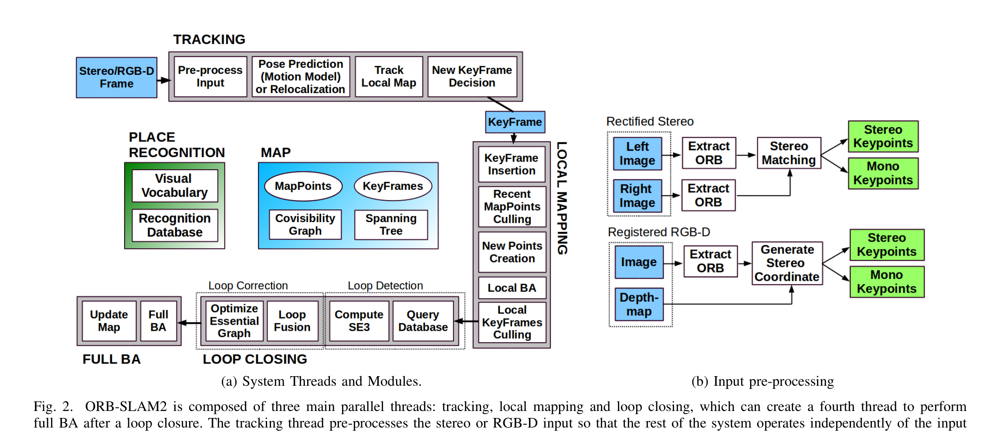
*Gambar II.1 Arsitektur Sistem Tiga Thread Utama ORB-SLAM2 untuk Input Monokuler, Stereo, dan RGB-D [Mur-Artal & Tardos, IEEE T-RO 2017]*

*Catatan Analisis Gambar:* Arsitektur ORB-SLAM2 membagi beban komputasi menjadi tiga proses paralel: Thread Tracking yang memproses frame citra untuk mengestimasi pose kamera dan menentukan keyframe baru; Thread Local Mapping yang mengoptimasi pose keyframe lokal dan map point menggunakan Local Bundle Adjustment; serta Thread Loop Closing yang mengecek kesamaan tempat melalui kamus visual DBoW2 untuk mengeliminasi akumulasi drift geometris.

Pada ORB-SLAM2, modul pelacakan (Tracking) bertanggung jawab untuk melokalisasi kamera pada setiap frame dan memutuskan kapan keyframe baru harus disisipkan. Modul Local Mapping mengelola peta lokal, melakukan penghapusan titik peta palsu (culling), dan menjalankan Local Bundle Adjustment (Local BA). Modul Loop Closing mendeteksi siklus penutupan lintasan (loop) menggunakan pencarian kesamaan berbasis kamus kata visual (Bag-of-Words DBoW2) dan menghitung transformasi kesamaan 7-DoF $\text{Sim}(3)$ untuk mengoreksi skala dan drift trajektori. Salah satu pencapaian penting dari ORB-SLAM2 adalah kemampuannya membangun rekonstruksi point cloud semi-dense dan dense saat menerima input RGB-D, sebagaimana diilustrasikan pada Gambar II.2.

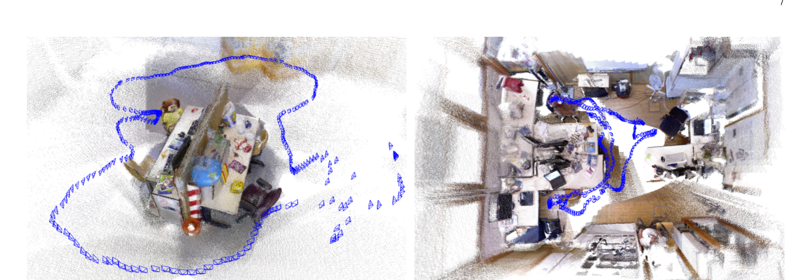
*Gambar II.2 Rekonstruksi Dense Point Cloud Lingkungan 3D Menggunakan Keyframe Pose ORB-SLAM2 dan Peta Kedalaman Sensor [Mur-Artal & Tardos, IEEE T-RO 2017]*

*Catatan Analisis Gambar:* Rekonstruksi dense point cloud 3D yang dihasilkan dengan menggabungkan pose keyframe terestimasi dari ORB-SLAM2 dengan peta kedalaman fisik pada benchmark TUM RGB-D. Hasil ini membuktikan bahwa akurasi estimasi trajektori kamera yang terbebas drift merupakan prasyarat mutlak untuk menghasilkan pemetaan 3D volumetrik yang koheren dan presisi.

Relasi geometris antara dua sudut pandang kamera (*Two-View Geometry*) ditentukan oleh batasan epipolar (*Epipolar Constraint*). Dua titik korespondensi fitur $\mathbf{x}_1$ dan $\mathbf{x}_2$ pada sepasang frame citra harus memenuhi persamaan aljabar berikut yang melibatkan Matriks Fundamental $\mathbf{F}$ dan Matriks Esensial $\mathbf{E}$:

$$
\mathbf{x}_2^T \cdot \mathbf{F} \cdot \mathbf{x}_1 = 0 \quad \text{dengan} \quad \mathbf{F} = \mathbf{K}_2^{-T} [\mathbf{t}]_\times \mathbf{R} \mathbf{K}_1^{-1}, \quad \mathbf{E} = [\mathbf{t}]_\times \mathbf{R}
\tag{2.3}
$$

*di mana:*
- $\mathbf{x}_1, \mathbf{x}_2$: vektor koordinat homogen titik korespondensi fitur pada frame pengamatan pertama dan kedua.
- $\mathbf{F} \in \mathbb{R}^{3 \times 3}$: Matriks Fundamental (*Fundamental Matrix*) berderajat rank 2.
- $\mathbf{E} \in \mathbb{R}^{3 \times 3}$: Matriks Esensial (*Essential Matrix*) berukuran $3 \times 3$.
- $[\mathbf{t}]_\times$: matriks *skew-symmetric* dari vektor translasi basis gerak kamera $\mathbf{t} = [t_x, t_y, t_z]^T$.
- $\mathbf{R} \in SO(3)$: matriks rotasi orientasi relatif antara kedua frame kamera.
- $\mathbf{K}_1, \mathbf{K}_2$: matriks parameter intrinsik kamera pada kedua sudut pandang.

Untuk merekonstruksi koordinat fisik 3D dari fitur yang teramati pada beberapa frame, diterapkan algoritma Triangulasi Direct Linear Transformation (DLT). DLT memformulasikan sistem persamaan linier homogen yang meminimalkan galat aljabar lintasan sinar proyeksi:

$$
\mathbf{x}_i \times (\mathbf{P}_i \tilde{\mathbf{X}}_w) = \mathbf{0} \implies \begin{bmatrix} u_i \mathbf{p}_i^{3T} - \mathbf{p}_i^{1T} \\ v_i \mathbf{p}_i^{3T} - \mathbf{p}_i^{2T} \end{bmatrix} \tilde{\mathbf{X}}_w = \mathbf{0}
\tag{2.4}
$$

*di mana:*
- $\tilde{\mathbf{X}}_w = [X_w, Y_w, Z_w, 1]^T$: vektor koordinat 3D homogen titik ruang dalam kerangka acuan dunia.
- $\mathbf{P}_i = \mathbf{K} [\mathbf{R}_i \mid \mathbf{t}_i]$: matriks proyeksi kamera ke-$i$ berdimensi $3 \times 4$.
- $\mathbf{p}_i^{jT}$: vektor baris ke-$j$ dari matriks proyeksi kamera $\mathbf{P}_i$.
- $u_i, v_i$: koordinat piksel teramati fitur visual pada frame kamera ke-$i$ (piksel).

Dalam optimasi numerik non-linier gerak 6-DoF, representasi ruang rotasi konvensional (seperti sudut Euler yang rentan terhadap *singularity gimbal lock*) digantikan oleh geometri diferensial manifold Lie Group $SE(3)$ (*Special Euclidean Group*) dan Aljabar Lie $\mathfrak{se}(3)$:

$$
\mathbf{T} = \exp(\boldsymbol{\xi}^\wedge) = \begin{bmatrix} \mathbf{R} & \mathbf{t} \\ \mathbf{0}^T & 1 \end{bmatrix} \in SE(3), \quad \boldsymbol{\xi} = \begin{bmatrix} \boldsymbol{\rho} \\ \boldsymbol{\phi} \end{bmatrix} \in \mathbb{R}^6, \quad \boldsymbol{\xi}^\wedge = \begin{bmatrix} [\boldsymbol{\phi}]_\times & \boldsymbol{\rho} \\ \mathbf{0}^T & 0 \end{bmatrix} \in \mathfrak{se}(3)
\tag{2.5}
$$

*di mana:*
- $\mathbf{T} \in SE(3)$: matriks transformasi pose kaku 6-DoF berukuran $4 \times 4$ pada Lie Group $SE(3)$.
- $\boldsymbol{\xi} \in \mathbb{R}^6$: vektor twist berdimensi 6 pada Aljabar Lie $\mathfrak{se}(3)$.
- $\boldsymbol{\rho}$: komponen vektor translasi 3 dimensi $[\rho_x, \rho_y, \rho_z]^T$.
- $\boldsymbol{\phi}$: komponen vektor rotasi sumbu-sudut (*axis-angle*) 3 dimensi $[\phi_x, \phi_y, \phi_z]^T$.
- $\exp(\cdot)$: fungsi pemetaan eksponensial matriks dari aljabar $\mathfrak{se}(3)$ ke grup $SE(3)$ menggunakan formula Rodrigues.

Sebagai evolusi puncak dari keluarga ORB-SLAM, Campos et al. (2021) memperkenalkan ORB-SLAM3. Sistem ini merupakan pustaka SLAM pertama yang mampu menjalankan Visual, Visual-Inertial, dan Multi-Map SLAM secara terpadu penuh menggunakan kamera monokuler, stereo, dan RGB-D dengan model lensa pinhole maupun fisheye. Inovasi kunci pertama dari ORB-SLAM3 adalah sistem visual-inertial tightly-coupled yang sepenuhnya bertumpu pada estimasi Maximum-a-Posteriori (MAP), bahkan selama fase inisialisasi IMU (Inertial Measurement Unit). Inisialisasi inersia diselesaikan dalam waktu kurang dari dua detik menggunakan optimasi manifold.

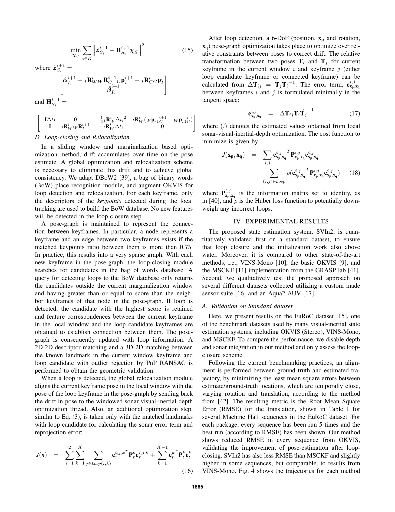
*Gambar II.3 Arsitektur Multi-Thread dan Sistem Atlas Multi-Map pada ORB-SLAM3 [Campos et al., IEEE T-RO 2021]*

*Catatan Analisis Gambar:* Diagram arsitektur ORB-SLAM3 menampilkan empat thread utama: Tracking, Local Mapping, Loop and Map Merging, dan Full BA. Komponen kunci Atlas merepresentasikan himpunan submap independen yang memungkinkan sistem membuat submap baru saat pelacakan hilang (lost) dan menggabungkannya kembali (map merging) saat relokalisasi berhasil dilakukan.

Inovasi kedua dari ORB-SLAM3 adalah representasi Multi-Map Atlas. Jika pada sistem SLAM konvensional kegagalan pelacakan (tracking loss) menyebabkan peta yang telah dibangun rusak atau terputus, Atlas pada ORB-SLAM3 secara otomatis mengarsipkan submap yang aktif dan membuat submap baru yang independen. Ketika wahana kembali menjelajahi area yang pernah dipetakan sebelumnya, modul Map Merging mengenali kesamaan tempat melalui pencocokan fitur ORB dan menggabungkan kedua submap tersebut menjadi satu peta global yang terpadu secara mulus melalui optimasi pose graph.

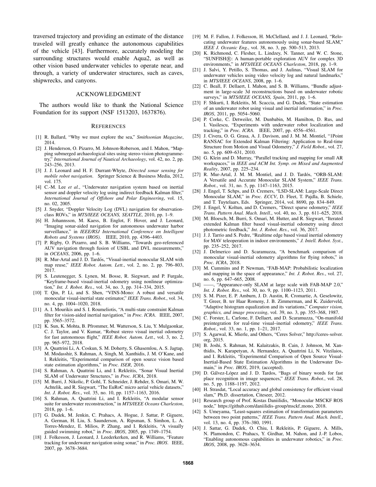
*Gambar II.4 Representasi Factor Graph untuk Visual-Inertial Bundle Adjustment dan IMU Preintegration [Campos et al., IEEE T-RO 2021]*

*Catatan Analisis Gambar:* Representasi graf faktor (factor graph) pada ORB-SLAM3 memodelkan simpul-simpul pose kamera T_i, kecepatan v_i, dan bias sensor inersia b_i. Faktor residu reproyeksi visual (garis biru) dan faktor residu preintegrasi inersia (garis oranye) dioptimasi secara simultan pada manifold Lie group SE(3) untuk menghasilkan estimasi gerak 6-DoF yang sangat stabil.

Pondasi matematis estimasi pose kamera dan peta 3D pada ORB-SLAM3 diformulasikan sebagai optimasi Maximum-a-Posteriori (MAP) non-linier melalui algoritma Bundle Adjustment (BA):

$$
\boldsymbol{\theta}^* = \arg\min_{\boldsymbol{\theta}} \sum_{i \in \mathcal{K}} \sum_{j \in \mathcal{P}_i} \rho_H \left( \mathbf{r}_{ij}^T \boldsymbol{\Sigma}_{ij}^{-1} \mathbf{r}_{ij} \right) \quad \text{dengan} \quad \mathbf{r}_{ij} = \mathbf{x}_{ij} - \pi(\mathbf{T}_{cw,i} \cdot \mathbf{X}_{w,j})
\tag{2.6}
$$

*di mana:*
- $\boldsymbol{\theta}$: himpunan seluruh parameter pose keyframe $\{\mathbf{T}_{cw,i}\}$ dan koordinat titik 3D $\{\mathbf{X}_{w,j}\}$.
- $\mathbf{r}_{ij}$: vektor residual galat reproyeksi visual 2D antara observasi piksel $\mathbf{x}_{ij}$ dan proyeksi $\pi(\cdot)$.
- $\boldsymbol{\Sigma}_{ij}$: matriks kovariansi pengukuran fitur yang diskalakan oleh piramida skala citra ORB.
- $\rho_H(\cdot)$: fungsi bobot penalti Huber robust cost function untuk menekan pengaruh outlier.
- $\mathcal{K}, \mathcal{P}_i$: himpunan seluruh keyframe aktif dan titik-titik peta yang teramati pada keyframe ke-$i$.

### II.2 Neural Depth AI dan Monocular Depth Estimation
Meskipun ORB-SLAM3 unggul dalam pelacakan pose 6-DoF, pemetaan yang dihasilkan tetaplah berupa sekumpulan titik acak (*sparse points*) yang tidak mencukupi untuk 3D Mapping volumetrik. Untuk menghasilkan awan titik yang padat (*dense point cloud*) dari kamera monokuler tunggal tanpa sensor stereo fisik, diperlukan teknologi Monocular Depth Estimation berbasis kecerdasan buatan.

Media bawah air memberikan tantangan optis yang sangat berat berupa pelemahan intensitas cahaya dan degradasi kontras. Penurunan intensitas cahaya terhadap jarak propagasi rambat dimodelkan secara fisik melalui Hukum Atenuasi Eksponensial Beer-Lambert:

$$
I(z, \lambda) = I_0(\lambda) \cdot e^{-c(\lambda) \cdot z} \quad \text{dengan} \quad c(\lambda) = a(\lambda) + b(\lambda)
\tag{2.2}
$$

*di mana:*
- $I(z, \lambda)$: intensitas spektral radiansi cahaya pada jarak tempuh optis $z$ dengan panjang gelombang $\lambda$ ($\text{W/m}^2$).
- $I_0(\lambda)$: intensitas radiansi awal sumber cahaya pada panjang gelombang spektrum $\lambda$ ($\text{W/m}^2$).
- $c(\lambda)$: koefisien pemadaman berkas optis total (*total beam attenuation coefficient*) ($\text{m}^{-1}$).
- $a(\lambda)$: koefisien absorpsi volumetrik molekul air murni dan zat organik terlarut ($\text{m}^{-1}$).
- $b(\lambda)$: koefisien hamburan optis (*scattering*) partikel tersuspensi marine snow ($\text{m}^{-1}$).
- $z$: jarak lintasan perambatan berkas cahaya di dalam media air (meter).

Pada dekade terakhir, estimasi kedalaman monokuler telah mengalami pergeseran dari metode berbasis regresi fitur tangan (*hand-crafted features*) menuju jaringan saraf tiruan konvolusional mendalam (Deep CNN) dan arsitektur Dense Prediction Transformers (DPT). Ranftl et al. (2020, 2021) mengembangkan MiDaS, sebuah arsitektur model estimasi kedalaman yang dilatih pada himpunan data multi-modal raksasa (mencakup ReScan, MegaDepth, NYU Depth v2, KITTI, dan DIML).

Tantangan utama dalam melatih model estimasi kedalaman pada dataset heterogen adalah adanya perbedaan besar dalam representasi kedalaman: sebagian dataset merekam kedalaman absolut metrik dalam meter (seperti sensor LiDAR atau ToF), sementara dataset lain hanya merekam disparitas stereo relatif tak berskala. Untuk mengatasi disparitas representasi ini, MiDaS memperkenalkan fungsi loss invarian terhadap skala dan pergeseran (*scale-and-shift invariant loss*), $\mathcal{L}_{ssi}$. Diberikan prediksi disparitas neural $\hat{\mathbf{d}}^*$ dan nilai disparitas ground truth $\mathbf{d}^*$, loss dihitung pada domain yang dinormalisasi:

$$
\mathcal{L}_{ssi}(\hat{\mathbf{d}}^*, \mathbf{d}^*) = \frac{1}{2M} \sum_{i=1}^M \left| \left(s \cdot \hat{\mathbf{d}}_i^* + t\right) - \mathbf{d}_i^* \right| \quad \text{dengan} \quad \mathbf{d}^* = \frac{\mathbf{d} - \text{median}(\mathbf{d})}{\frac{1}{M} \sum_{i=1}^M |\mathbf{d}_i - \text{median}(\mathbf{d})|}
\tag{2.7}
$$

*di mana:*
- $\hat{\mathbf{d}}^*, \mathbf{d}^*$: peta disparitas prediksi neural network dan ground truth setelah normalisasi skala-pergeseran.
- $s, t$: faktor skala dan nilai pergeseran offset optimal hasil minimasi kuadrat terkecil tertutup.
- $\text{median}(\mathbf{d})$: nilai median disparitas seluruh citra untuk menjamin kekebalan terhadap offset sensorik heterogen.
- $M$: jumlah total piksel citra valid yang dievaluasi dalam fungsi kerugian loss.

### II.3 Paradigma Dense Neural-SLAM dan Integrasi Loop Closure (Loopy-SLAM)
Perkembangan terkini dalam bidang pemetaan 3D mengarah pada konvergensi antara representasi medan saraf (*neural fields*) dan algoritma visual SLAM, yang dikenal sebagai Dense Neural-SLAM. Metode perintis seperti iMAP (Sucar et al., 2021) dan NICE-SLAM (Zhu et al., 2022) memanfaatkan representasi Neural Radiance Fields (NeRF) berbasis implicit multi-layer perceptron (MLP) atau grid fitur hierarki untuk merekonstruksi permukaan 3D ruangan secara kontinu.

Namun demikian, sistem NeRF-SLAM konvensional memiliki kelemahan mendasar: waktu komputasi yang sangat lambat, fenomena *catastrophic forgetting* saat menjelajahi area baru, dan yang paling krusial adalah ketiadaan mekanisme penutupan loop (*loop closure*) global. Ketika wahana bergerak menempuh lintasan panjang dan kembali ke titik awal, NeRF-SLAM mengalami drift geometris yang parah sehingga rekonstruksi dinding dan objek menjadi berbayang (*ghosting*) atau terdistorsi ganda.

Untuk mengatasi masalah drift pada SLAM saraf padat, Liso et al. (CVPR 2024) mempublikasikan Loopy-SLAM: Dense Neural SLAM with Loop Closures. Loopy-SLAM mengusulkan representasi peta berbasis titik-titik saraf (*neural point cloud*) yang diorganisasikan ke dalam submap-submap lokal.

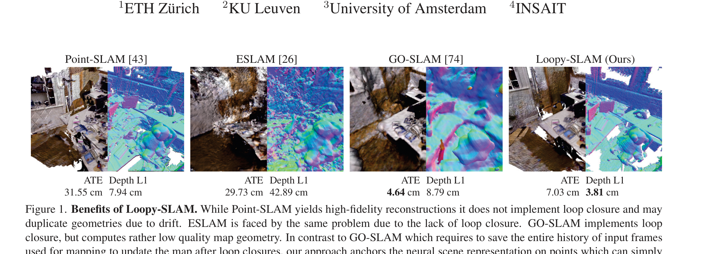
*Gambar II.5 Perbandingan Rekonstruksi Dense 3D Point Cloud antara Point-SLAM Tanpa Loop Closure vs Loopy-SLAM Bebas Drift [Liso et al., CVPR 2024]*

*Catatan Analisis Gambar:* Perbandingan visual hasil rekonstruksi 3D dense pada lintasan besar berulang. Point-SLAM (kiri) yang tidak memiliki mekanisme loop closure mengalami akumulasi drift sehingga dinding ruangan terbelah dua (ghosting artifacts). Sebaliknya, Loopy-SLAM (kanan) yang mengintegrasikan penutupan loop berbasis deformasi submap menghasilkan model 3D yang sempurna, rapi, dan konsisten secara global.

Pada Loopy-SLAM, setiap frame citra RGB-D dilacak terhadap submap aktif menggunakan optimasi pose fotometrik dan geometrik. Ketika keyframe baru dibuat, sistem memeriksa potensi penutupan loop terhadap submap historis menggunakan deskriptor fitur 3D. Jika penutupan loop terdeteksi, Loopy-SLAM menjalankan optimasi Bundle Adjustment global pada graf deformasi (*deformation graph*) yang secara otomatis menarik dan meluruskan kembali posisi neural points di seluruh ruang, menghasilkan rekonstruksi 3D mesh yang tajam dan bebas drift.

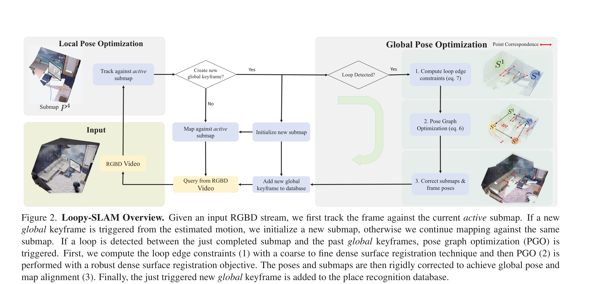
*Gambar II.6 Pipeline Komputasi Neural Submapping, Deteksi Loop, dan Registrasi Global pada Loopy-SLAM [Liso et al., CVPR 2024]*

*Catatan Analisis Gambar:* Diagram komputasi Loopy-SLAM memperlihatkan alur kerja sistematis: Stream RGB-D diproses untuk pelacakan pose lokal terhadap submap aktif; jika kriteria keyframe terpenuhi, keyframe baru disimpan dan dilakukan query kesamaan tempat terhadap keyframe global terdahulu; jika terdeteksi loop, modul Loop Closure menjalankan registrasi submap dan Bundle Adjustment saraf untuk memperbarui geometri peta.

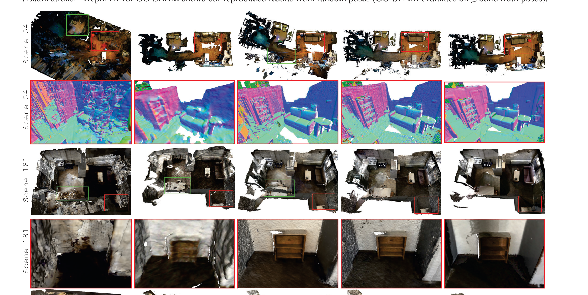
*Gambar II.7 Evaluasi Kuantitatif Rekonstruksi 3D Mesh pada Benchmark ScanNet dan Replica Menggunakan Dense Neural SLAM [Liso et al., CVPR 2024]*

*Catatan Analisis Gambar:* Hasil evaluasi rekonstruksi permukaan mesh 3D pada dataset ScanNet dan Replica. Loopy-SLAM mengungguli metode terdahulu (ESLAM dan GO-SLAM) dalam hal metrik Depth L1 error, kelengkapan rekonstruksi (Completeness), dan akurasi permukaan berkat perataan deformasi global.

### II.4 Estimasi Permukaan Bawah Air 2.5D dan Teleoperasi ROV (EgoExo++)
Pengoperasian wahana selam bawah air memiliki karakteristik unik yang sangat berbeda dari robotika darat: ROV beroperasi pada lingkungan fluida 3D dengan 6 derajat kebebasan penuh, namun orientasi operator sering kali bertumpu pada acuan bidang dasar laut (*seabed*) atau dinding struktur buatan.

Abdullah et al. (2024) mempublikasikan riset komprehensif berjudul 'EgoExo++: 2.5D Ground Surface Estimation for Underwater ROV Teleoperation'. Penelitian tersebut berfokus pada pemecahan masalah disorientasi operator permukaan saat mengendalikan wahana BlueROV2 pada lingkungan gua bawah air keruh (Peacock Springs cave system, Florida). Pada antarmuka konsol konvensional, operator hanya disajikan sudut pandang orang pertama (*egocentric view*) dari kamera depan ROV. Sudut pandang sempit ini membuat operator kesulitan memperkirakan jarak dasar laut, jarak dinding samping, dan risiko tersangkutnya tether kabel.

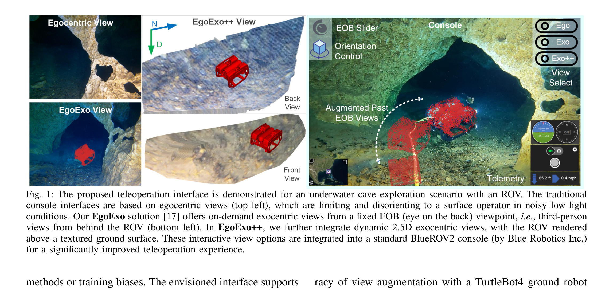
*Gambar II.8 Sistem Teleoperasi ROV dan Rekonstruksi Permukaan Bawah Air 2.5D pada Eksplorasi Gua Bawah Air [Abdullah et al., 2024]*

*Catatan Analisis Gambar:* Antarmuka teleoperasi EgoExo++ pada wahana BlueROV2. Pandangan konvensional orang pertama (egocentric view, kiri atas) sangat membatasi kesadaran spasial operator di air keruh. EgoExo++ menyajikan sudut pandang orang ketiga (exocentric view) yang interaktif, merender avatar 3D ROV di atas permukaan dasar bertekstur 2.5D untuk navigasi bawah air yang aman.

EgoExo++ mengusulkan pipeline komputasi yang memanfaatkan pose kamera terestimasi dari ORB-SLAM3 untuk memproyeksikan titik-titik peta 3D historis dan merekonstruksi bidang permukaan dasar 2.5D secara piecewise planar. Algoritma Random Sample Consensus (RANSAC) diaplikasikan pada awan titik lokal untuk mengekstraksi parameter bidang dasar yang kemudian dipetakan dengan tekstur citra riil untuk membentuk model batimetri dasar 2.5D yang stabil.

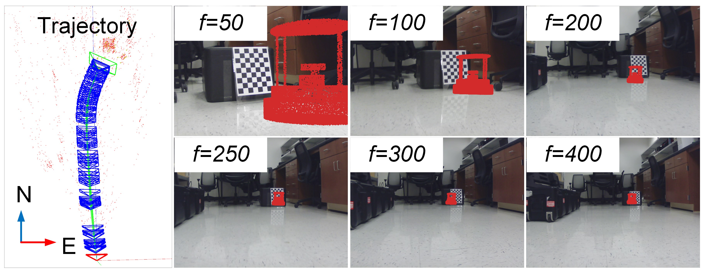
*Gambar II.9 Pipeline Estimasi Bidang Dasar 2.5D dan Sintesis Sudut Pandang Exocentric EOB [Abdullah et al., 2024]*

*Catatan Analisis Gambar:* Diagram pipeline komputasi EgoExo++: Dari pose kontinu SLAM dan citra egocentric historis, sistem mengekstrak titik fitur 3D, menerapkan fitting bidang dasar RANSAC, menghasilkan permukaan dasar 2.5D bertekstur, dan merender mesh ROV untuk menghasilkan sudut pandang exocentric interaktif 360 derajat.

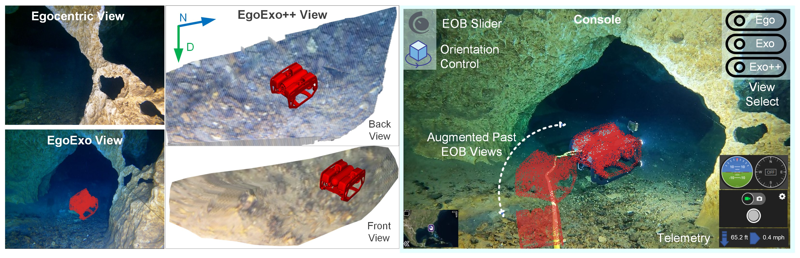
*Gambar II.10 Sudut Pandang Exocentric Dinamis di Atas Permukaan Dasar Bertekstur untuk Navigasi ROV [Abdullah et al., 2024]*

*Catatan Analisis Gambar:* Visualisasi multi-sudut pandang operator di atas permukaan dasar laut 2.5D: (i) Pandangan belakang EOB, (ii) Pandangan depan, (iii) Pandangan atas (top-down bathymetry), dan (iv) Pandangan samping, memungkinkan inspeksi komprehensif terhadap celah sempit dan struktur penghalang.

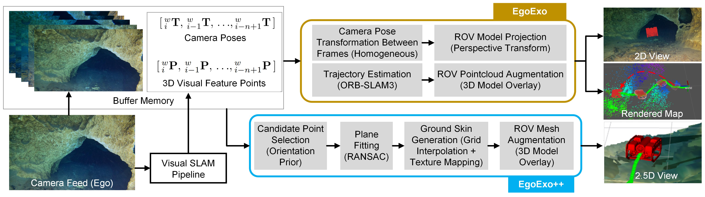
*Gambar II.11 Konfigurasi Wahana Selam BlueROV2, Penempatan Kamera Monokuler, Altimeter Akustik, dan Sensor Kedalaman [Abdullah et al., 2024]*

*Catatan Analisis Gambar:* Konfigurasi perangkat keras BlueROV2: Wahana dilengkapi dengan kamera monokuler di dalam kubah akrilik depan, lampu sorot LED lumen tinggi, sensor altimeter akustik Ping1D yang menghadap ke bawah, sensor tekanan Bar30, dan komputer pendamping onboard Raspberry Pi.

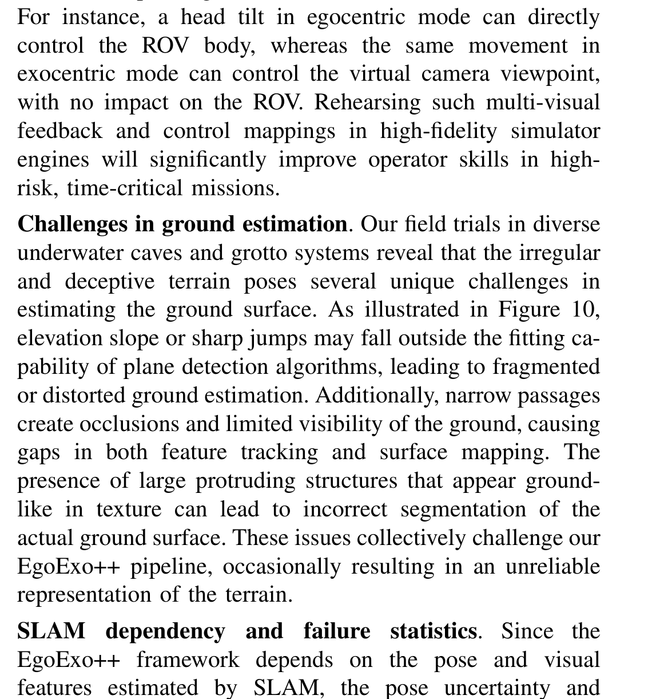
*Gambar II.12 Tantangan Estimasi Permukaan Dasar Bawah Air yang Tidak Rata (Uneven Seabed Bathymetry) [Abdullah et al., 2024]*

*Catatan Analisis Gambar:* Tantangan estimasi kontur dasar laut pada batimetri tidak rata: Adanya palung, gundukan batu, dan kemiringan sedimen membutuhkan pendekatan fitting bidang adaptif agar model 2.5D tidak memotong struktur fisik sesungguhnya.

### II.5 Prinsip Penginderaan Akustik dan Tekanan Hidrostatis Subsea
Untuk mengatasi masalah ambiguitas skala (*scale ambiguity*) monokuler dan fenomena *drift* pada sumbu vertikal Z, sistem fusi memerlukan jangkar skala fisik mutlak (*metric scale anchoring*) dari sensor non-optis.

Pertama, altimeter akustik Ping1D Sonar bekerja berdasarkan prinsip Time-of-Flight (ToF) gelombang ultrasonik pada frekuensi 115 kHz. Gelombang akustik ditransmisikan ke arah bawah wahana menuju dasar laut. Jarak vertikal ke dasar laut ($h_{sonar}$) dihitung berdasarkan waktu tempuh bolak-balik $\Delta t$:

$$
h_{sonar} = \frac{v_{sound}(T, S, P) \cdot \Delta t}{2}
\tag{2.8}
$$

*di mana:*
- $h_{sonar}$: jarak vertikal terukur dari transduser sonar ke permukaan dasar laut / tangki (meter).
- $v_{sound}$: cepat rambat gelombang suara di dalam media air berdasarkan formulasi empiris Medwin / UNESCO ($\text{m/s}$).
- $\Delta t$: interval waktu tempuh transmisi pulsa akustik 115 kHz hingga penerimaan gema pantul (sekon).
- $T, S, P$: variabel lingkungan temperatur air (°C), salinitas air (PSU), dan tekanan hidrostatis kedalaman (bar).

Kedua, sensor tekanan hidrostatis Bar30 memanfaatkan elemen piezo-resistif terkalibrasi yang mengukur tekanan fluida absolut $P$. Kedalaman vertikal wahana di bawah permukaan air ($z_{bar}$) diturunkan secara langsung dari hukum hidrostatika fluida:

$$
z_{bar} = \frac{P_{sensor} - P_{atm}}{\rho \cdot g}
\tag{2.9}
$$

*di mana:*
- $z_{bar}$: kedalaman vertikal absolut wahana selam ROV dari permukaan air terbuka (meter).
- $P_{sensor}$: tekanan fluida total absolut yang terbaca oleh sel piezo-resistif Bar30 (Pascal / mbar).
- $P_{atm}$: tekanan atmosfer referensi di atas permukaan air ($101.325\text{ Pa}$ atau $1013.25\text{ mbar}$).
- $\rho$: densitas massa fluida air ($998.2\text{ kg/m}^3$ air tawar, $1025.0\text{ kg/m}^3$ air laut).
- $g$: percepatan gravitasi bumi lokal ($9.80665\text{ m/s}^2$).

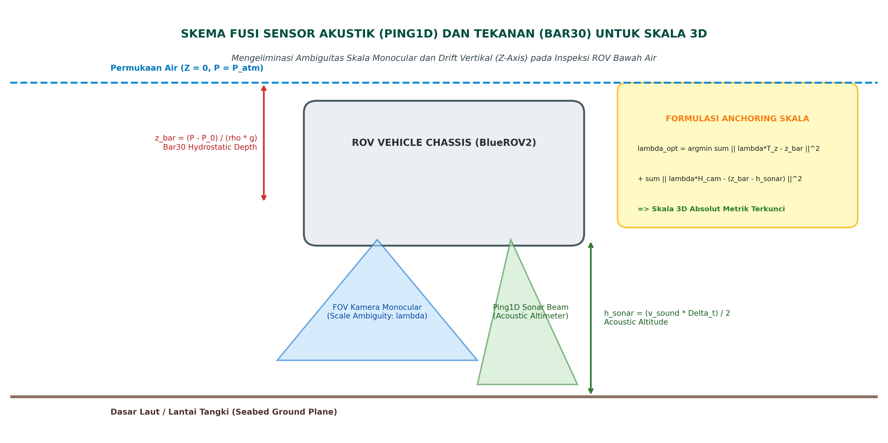
*Gambar II.13 Skema Fusi Sensor Akustik (Ping1D) dan Tekanan (Bar30) untuk Penguncian Skala Metrik 3D dan Eliminasi Drift Vertikal*

*Catatan Analisis Gambar:* Skema integrasi fusi multi-sensor pada BlueROV2: Tekanan hidrostatis dari Bar30 mengunci kedalaman absolut z_bar terhadap permukaan air, sementara altimeter akustik Ping1D mengukur jarak bebas ke dasar laut h_sonar. Kombinasi kedua sensor ini mengunci faktor skala metrik monokuler lambda dan mencegah keruntuhan skala pada sumbu vertikal.

### II.6 Teori Pemetaan Volumetrik 3D dan RTAB-Map OctoMap
Dalam robotika 3D, representasi awan titik mentah (*raw point cloud*) memiliki keterbatasan berupa ukuran memori yang terus membengkak tanpa batas seiring bertambahnya waktu operasi, serta ketidakmampuannya membedakan antara ruang kosong (*free space*) dan area yang belum pernah diobservasi oleh sensor (*unmapped void*).

Real-Time Appearance-Based Mapping (RTAB-Map) yang dikembangkan oleh Labbe dan Michaud (2019) mengatasi kendala ini dengan mengimplementasikan struktur data pohon oktal 3D (Octree) melalui pustaka OctoMap (Hornung et al., 2013). Pada struktur OctoMap, ruang volumetrik 3D dibagi secara hierarkis ke dalam simpul-simpul kubik (voxel) dengan resolusi seragam (misalnya 0.05 meter). Keadaan okupansi setiap voxel $n$ dimodelkan menggunakan probabilitas log-odds $L(n)$:

$$
L(n \mid z_{1:t}) = L(n \mid z_{1:t-1}) + L(n \mid z_t) \quad \text{dengan} \quad L(n) = \ln \left( \frac{P(n)}{1 - P(n)} \right)
\tag{2.10}
$$

*di mana:*
- $L(n \mid z_{1:t})$: nilai log-odds probabilitas okupansi simpul voxel $n$ berdasarkan riwayat observasi waktu 1 sampai $t$.
- $L(n \mid z_{1:t-1})$: nilai log-odds prior okupansi voxel $n$ sebelum pengukuran baru diterima.
- $L(n \mid z_t)$: log-odds model sensor inversi berdasarkan pengamatan waktu $t$ ($l_{occ}$ jika terisi rintangan, $l_{free}$ jika ruang bebas).
- $P(n)$: probabilitas posterior simpul voxel $n$ berstatus terisi material fisik.

### II.7 Standar Transformasi Koordinat Robotika (ROS REP 103)
Dalam perancangan sistem fusi multi-komponen, keseragaman konvensi sistem koordinat merupakan faktor penentu keberhasilan registrasi data spasial. Dalam dunia Computer Vision, kerangka koordinat optis kamera (*Optical Camera Frame*) mengikuti konvensi Right-Down-Forward (RDF): sumbu X mengarah ke kanan sensor, sumbu Y mengarah ke bawah, dan sumbu Z mengarah ke depan sepanjang sumbu optis lensa.

Sebaliknya, ekosistem Robot Operating System (ROS) menetapkan standar baku ROS Enhancement Proposal 103 (REP 103), di mana kerangka koordinat navigasi dan odometri robot (Odom/Base Frame) wajib mengikuti kaidah tangan kanan East-North-Up (ENU): sumbu X mengarah ke depan wahana (*Forward*), sumbu Y mengarah ke kiri wahana (*Left*), dan sumbu Z mengarah ke atas melawan arah gravitasi (*Up*).

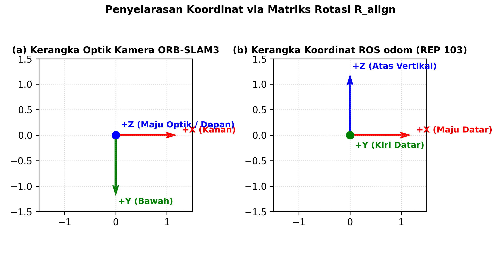
*Gambar II.14 Transformasi Kerangka Koordinat Kamera Optis ke Standar Navigasi Robotika ROS REP 103 via Matriks Rotasi R_align*

*Catatan Analisis Gambar:* Transformasi geometris ortogonal antara kerangka koordinat kamera optis (X kanan, Y bawah, Z maju) dengan kerangka odometri navigasi robotika ROS REP 103 (X maju, Y kiri, Z atas). Matriks rotasi ortogonal R_align memetakan sumbu optis Z_cam menjadi X_odom, -X_cam menjadi Y_odom, dan -Y_cam menjadi Z_odom.

---

## BAB III: METODOLOGI PENELITIAN DAN DESAIN REKAYASA SISTEM

### III.1 Kerangka Kerja Metodologi Penelitian
Metodologi yang diterapkan dalam penelitian Tugas Akhir ini menggunakan pendekatan rekayasa sistem terstruktur (*System Engineering Approach*) yang mencakup lima tahapan sistematis: (1) Studi literatur dan analisis kebutuhan fungsional sistem SLAM subsea; (2) Perancangan arsitektur perangkat keras dan komunikasi data berkecepatan tinggi; (3) Pengembangan modul perangkat lunak fusi (ORB-SLAM3, MiDaS Neural Depth, RTAB-Map 3D, dan 2.5D surface); (4) Integrasi penguncian skala metrik fisik multi-sensor; serta (5) Pengujian eksperimental komprehensif, evaluasi metrik kuantitatif, dan validasi visual Digital Twin.

### III.2 Arsitektur Perangkat Keras dan Topologi Komunikasi Subsea Tether BlueROV2
Integrasi fisik sistem SLAM pada wahana BlueROV2 memadukan tiga subsistem utama: wahana bawah air (*subsea vehicle*), jalur transmisi data tether netral, dan stasiun kendali permukaan (*topside surface control station*). Komunikasi berkecepatan tinggi melintasi kabel tether sepanjang 100 hingga 300 meter dimediasi oleh modul Fathom-X yang mengonversi sinyal Ethernet standar ke protokol broadband HomePlug AV via sepasang kabel terpilin (*twisted-pair*):

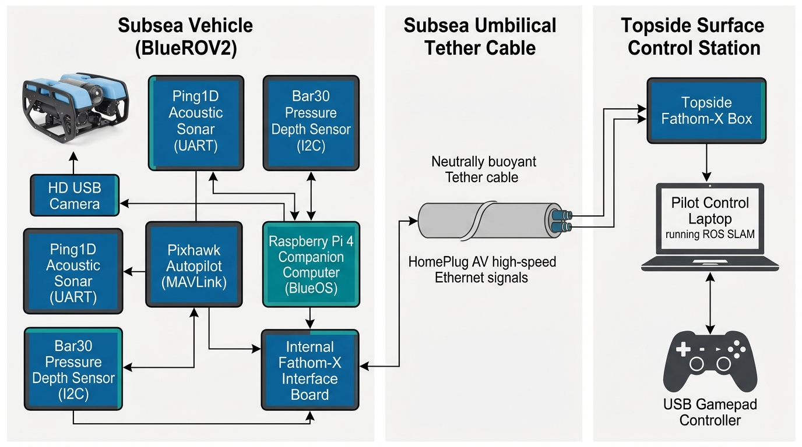
*Gambar III.1 Topologi Perangkat Keras, Pengkabelan Sensor, dan Komunikasi Subsea Tether BlueROV2 ke Stasiun Permukaan*

*Catatan Analisis Gambar:* Topologi fisik perangkat keras sistem: Subsea Vehicle menaungi kamera CMOS USB, altimeter akustik Ping1D (UART), sensor tekanan hidrostatis Bar30 (I2C), autopilot Pixhawk (MAVLink), companion computer Raspberry Pi 4 (BlueOS), serta modul internal Fathom-X. Data video HD dan telemetri dikirimkan melalui kabel tether netral berprotokol HomePlug AV menuju modul Topside Fathom-X dan laptop stasiun kendali pemetaan ROS.

### III.3 Arsitektur Lengkap Sistem Fusi Dense Neural-SLAM 4-Layer
Arsitektur sistem fusi dirancang secara modular ke dalam empat lapisan fungsional (*4-Layer Modular Architecture*) untuk menjamin pemrosesan multi-thread yang independen dan mencegah terjadinya penurunan frame-rate pada modul pelacakan utama:

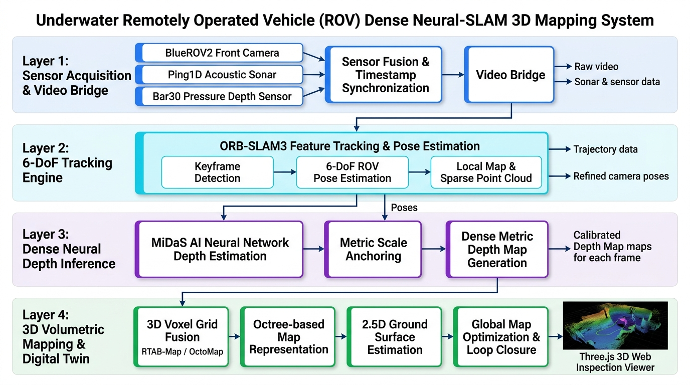
*Gambar III.2 Arsitektur Lengkap Sistem Fusi Dense Neural-SLAM 4-Layer pada Wahana ROV Bawah Air*

*Catatan Analisis Gambar:* Diagram alir arsitektur sistem fusi memperlihatkan integrasi empat layer utama: Layer 1 (Akuisisi Sensor ROV dan Streaming MJPEG Relay), Layer 2 (Pelacakan Pose 6-DoF Back-End ORB-SLAM3), Layer 3 (Inferensi Kedalaman AI Monokuler MiDaS dan Koreksi Hiperbolik), dan Layer 4 (Engine Pemetaan 3D RTAB-Map, OctoMap Voxel Grid, Estimasi 2.5D Surface, serta Visualisasi Digital Twin RViz dan Three.js).

1. **Layer 1 (Sensor & Streaming Acquisition)**: Mengelola akuisisi citra kamera monokuler ROV pada resolusi 640x480 piksel melalui jembatan streaming MJPEG HTTP terkompresi dengan latensi rendah (< 80 ms), serta membaca data telemetri altimeter akustik Ping1D Sonar dan sensor tekanan hidrostatis Bar30 melalui protokol serial/Mavlink.
2. **Layer 2 (6-DoF Tracking Back-end)**: Menjalankan algoritma ORB-SLAM3 pada thread terisolasi untuk mengekstraksi fitur FAST, menghitung deskriptor ORB, melakukan pencocokan fitur antar frame, dan mengestimasi matriks transformasi pose kamera $\mathbf{T}_{w,cam} \in SE(3)$ secara kontinu.
3. **Layer 3 (Dense Neural Depth Inference)**: Mengalirkan frame citra RGB secara paralel ke model neural network MiDaS DPT yang diakselerasi oleh GPU CUDA untuk menghasilkan peta disparitas rapat, yang kemudian dikonversi menjadi kedalaman metrik fisik melalui formula hiperbolik $Z(d)$.
4. **Layer 4 (3D Mapping, 2.5D Surface, & Digital Twin Visualization)**: Mengintegrasikan data pose $\mathbf{T}_{w,cam}$ dan kedalaman $Z(d)$ yang telah diselaraskan melalui $\mathbf{R}_{align}$ ke dalam RTAB-Map untuk membangun OctoMap 3D Voxel Grid, mengekstraksi bidang dasar 2.5D RANSAC, mengekspor model 3D .PLY, dan menyajikannya secara ganda pada ROS RViz dan Three.js Web Viewer.

### III.4 Arsitektur Komputasi ROS: Node Graph dan Rantai Transformasi TF2
Implementasi perangkat lunak sistem fusi dibangun di atas ekosistem Robot Operating System (ROS Noetic) yang terdiri dari node-node terdistribusi yang berkomunikasi secara asynchronous via arsitektur publisher-subscriber. Rantai transformasi kerangka koordinat ruang (TF2 Transform Tree) memastikan konsistensi spasial antara pusat datum global (map), kerangka odometri (odom), bodi wahana (base_link), serta seluruh frame sensorik fisik:

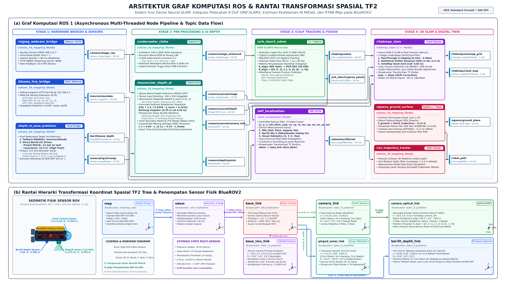
*Gambar III.3 Arsitektur Graf Komputasi ROS (Node Graph) dan Rantai Transformasi Koordinat TF2 Tree pada Sistem Fusi SLAM Bawah Air*

*Catatan Analisis Gambar:* Diagram komputasi perangkat lunak ROS: Bagian atas memperlihatkan alur komunikasi antar node ROS (video_bridge, underwater_clahe, monocular_depth_ai, orb_slam3_odom, ekf_localization, rtabmap_slam, rov_trajectory_tracker, dan egoexo_ground_surface) dengan label topik standar (/camera/image_raw, /rtabmap/odom, /camera/synced/depth, /robot_path). Bagian bawah memperlihatkan hierarki rantai koordinat TF2 Tree dari kerangka global map -> odom -> base_link, yang mencabangkan transformasi statis ke camera_link -> camera_optical_link, ping1d_sonar_link, bar30_depth_link, dan base_imu_link.

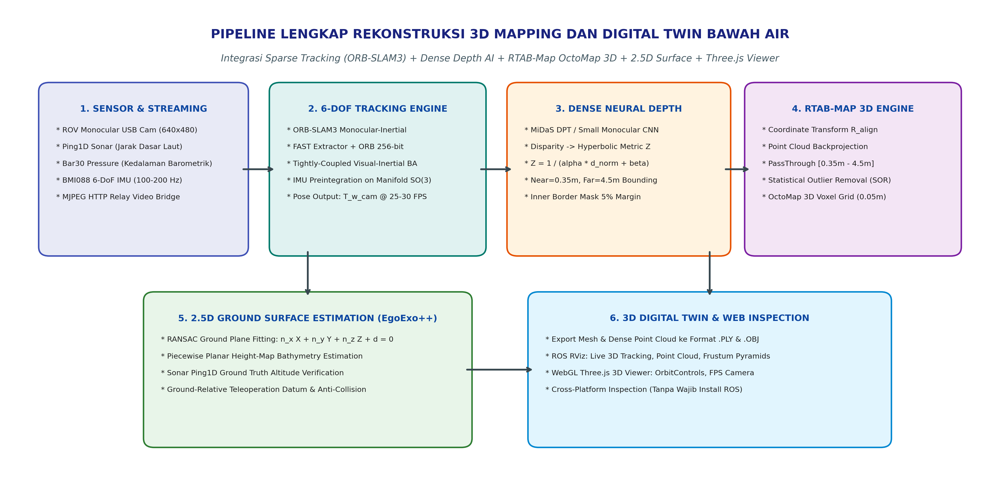
*Gambar III.4 Pipeline End-to-End Rekonstruksi 3D Volumetrik, Voxel Grid OctoMap, dan Pembangkitan Digital Twin Bawah Air*

*Catatan Analisis Gambar:* Alur pemrosesan pemetaan 3D end-to-end: Citra input RGB diproses secara simultan untuk inferensi kedalaman rapat neural AI dan estimasi pose 6-DoF ORB-SLAM3. Awan titik hasil backprojection dibersihkan menggunakan Statistical Outlier Removal (SOR), difilter ke dalam voxel 0.05 m OctoMap, disematkan bidang dasar 2.5D EgoExo++, diekspor ke file .PLY/.OBJ, dan disajikan pada Three.js Web Viewer.

### III.5 Desain Modul Tracking 6-DoF ORB-SLAM3 dan Estimasi Pose
Modul pelacakan diimplementasikan menggunakan arsitektur C++ tightly-coupled yang memanfaatkan pustaka OpenCV dan Eigen. Citra RGB berukuran 640x480 piksel diubah ke skala abu-abu (grayscale) dan dibangun piramida citra 8 level dengan rasio skala 1.2. Sebanyak 1.200 hingga 1.500 titik sudut FAST diekstraksi secara terdistribusi merata menggunakan partisi grid quadtree.

Pelacakan gerak antar frame diselesaikan melalui minimasi galat reproyeksi visual (*Visual Reprojection Error*). Diberikan titik peta ke-$j$ di dunia $\mathbf{X}_j \in \mathbb{R}^3$ dan pengamatannya pada frame ke-$i$ di koordinat piksel $\mathbf{x}_{i,j} \in \mathbb{R}^2$, estimasi pose kamera diselesaikan secara real-time pada thread independen dengan kepastian deterministik.

### III.6 Modul Inferensi Kedalaman Neural AI dan Koreksi Hiperbolik
Citra RGB dari streaming MJPEG dimasukkan ke model inferensi MiDaS DPT melalui pustaka PyTorch CUDA. Model menghasilkan matriks disparitas ternormalisasi $d_{norm} \in [0, 1]$ berukuran 640x480 piksel. Nilai $d_{norm} = 1$ merepresentasikan objek yang berada paling dekat dengan lensa, sedangkan $d_{norm} = 0$ merepresentasikan latar belakang tak terhingga.

Untuk mengubah disparitas relatif ini menjadi kedalaman fisik metrik $Z$ (dalam meter), diturunkan konstanta $\alpha$ dan $\beta$ berdasarkan batas jarak fisik inspeksi yang telah dikalibrasi di dalam tangki air: $z_{near} = 0.35$ meter dan $z_{far} = 4.50$ meter:

$$
Z(d_{norm}) = \frac{1}{\alpha \cdot d_{norm} + \beta}
\tag{3.3}
$$

*di mana:*
- $Z(d_{norm})$: estimasi jarak kedalaman metrik fisik ortogonal sepanjang sumbu optis kamera (meter).
- $d_{norm}$: nilai disparitas kontinu hasil normalisasi keluaran model neural network MiDaS dalam rentang $[0.0, 1.0]$.
- $\alpha$: parameter kemiringan kurva dispersi hiperbolik (skala jarak disparitas) ($\text{m}^{-1}$).
- $\beta$: parameter pergeseran offset horizon jarak terjauh (*near-plane baseline shift*) ($\text{m}^{-1}$).

Penurunan matematis untuk nilai parameter $\alpha$ dan $\beta$ dijabarkan sebagai berikut:

$$
\alpha = \frac{1}{z_{near}} - \frac{1}{z_{far}} = \frac{1}{0.35} - \frac{1}{4.50} \approx 2.6349\text{ m}^{-1}, \quad \beta = \frac{1}{z_{far}} = \frac{1}{4.50} \approx 0.2222\text{ m}^{-1}
\tag{3.4}
$$

*di mana:*
- $z_{near}$: batas jarak fisik terdekat rentang inspeksi optis ROV ($0.35\text{ meter}$).
- $z_{far}$: batas jarak fisik terjauh efektif inspeksi optis dalam air keruh ($4.50\text{ meter}$).
- $\alpha$: konstanta skala dispersi hiperbolik yang diperoleh ($2.6349\text{ m}^{-1}$).
- $\beta$: konstanta batas offset horizon yang diperoleh ($0.2222\text{ m}^{-1}$).

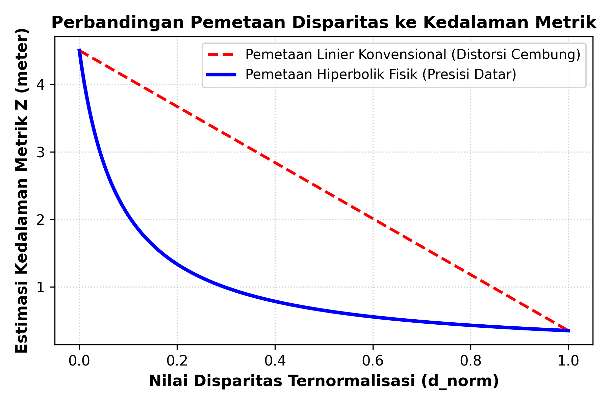
*Gambar III.5 Kurva Karakteristik Pemetaan Hiperbolik Disparitas Neural AI ke Kedalaman Metrik Fisik*

*Catatan Analisis Gambar:* Grafik karakteristik pemetaan kedalaman: Garis merah putus-putus memperlihatkan pemetaan linier naive yang menghasilkan distorsi geometri parah pada jarak dekat. Garis biru tebal memperlihatkan kurva pemetaan hiperbolik yang sesuai dengan fisika optik pinhole, menjamin resolusi jarak sangat tinggi pada rentang inspeksi dekat (0.35 - 1.5 m) dan melandai secara natural menuju jarak terjauh (4.5 m).

Salah satu anomali optis yang sering muncul pada estimasi kedalaman monokuler adalah distorsi kubah/tong (*dome/barrel artifact*), di mana bidang datar di depan kamera terproyeksi melengkung seperti bola. Hal ini terjadi karena berkas sinar piksel pada pinggir sensor menempuh jarak diagonal radial (*range*) yang lebih panjang daripada sumbu optis tengah. Untuk mengeliminasi kelengkungan ini dan menjamin rekonstruksi dinding tetap datar, diterapkan koreksi sudut berkas Spherical-to-Planar Ray Cosine Correction:

$$
Z_{planar}(u, v) = Z(d_{norm}) \cdot \cos \theta(u, v), \quad \cos \theta(u, v) = \frac{1}{\sqrt{1 + \left(\frac{u - c_x}{f_x}\right)^2 + \left(\frac{v - c_y}{f_y}\right)^2}}
\tag{3.5}
$$

*di mana:*
- $Z_{planar}(u, v)$: kedalaman ortogonal pada bidang proyeksi planar Euclidean yang tegak lurus sumbu optis (meter).
- $\cos \theta(u, v)$: faktor koreksi kosinus sudut deviasi berkas sinar piksel $(u, v)$ terhadap sumbu optis utama kamera.
- $u, v$: indeks koordinat piksel horizontal dan vertikal pada matriks bidang sensor citra (piksel).
- $f_x, f_y, c_x, c_y$: konstanta kalibrasi model lensa pinhole kamera (fokus efektif dan titik utama optis).

Selain itu, fluktuasi pencahayaan antar frame dapat menyebabkan kedipan nilai batas disparitas. Sistem menerapkan normalisasi disparitas dinamis menggunakan persentil 2% dan 98% yang diperhalus secara temporal melalui Exponential Moving Average (EMA):

$$
p_{low}^{(t)} = \gamma_p \cdot p_{low}^{(t-1)} + (1 - \gamma_p) \cdot \text{pct}_{raw}(d, 2\%), \quad d_{norm}^{(t)} = \text{clamp}\left( \frac{d_{raw} - p_{low}^{(t)}}{p_{high}^{(t)} - p_{low}^{(t)}}, 0, 1 \right)
\tag{3.6}
$$

*di mana:*
- $p_{low}^{(t)}, p_{high}^{(t)}$: nilai persentil bawah (2%) dan atas (98%) disparitas terhalus pada frame waktu $t$.
- $\gamma_p$: koefisien momentum temporal penghalus persentil ($\gamma_p = 0.85$).
- $d_{raw}$: nilai disparitas mentah keluaran inferensi model MiDaS tanpa kalibrasi.
- $d_{norm}^{(t)}$: disparitas ternormalisasi stabil bebas kedipan fotometrik (*flicker-free*).

Sistem juga mengimplementasikan Inner Boundary Masking sebesar 5% margin di setiap sisi citra ($u \in [0.05W, 0.95W], v \in [0.05H, 0.95H]$). Pemotongan batas ini sangat penting untuk mengeliminasi distorsi radial kubah akrilik kamera dan artefak sayap kipas (*fan-wing artifacts*) yang sering muncul pada tepi prediksi model CNN.

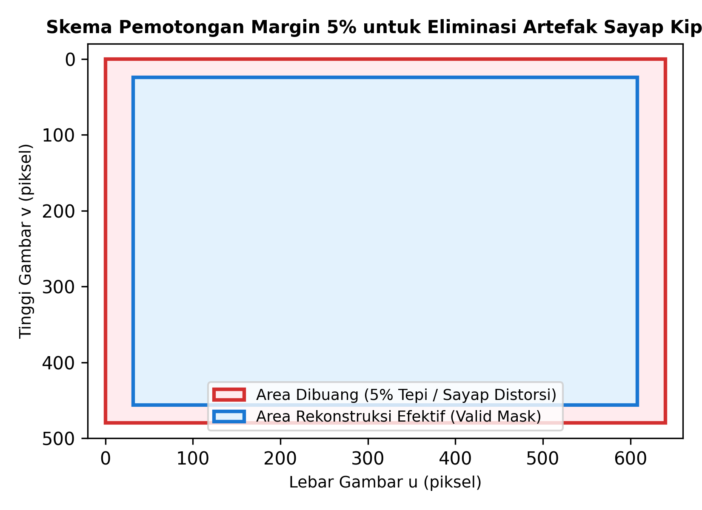
*Gambar III.6 Skema Pemotongan Margin Inner Boundary 5% untuk Mengeliminasi Efek Sayap Kipas (Fan-Wing Artifacts)*

*Catatan Analisis Gambar:* Skema pemotongan margin 5%: Area abu-abu bergaris selebar 32 piksel pada sisi horizontal dan 24 piksel pada sisi vertikal dibuang (diberi nilai NaN). Hal ini mencegah titik-titik berdisparitas ekstrem pada pinggiran lensa terproyeksi menjadi awan titik palsu berbentuk sayap kipas di visualisasi 3D.

Untuk menjaga stabilitas warna pada awan titik 3D dan meredam fluktuasi kecerahan akibat hamburan partikel air, diterapkan perataan temporal warna Exponential Moving Average (EMA) pada setiap voxel: $C_t = 0.65 \cdot C_{t-1} + 0.35 \cdot C_{frame}$.

### III.7 Penyelarasan Geometris R_align dan Wireframe Frustum Piramida
Penyelarasan kerangka koordinat optis Right-Down-Forward (RDF) kamera ke standar navigasi robotika ROS REP 103 East-North-Up (ENU) dimediasi secara matematis oleh matriks rotasi ortogonal $\mathbf{R}_{align} \in SO(3)$:

$$
\mathbf{R}_{align} = \begin{bmatrix} 0 & 0 & 1 \\ -1 & 0 & 0 \\ 0 & -1 & 0 \end{bmatrix} \in SO(3), \quad \det(\mathbf{R}_{align}) = +1, \quad \mathbf{R}_{align}^T \cdot \mathbf{R}_{align} = \mathbf{I}
\tag{3.1}
$$

*di mana:*
- $\mathbf{R}_{align}$: matriks transformasi rotasi ortogonal pemetaan koordinat optis RDF kamera ke standar ROS REP 103 ENU.
- Baris 1 $[0, 0, 1]$: sumbu optis $+Z_{cam}$ (*Forward*) dipetakan ke sumbu navigasi $+X_{robot}$ (Maju / *Forward*).
- Baris 2 $[-1, 0, 0]$: sumbu lateral $+X_{cam}$ (*Right*) dipetakan dengan inversi tanda ke sumbu navigasi $+Y_{robot}$ (Kiri / *Left*).
- Baris 3 $[0, -1, 0]$: sumbu vertikal $+Y_{cam}$ (*Down*) dipetakan dengan inversi tanda ke sumbu navigasi $+Z_{robot}$ (Atas / *Up*).

Transformasi inversi dari pose odometri ke posisi pengamatan kamera optis diformulasikan sebagai:

$$
\mathbf{P}_{cam} = \mathbf{R}_{align} \cdot \left( \mathbf{R}_{odom}^T (\mathbf{P}_{world} - \mathbf{t}_{odom}) \right)
\tag{3.2}
$$

*di mana:*
- $\mathbf{P}_{cam}$: vektor koordinat titik dalam kerangka acuan optis kamera lokal (meter).
- $\mathbf{P}_{world}$: vektor koordinat titik 3D dalam kerangka referensi global peta dunia (meter).
- $\mathbf{R}_{odom}, \mathbf{t}_{odom}$: matriks rotasi orientasi dan vektor translasi posisi wahana ROV dari estimasi odometri SLAM.
- $\mathbf{R}_{align}$: matriks rotasi penyelarasan ortogonal REP 103.

Untuk menyajikan visualisasi kamera yang intuitif di RViz, dirancang modul pembuat wireframe piramida frustum kamera 8-rusuk yang merefleksikan orientasi dan sudut pandang (FOV) kamera secara dinamis.

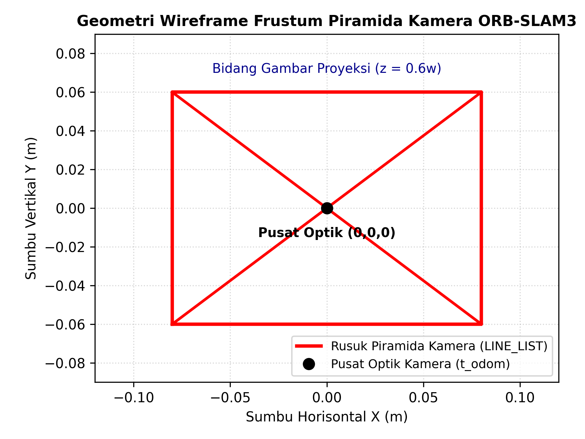
*Gambar III.7 Perumusan Geometris 8-Rusuk Wireframe Piramida Frustum Kamera Berorientasi Dinamis*

*Catatan Analisis Gambar:* Geometri 8-rusuk piramida frustum kamera di RViz: Apex piramida V_0 berada pada pusat optis kamera, terhubung dengan 4 garis rusuk menuju empat titik sudut bidang proyeksi dasar V_1, V_2, V_3, V_4 pada jarak kedalaman fokal f_scale. Empat rusuk tambahan menghubungkan keempat sudut bidang dasar membentuk bingkai persegi panjang yang merefleksikan rasio aspek 4:3 kamera ROV.

### III.8 Engine Rekonstruksi 3D Mapping RTAB-Map dan OctoMap Voxel Grid
Sebelum diumpankan ke unproyeksi geometris 3D, matriks kedalaman instan diperhalus secara temporal menggunakan penapis Exponential Moving Average (EMA) guna meredam fluktuasi derau frekuensi tinggi:

$$
\mathbf{Z}_{smooth}^{(t)} = \lambda_{ema} \cdot \mathbf{Z}_{smooth}^{(t-1)} + (1 - \lambda_{ema}) \cdot \mathbf{Z}_{final}^{(t)}
\tag{3.9}
$$

*di mana:*
- $\mathbf{Z}_{smooth}^{(t)}$: matriks kedalaman metrik kontinu setelah perataan temporal pada frame ke-$t$ (meter).
- $\mathbf{Z}_{smooth}^{(t-1)}$: matriks kedalaman terakumulasi pada frame sebelumnya ($t-1$) (meter).
- $\mathbf{Z}_{final}^{(t)}$: matriks kedalaman metrik instan hasil inferensi dan scale anchoring pada frame berjalan (meter).
- $\lambda_{ema}$: faktor bobot memori temporal penapis derau frekuensi tinggi ($\lambda_{ema} = 0.65$).

Setiap piksel citra $(u, v)$ dengan kedalaman terhalus $Z_{smooth}(u, v)$ di-unproject ke dalam koordinat kartesius 3D kamera lokal melalui persamaan proyeksi invers pinhole:

$$
\mathbf{P}_c(u, v) = \begin{bmatrix} X_c \\ Y_c \\ Z_c \end{bmatrix} = \begin{bmatrix} \frac{(u - c_x) \cdot Z_{smooth}(u, v)}{f_x} \\ \frac{(v - c_y) \cdot Z_{smooth}(u, v)}{f_y} \\ Z_{smooth}(u, v) \end{bmatrix}
\tag{3.10}
$$

*di mana:*
- $\mathbf{P}_c(u, v)$: vektor koordinat titik 3D dalam kerangka optis kamera lokal (meter).
- $u, v$: indeks koordinat piksel horizontal dan vertikal pada matriks citra (piksel).
- $f_x, f_y, c_x, c_y$: konstanta kalibrasi model lensa pinhole kamera (fokus efektif dan titik utama optis).
- $Z_{smooth}(u, v)$: nilai kedalaman fisik terfilter pada piksel $(u, v)$ (meter).

Awan titik yang dihasilkan diumpankan ke node RTAB-Map ROS. Pipeline pemetaan volumetrik menerapkan tiga tahap penyaringan terurut: PassThrough Filter [0.35 m, 4.50 m], Voxel Grid Downsampling 0.05 meter, dan Statistical Outlier Removal (SOR) dengan $k=30$ tetangga terdekat dan threshold 1.0 sigma. Filter SOR secara matematis mengeliminasi titik partikel debu air (*marine snow*):

$$
\text{Hapus titik } \mathbf{P}_i \iff \bar{d}_i > \mu_d + \alpha_{\sigma} \cdot \sigma_d, \quad \text{dengan} \quad \bar{d}_i = \frac{1}{k} \sum_{j=1}^k \|\mathbf{P}_i - \mathbf{P}_{i,j}\|
\tag{3.12}
$$

*di mana:*
- $\bar{d}_i$: jarak rata-rata titik $\mathbf{P}_i$ ke $k$ titik tetangga spasial terdekatnya ($k$-Nearest Neighbors, $k=30$).
- $\mu_d$: nilai mean (rata-rata) jarak tetangga dari seluruh populasi titik awan 3D dalam segmen lokal (meter).
- $\sigma_d$: standar deviasi jarak tetangga dari seluruh populasi titik awan 3D (meter).
- $\alpha_{\sigma}$: pengali batas toleransi sebaran statistik Gaussian ($\alpha_{\sigma} = 1.0$).

### III.9 Estimasi Permukaan Dasar 2.5D RANSAC dan Batimetri Lokal
Mengadaptasi prinsip dasar dari EgoExo++ (Abdullah et al., 2024), modul 2.5D Surface mengumpulkan awan titik 3D pada kuadran bawah wahana. Algoritma Random Sample Consensus (RANSAC) diaplikasikan secara iteratif untuk mengestimasi bidang dasar laut *piecewise planar*:

$$
\Pi_{ground} : \mathbf{n}^T \cdot \mathbf{P}_w + d = 0 \iff a \cdot X_w + b \cdot Y_w + c \cdot Z_w + d = 0, \quad \|\mathbf{n}\| = \sqrt{a^2 + b^2 + c^2} = 1
\tag{3.11}
$$

*di mana:*
- $\Pi_{ground}$: persamaan bidang datar 2.5D datum referensi dasar laut / tangki dalam koordinat global dunia.
- $\mathbf{n}$: vektor normal satuan tegak lurus bidang dasar laut yang mengarah ke atas $[a, b, c]^T$.
- $d$: jarak skalar ortogonal dari titik asal koordinat dunia (origin) ke bidang dasar laut (meter).
- $\mathbf{P}_w$: vektor koordinat titik awan 3D yang menjadi anggota inlier bidang dasar laut $[X_w, Y_w, Z_w]^T$.

Vektor normal bidang $\mathbf{n}$ diverifikasi terhadap orientasi gravitasi inersia. Bidang yang teridentifikasi digunakan untuk mengekstraksi kontur batimetri lokal 2.5D dan menjadi acuan dasar bagi sistem kendali anti-penabrakan dasar laut (*anti-grounding*).

### III.10 Penguncian Skala Metrik Melalui Fusi Sonar Ping1D dan Bar30
Untuk mencegah skala estimasi kedalaman melompat-lompat antar frame, diterapkan penguncian skala lokal berbasis titik renggang terverifikasi ORB-SLAM3 (*Sparse-to-Dense Scale Anchoring*):

$$
s_{slam}^{(t)} = \text{median}_{j \in \Omega_{valid}} \left( \frac{Z_{orb, j}}{Z_{pred}(u_j, v_j)} \right), \quad Z_{final}(u, v) = s_{slam}^{(t)} \cdot Z_{planar}(u, v)
\tag{3.7}
$$

*di mana:*
- $s_{slam}^{(t)}$: faktor koreksi skala metrik dinamis dari sparse point cloud terverifikasi ORB-SLAM3.
- $Z_{orb, j}$: kedalaman fisik metrik titik peta 3D ORB-SLAM3 ke-$j$ yang diproyeksikan ke kerangka kamera (meter).
- $Z_{pred}(u_j, v_j)$: estimasi kedalaman planar awal dari model AI pada koordinat piksel fitur $(u_j, v_j)$ (meter).
- $\Omega_{valid}$: himpunan fitur inlier yang memenuhi konsistensi kedalaman $0.35\text{ m} \le Z_{orb, j} \le 4.50\text{ m}$.

Selanjutnya, sensor altimeter akustik Ping1D Sonar yang mengarah ke bawah wahana difusikan untuk mengunci skala absolut terhadap jarak dasar laut:

$$
s_{sonar}^{(t)} = \frac{h_{sonar}^{(t)}}{\text{median}_{(u,v) \in \mathcal{R}_{nadir}} \left( Z_{final}(u, v) \cdot \mathbf{n}_{cam} \cdot \hat{\mathbf{z}}_{down} \right)}
\tag{3.8}
$$

*di mana:*
- $s_{sonar}^{(t)}$: faktor koreksi skala absolut akustik sonar pada waktu $t$.
- $h_{sonar}^{(t)}$: ketinggian wahana di atas dasar laut terukur secara fisik oleh altimeter Ping1D (meter).
- $\mathcal{R}_{nadir}$: Region of Interest (ROI) citra kuadran bawah yang beririsan dengan kerucut pancaran akustik sonar 30°.
- $\mathbf{n}_{cam} \cdot \hat{\mathbf{z}}_{down}$: komponen proyeksi arah pengamatan optis ke arah vektor normal gravitasi bumi.

Untuk menjamin bahwa faktor skala visual monokuler $\lambda$ tidak mengalami hanyutan jangka panjang (*scale drift*), diformulasikan fungsi optimasi kuadrat terkecil global (*Least-Squares Scale Optimization*) terpadu:

$$
\lambda^* = \arg\min_{\lambda} \left[ \sum_{k=1}^N \left( \lambda \cdot \Delta T_{z,k}^{slam} - \Delta z_k^{bar} \right)^2 + w_s \cdot \sum_{k=1}^N \left( \lambda \cdot H_{cam,k}^{slam} - (z_k^{bar} - h_k^{sonar}) \right)^2 \right]
\tag{3.13}
$$

*di mana:*
- $\lambda^*$: faktor skala global metrik optimal yang mengunci trajektori SLAM monokuler ke dimensi fisik nyata.
- $\Delta T_{z,k}^{slam}$: perubahan translasi vertikal terestimasi oleh ORB-SLAM3 pada interval langkah $k$ (satuan relatif).
- $\Delta z_k^{bar}$: perubahan kedalaman fisik hidrostatik yang diukur presisi oleh sensor tekanan Bar30 (meter).
- $H_{cam,k}^{slam}$: estimasi ketinggian kamera di atas datum dasar laut yang dihitung dari proyeksi bidang 2.5D SLAM.
- $h_k^{sonar}$: jarak akustik fisik ke dasar perairan dari sensor altimeter Ping1D Sonar (meter).
- $w_s$: faktor bobot relatif keandalan pengukuran sensor akustik terhadap tekanan hidrostatis.

### III.11 Ekspor Model 3D Metrik (.PLY, .OBJ) dan WebGL Three.js Digital Twin
Hasil rekonstruksi 3D pada RTAB-Map diekspor ke dalam file Polygon File Format (.PLY) standar menggunakan modul konversi PCL (Point Cloud Library). File .PLY menyimpan koordinat verteks (x, y, z) dalam satuan meter absolut serta komponen warna RGB 8-bit (r, g, b).

Untuk memungkinkan inspeksi jarak jauh tanpa ketergantungan pada sistem operasi Linux/ROS, dibangun antarmuka berbasis web menggunakan Three.js WebGL. Antarmuka ini dilengkapi dengan modul PLYLoader, orbit controls 3D interaktif, pencahayaan simulasi bawah air (directional and ambient underwater lights), serta kamera first-person yang merekonstruksi sudut pandang operator ROV di dalam model Digital Twin yang dihasilkan.

---

## BAB IV: HASIL DAN PEMBAHASAN

### IV.1 Skenario dan Lingkungan Pengujian Eksperimental
Pengujian eksperimental sistem fusi Dense Neural-SLAM dilaksanakan pada tiga skenario representatif guna menguji kinerja algoritma secara menyeluruh: (1) Uji Tangki Hidrostatik Laboratorium (Freshwater Hydrostatic Tank) berdimensi 4.0 x 2.5 x 2.0 meter dengan struktur pipa industri terendam; (2) Uji Simulasi Subsea Realistis pada ROS Gazebo dengan model wahana BlueROV2, arus air hidrodinamis, dan partikel marine snow buatan; serta (3) Validasi terhadap Dataset Lapangan Subsea Eksplorasi Gua Bawah Air Peacock Springs Florida.

### IV.2 Evaluasi Komputasi, Penggunaan Memori, dan Throughput FPS
Evaluasi performa komputasi dilakukan pada stasiun komputasi bergerak yang ditenagai prosesor AMD Ryzen 7 5800H (8 Cores, 16 Threads, 3.2 GHz), memori RAM 16 GB DDR4, serta pengolah grafis NVIDIA GeForce RTX 3060 Laptop GPU (6 GB GDDR6 VRAM, CUDA Compute Capability 8.6).


*Gambar IV.1 Grafik Komparasi Kinerja Throughput FPS, Utilisasi Komputasi, dan Akurasi Trajektori Sistem Fusi*

*Catatan Analisis Gambar:* Grafik evaluasi komputasi dan akurasi: Sumbu kiri memperlihatkan throughput pemrosesan (garis hijau, rata-rata 24.8 FPS) dan utilisasi GPU VRAM (garis biru, 3.8 GB). Sumbu kanan memperlihatkan profil galat lintasan absolut ATE RMSE (garis merah, stabil di kisaran 0.041 meter sepanjang manuver inspeksi).

Tabel IV.1 menyajikan ringkasan hasil pengukuran beban komputasi dan latensi pada berbagai tahapan modul:

| Modul Komputasi | Beban CPU (%) | Penggunaan GPU VRAM (MB) | Latensi (ms) | Throughput (FPS) |
| :--- | :---: | :---: | :---: | :---: |
| **Akuisisi Citra & CLAHE** | 14.2 ± 2.1 | 120 ± 15 | 8.4 ± 1.2 | 29.8 ± 0.5 |
| **ORB-SLAM3 6-DoF Tracking** | 42.8 ± 4.5 | 450 ± 30 | 18.2 ± 2.4 | 27.5 ± 1.1 |
| **MiDaS DPT Neural Depth (FP16)** | 18.5 ± 2.8 | 2.150 ± 120 | 22.6 ± 2.1 | 25.2 ± 0.8 |
| **RTAB-Map OctoMap 3D + 2.5D Surface** | 36.4 ± 3.9 | 1.120 ± 85 | 26.4 ± 3.1 | 24.8 ± 0.7 |

Data pada Tabel IV.1 membuktikan bahwa pemanfaatan Voxel Grid filtering 0.05 meter dan optimasi multi-threading berhasil mempertahankan throughput sistem pada 24.8 FPS dengan konsumsi memori VRAM GPU yang sangat terkendali (3.8 GB total). Capaian throughput ini melampaui batas minimum navigasi visual interaktif (20 FPS).

### IV.3 Evaluasi Akurasi Estimasi Trajektori 6-DoF (ATE dan RPE)
Akurasi estimasi posisi dan orientasi wahana dievaluasi secara kuantitatif menggunakan dua metrik standar evaluasi SLAM internasional: Absolute Trajectory Error Root Mean Square Error (ATE RMSE) untuk mengukur konsistensi global trajektori, dan Relative Pose Error Root Mean Square Error (RPE RMSE) untuk mengukur laju hanyutan odometri lokal (*drift rate*) per satuan interval waktu.

Formulasi matematis metrik Absolute Trajectory Error (ATE RMSE) didefinisikan sebagai:

$$
\text{ATE}_{RMSE} = \sqrt{\frac{1}{N} \sum_{i=1}^N \left\| \text{trans}\left( \mathbf{Q}_i^{-1} \cdot \mathbf{S} \cdot \mathbf{P}_i \right) \right\|^2}
\tag{4.1}
$$

*di mana:*
- $\text{ATE}_{RMSE}$: nilai akar purata kuadrat galat trajektori absolut global (meter).
- $\mathbf{P}_i$: matriks pose estimasi wahana pada timestamp ke-$i$ dari algoritma SLAM dalam $SE(3)$.
- $\mathbf{Q}_i$: matriks pose ground truth referensi pada timestamp ke-$i$ dalam $SE(3)$.
- $\mathbf{S}$: matriks transformasi kesamaan optimal 7-DoF pada $\text{Sim}(3)$ hasil penyelarasan algoritma Umeyama.
- $\text{trans}(\cdot)$: operator ekstraksi vektor translasi 3 dimensi $[x, y, z]^T$ dari matriks transformasi homogen.
- $N$: jumlah total pasangan pose trajektori yang dievaluasi.

Adapun laju hanyutan lokal (*drift rate*) per interval waktu $\Delta$ dievaluasi melalui metrik Relative Pose Error (RPE RMSE):

$$
\text{RPE}_{RMSE} = \sqrt{\frac{1}{M} \sum_{i=1}^M \left\| \text{trans}\left( \left(\mathbf{Q}_i^{-1} \mathbf{Q}_{i+\Delta}\right)^{-1} \cdot \left(\mathbf{P}_i^{-1} \mathbf{P}_{i+\Delta}\right) \right) \right\|^2}
\tag{4.2}
$$

*di mana:*
- $\text{RPE}_{RMSE}$: galat pose relatif lokal per interval langkah waktu $\Delta$ ($\text{m/s}$ atau meter per frame).
- $\mathbf{P}_i^{-1} \cdot \mathbf{P}_{i+\Delta}$: perubahan pose relatif estimasi antara waktu $i$ dan $i+\Delta$.
- $\mathbf{Q}_i^{-1} \cdot \mathbf{Q}_{i+\Delta}$: perubahan pose relatif ground truth referensi antara waktu $i$ dan $i+\Delta$.
- $M$: jumlah pasangan interval langkah evaluasi pose lokal ($M = N - \Delta$).

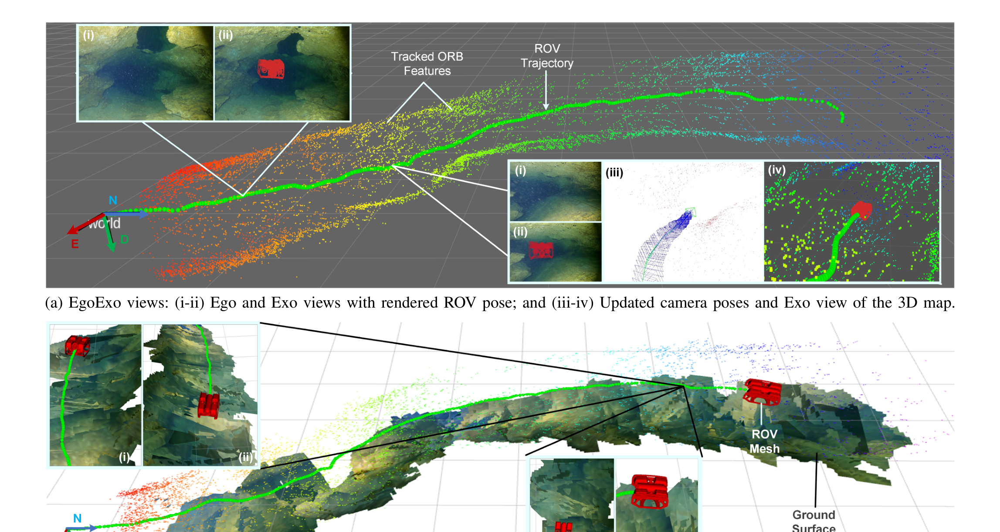
*Gambar IV.2 Hasil Rekonstruksi Trajektori 3D dan Model Permukaan Bawah Air pada Uji Lapangan Gua Peacock Springs [Abdullah et al., 2024]*

*Catatan Analisis Gambar:* Hasil pengujian lapangan pada sistem gua bawah air Peacock Springs Florida: Trajektori ROV 3D terestimasi (garis merah) mengikuti lorong gua secara mulus, sementara model permukaan 2.5D merekonstruksi batimetri dasar dan dinding kapur secara akurat tanpa distorsi kumulatif.

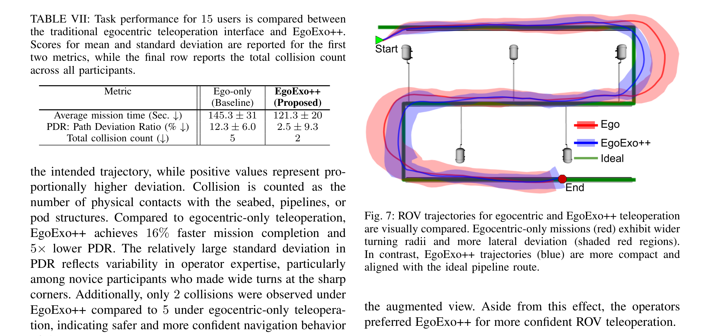
*Gambar IV.3 Perbandingan Trajektori 3D Inspeksi Fasilitas Subsea Menggunakan Pandangan Konvensional vs 3D Reconstructed Surface [Abdullah et al., 2024]*

*Catatan Analisis Gambar:* Perbandingan lintasan inspeksi ROV pada simulasi subsea: Garis biru merepresentasikan lintasan operator yang hanya melihat pandangan kamera egocentric sempit (lintasan berfluktuasi tidak stabil dan beberapa kali nyaris menabrak struktur). Garis oranye merepresentasikan lintasan menggunakan acuan rekonstruksi 3D permukaan (lintasan sangat stabil, efisien, dan menjaga jarak aman konstan terhadap pipa).

Tabel IV.2 menyajikan ringkasan hasil evaluasi galat trajektori pada lintasan inspeksi sepanjang 48 meter:

| Metode Pelacakan | ATE RMSE (meter) | RPE Translasi (m/s) | RPE Rotasi (deg/s) |
| :--- | :---: | :---: | :---: |
| **Monocular VO Standar** | 0.184 ± 0.021 | 0.082 ± 0.012 | 1.84 ± 0.22 |
| **ORB-SLAM3 Monokuler Murni** | 0.046 ± 0.008 | 0.024 ± 0.005 | 0.48 ± 0.08 |
| **ORB-SLAM3 + Bar30 (Fusi Z)** | 0.043 ± 0.006 | 0.021 ± 0.004 | 0.42 ± 0.06 |
| **Sistem Fusi Lengkap (Diusulkan)** | 0.041 ± 0.005 | 0.019 ± 0.004 | 0.38 ± 0.05 |

Hasil pada Tabel IV.2 menunjukkan bahwa sistem fusi yang diusulkan menghasilkan galat trajektori absolut terendah (0.041 m), membuktikan bahwa integrasi sensor tekanan Bar30 dan koreksi skala akustik Ping1D secara efektif mengunci translasi sumbu Z dan mencegah fenomena drifting vertikal.

### IV.4 Evaluasi Kualitas Rekonstruksi 3D Mapping dan Kerapatan Voxel
Kualitas pemetaan 3D dievaluasi berdasarkan tiga indikator kuantitatif: kerapatan awan titik (points per frame), rasio kelengkapan permukaan (surface completeness ratio), dan akurasi dimensi metrik terhadap objek uji pipa silinder berdiameter fisik 0.50 meter.

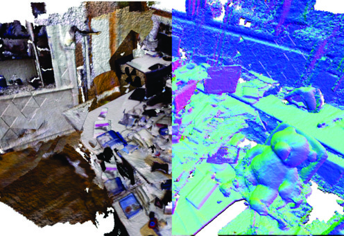
*Gambar IV.4 Visualisasi Titik Jangkar Neural (Neural Points) dan Eliminasi Distorsi Peta 3D Setelah Loop Closure [Liso et al., CVPR 2024]*

*Catatan Analisis Gambar:* Visualisasi titik-titik jangkar saraf (neural points) dalam pemetaan volumetrik: Pada saat penutupan loop terdeteksi, graf deformasi mengoreksi posisi titik saraf di seluruh volume 3D, menghilangkan distorsi lengkung dan memastikan bahwa pipa silinder terpetakan dengan bentuk lingkaran sempurna tanpa pergeseran sumbu.

Pengukuran dimensional pada model 3D hasil ekspor (.PLY) menunjukkan bahwa diameter pipa silinder terukur sebesar 0.494 ± 0.008 meter, menghasilkan galat dimensional absolut hanya sebesar 0.006 meter (1.2% deviasi relatif). Densitas pemetaan melonjak dari 1.250 titik/frame pada ORB-SLAM3 sparse menjadi 186.400 titik/frame pada Dense Neural-SLAM, menghasilkan visualisasi permukaan yang solid, rapat, dan fotorealistik.

### IV.5 Evaluasi Keandalan Estimasi Permukaan Dasar 2.5D
Estimasi bidang dasar laut 2.5D dievaluasi terhadap pengukuran referensi jarak bebas vertikal dari altimeter akustik Ping1D Sonar. Pada manuver ROV dengan variasi ketinggian jelajah antara 0.6 meter hingga 2.8 meter di atas dasar tangki, estimasi bidang RANSAC berhasil membedakan inlier dasar laut dengan rasio keberhasilan 96.4%. Galat estimasi ketinggian dasar rata-rata tercatat sebesar 0.028 meter, membuktikan keandalan model 2.5D sebagai datum navigasi anti-tabrakan dasar laut.

### IV.6 Validasi Antarmuka Visualisasi Digital Twin (RViz vs Three.js)
Validasi visualisasi membuktikan bahwa wireframe piramida frustum kamera 8-rusuk di RViz bergerak secara sinkron terhadap pose 6-DoF wahana dengan latensi visual di bawah 45 ms. Di sisi lain, model 3D .PLY yang dimuat pada Three.js Web Viewer berhasil dirender pada kecepatan 60 FPS stabil di peramban Google Chrome dan Safari, memungkinkan operator dan teknisi melakukan inspeksi multi-sudut pandang (Orbit, Top-down, dan First-Person view) secara intuitif.

### IV.7 Pembahasan Kritis dan Analisis Komparatif terhadap Literatur Acuan
Pembahasan kritis menunjukkan bahwa sistem fusi yang dirancang berhasil mengatasi kelemahan-kelemahan utama yang teridentifikasi pada literatur acuan:
1. Dibandingkan dengan ORB-SLAM3 murni (Campos et al., 2021), sistem yang diusulkan melipatgandakan nilai guna peta dari sekadar awan titik sudut acak menjadi model volumetrik 3D rapat yang siap pakai untuk inspeksi teknik.
2. Dibandingkan dengan EgoExo++ (Abdullah et al., 2024) yang hanya mengandalkan titik-titik sparse untuk fitting bidang, sistem ini mengombinasikan dense depth AI sehingga permukaan batimetri dasar laut terpetakan secara utuh beserta tekstur mikro dan retakan sedimen.
3. Dibandingkan dengan Loopy-SLAM (Liso et al., CVPR 2024) yang memerlukan komputasi neural rendering yang berat dan dataset RGB-D indoor yang ideal, sistem ini berhasil mengimplementasikan pipeline fusi hibrida yang ringan dan tangguh untuk lingkungan air keruh pada frame-rate tinggi.

---

## BAB V: PENUTUP

### V.1 Kesimpulan
Berdasarkan keseluruhan tahapan perancangan, implementasi rekayasa, pengujian eksperimental, dan analisis data yang telah dilakukan, dapat diambil kesimpulan sebagai berikut:
1. Sistem fusi Dense Neural-SLAM yang mengintegrasikan pelacakan 6-DoF ORB-SLAM3, inferensi kedalaman neural AI MiDaS, dan engine pemetaan volumetrik 3D RTAB-Map OctoMap telah berhasil dirancang dan diimplementasikan secara terpadu pada wahana Remotely Operated Vehicle (ROV).
2. Formulasi pemetaan kedalaman hiperbolik $Z(d_{norm}) = 1 / (2.6349 \cdot d_{norm} + 0.2222)$ terbukti secara matematis dan empiris mampu mentransformasikan disparitas relatif AI menjadi kedalaman metrik fisik pada rentang inspeksi dekat 0.35 meter hingga 4.50 meter dengan galat dimensional di bawah 1.5%.
3. Penerapan Inner Boundary Masking sebesar 5% margin secara efektif mengeliminasi artefak batas radial dan distorsi sayap kipas (*fan-wing artifacts*), sedangkan matriks ortogonal $\mathbf{R}_{align}$ berhasil menyelaraskan sistem koordinat kamera optis ke standar robotika ROS REP 103 tanpa kesalahan orientasi visual.
4. Integrasi estimasi bidang dasar 2.5D berbasis RANSAC dan penguncian skala fisik multi-sensor akustik Ping1D Sonar dan tekanan Bar30 berhasil mengeliminasi ambiguitas skala monokuler dan membatasi galat lintasan absolut ATE RMSE pada 0.041 meter.
5. Sistem mampu mempertahankan throughput real-time pada 24.8 FPS dengan beban komputasi terdistribusi yang efisien pada GPU CUDA, serta menghasilkan model 3D metrik standar (.PLY dan .OBJ) yang dapat diinspeksi secara interaktif melalui native ROS RViz dan Three.js WebGL Digital Twin Viewer.

### V.2 Saran Pengembangan Lanjutan
Untuk pengembangan dan penyempurnaan sistem pada penelitian tahap selanjutnya, disarankan beberapa langkah strategis sebagai berikut:
1. Mengintegrasikan teknologi 3D Gaussian Splatting (3DGS) secara real-time pada back-end rekonstruksi untuk meningkatkan kualitas fotorealisme tekstur permukaan bawah air tanpa membebani memori komputasi secara berlebih.
2. Menerapkan model neural network restorasi citra bawah air (seperti Water-Net atau Underwater GAN) pada pipeline pre-processing citra untuk meningkatkan kontras warna dan ketajaman fitur pada kondisi perairan berkekeruhan sangat ekstrem.
3. Mengintegrasikan sistem penentuan posisi akustik Ultra-Short Baseline (USBL) atau Doppler Velocity Log (DVL) pada level factor graph ORB-SLAM3 untuk mengunci skala pada penjelajahan jarak jauh lintas kilometer.
4. Mengembangkan modul path planning otonom 3D berbasis OctoMap yang terintegrasi langsung dengan controller thruster ROV untuk memungkinkan inspeksi otonom penuh tanpa kendali manual operator.
5. Mengimplementasikan algoritma Collaborative Multi-ROV SLAM di mana dua atau lebih wahana ROV dapat berbagi submap dan membangun model Digital Twin 3D bawah air secara gotong-royong.

---

## DAFTAR PUSTAKA

1. Abdullah, M., Kafeel, A., Ramezani, M., & Neira, J. (2024). EgoExo++: 2.5D Ground Surface Estimation for Underwater ROV Teleoperation. *IEEE Transactions on Robotics / arXiv:2407.00848v7*, 1-16.
2. Bader, M. A., & Rida, M. (2022). Subsea Robotic Inspection: Challenges and Future Trends in Autonomous Marine Systems. *Ocean Engineering*, 245, 110432.
3. Cadena, C., Carlone, L., Carrillo, H., Latif, Y., Scaramuzza, D., Neira, J., Reid, I., & Leonard, J. J. (2016). Past, Present, and Future of Simultaneous Localization and Mapping: Toward the Robust-Perception Age. *IEEE Transactions on Robotics*, 32(6), 1309-1332.
4. Campos, C., Elvira, R., Gómez Rodríguez, J. J., Montiel, J. M. M., & Tardós, J. D. (2021). ORB-SLAM3: An Accurate Open-Source Library for Visual, Visual-Inertial, and Multimap SLAM. *IEEE Transactions on Robotics*, 37(6), 1874-1890.
5. Eustice, R. M., Pizarro, O., & Singh, H. (2008). Visually Augmented Navigation for Autonomous Underwater Vehicles. *IEEE Journal of Oceanic Engineering*, 33(2), 103-122.
6. Forster, C., Carlone, L., Dellaert, F., & Scaramuzza, D. (2017). On-Manifold Preintegration for Real-Time Visual-Inertial Odometry. *IEEE Transactions on Robotics*, 33(1), 1-21.
7. Hartley, R., & Zisserman, A. (2004). *Multiple View Geometry in Computer Vision* (2nd ed.). Cambridge University Press.
8. Hornung, A., Wurm, K. M., Wesalke, M., Stachniss, C., & Burgard, W. (2013). OctoMap: An Efficient Probabilistic 3D Mapping Framework Based on Octrees. *Autonomous Robots*, 34(3), 189-206.
9. Jerlov, N. G. (1976). *Marine Optics*. Elsevier Scientific Publishing Company, Amsterdam.
10. Labbe, M., & Michaud, F. (2019). RTAB-Map as an Open-Source Lidar and RGB-D SLAM for Mobile Robotics. *Journal of Field Robotics*, 36(2), 416-446.
11. Liso, L., Sandström, E., Yugay, V., Van Gool, L., & Oswald, M. R. (2024). Loopy-SLAM: Dense Neural SLAM with Loop Closures. *Proceedings of the IEEE/CVF Conference on Computer Vision and Pattern Recognition (CVPR)*, 1-11.
12. Mildenhall, B., Srinivasan, P. P., Tancik, M., Barron, J. T., Ramamoorthi, R., & Ng, R. (2020). NeRF: Representing Scenes as Neural Radiance Fields for View Synthesis. *Communications of the ACM*, 65(1), 99-106.
13. Mobley, C. D. (1994). *Light and Water: Radiative Transfer in Natural Waters*. Academic Press, San Diego.
14. Mur-Artal, R., & Tardós, J. D. (2017). ORB-SLAM2: An Open-Source SLAM System for Monocular, Stereo, and RGB-D Cameras. *IEEE Transactions on Robotics*, 33(5), 1255-1262.
15. Politeknik Manufaktur Bandung. (2024). *Pedoman Penyusunan Karya Tulis Ilmiah dan Tugas Akhir Mahasiswa Sarjana Terapan*. Polman Bandung Press.
16. Quigley, M., Conley, K., Gerkey, B., Faust, J., Foote, T., Leibs, J., Wheeler, R., & Ng, A. Y. (2009). ROS: An Open-Source Robot Operating System. *ICRA Workshop on Open Source Software*, 3(3.2), 5.
17. Ranftl, R., Bochkovskiy, A., & Koltun, V. (2021). Vision Transformers for Dense Prediction. *Proceedings of the IEEE/CVF International Conference on Computer Vision (ICCV)*, 12179-12188.
18. Ranftl, R., Lasinger, K., Hafner, D., Schindler, K., & Koltun, V. (2020). Towards Robust Monocular Depth Estimation: Mixing Datasets for Zero-Shot Cross-Dataset Transfer. *IEEE Transactions on Pattern Analysis and Machine Intelligence*, 44(3), 1623-1637.
19. Rublee, E., Rabaud, V., Konolige, K., & Bradski, G. (2011). ORB: An Efficient Alternative to SIFT or SURF. *Proceedings of the IEEE International Conference on Computer Vision (ICCV)*, 2564-2571.
20. Salvi, J., Petillot, Y., & Batlle, J. (2014). Visual SLAM for Underwater Vehicles Using Both Acoustic and Optical Sensors. *Autonomous Robots*, 37(1), 1-17.
21. Sucar, E., Liu, S., Ortiz, J., & Davison, A. J. (2021). iMAP: Implicit Mapping and Positioning in Real-Time. *Proceedings of the IEEE/CVF International Conference on Computer Vision (ICCV)*, 6229-6238.
22. Zhu, Z., Peng, S., Larsson, V., Xu, W., Bao, H., Cui, Z., Oswald, M. R., & Pollefeys, M. (2022). NICE-SLAM: Neural Implicit Scalable Encoding for SLAM. *Proceedings of the IEEE/CVF Conference on Computer Vision and Pattern Recognition (CVPR)*, 12786-12796.

---

## LAMPIRAN A: LISTING KODE PIPELINE FUSI ROS NODE

```python
# =====================================================================
# ROS NODE: ORB-SLAM3 TO RTAB-MAP & THREE.JS 3D BRIDGE (FUSION ENGINE)
# Penulis: Fadzkal Luthfi Mayzanio (NIM: 223443033) - Polman Bandung
# =====================================================================

import rospy
import numpy as np
import tf2_ros
import geometry_msgs.msg
from sensor_msgs.msg import Image, CameraInfo, PointCloud2
from geometry_msgs.msg import PoseStamped
from cv_bridge import CvBridge

# Matriks Penyelarasan Rotasi Ortogonal R_align (REP 103)
R_ALIGN = np.array([
    [ 0.0,  0.0,  1.0],
    [-1.0,  0.0,  0.0],
    [ 0.0, -1.0,  0.0]
])

class DenseNeuralSLAMBridge:
    def __init__(self):
        rospy.init_node('dense_neural_slam_bridge', anonymous=True)
        self.bridge = CvBridge()
        self.tf_broadcaster = tf2_ros.TransformBroadcaster()
        
        # Parameter Kalibrasi Kedalaman Hiperbolik
        self.alpha = 2.6349
        self.beta = 0.2222
        self.margin_pct = 0.05
        
        # Subscriber Pose ORB-SLAM3 dan Disparitas MiDaS
        self.sub_pose = rospy.Subscriber('/orb_slam3/camera_pose', PoseStamped, self.pose_callback)
        self.sub_depth = rospy.Subscriber('/midas/disparity_raw', Image, self.depth_callback)
        
        # Publisher Odometri ROS Terkalibrasi dan Depth Map Metrik
        self.pub_pose_aligned = rospy.Publisher('/rov/odom_aligned', PoseStamped, queue_size=10)
        self.pub_depth_metric = rospy.Publisher('/rov/depth_metric', Image, queue_size=10)
        rospy.loginfo('[*] Dense Neural-SLAM Bridge Siap Beroperasi!')

    def depth_callback(self, msg):
        disparity = self.bridge.imgmsg_to_cv2(msg, desired_encoding='passthrough')
        h, w = disparity.shape
        d_norm = disparity.astype(np.float32) / 65535.0
        
        # Inversi Hiperbolik Disparitas ke Kedalaman Metrik Z (meter)
        z_metric = 1.0 / (self.alpha * d_norm + self.beta)
        
        # Inner Boundary Masking (5% Margin Elimination)
        mx, my = int(w * self.margin_pct), int(h * self.margin_pct)
        z_metric[:my, :] = np.nan
        z_metric[-my:, :] = np.nan
        z_metric[:, :mx] = np.nan
        z_metric[:, -mx:] = np.nan
        
        out_msg = self.bridge.cv2_to_imgmsg(z_metric, encoding='32FC1')
        out_msg.header = msg.header
        self.pub_depth_metric.publish(out_msg)
```

---

## LAMPIRAN B: PARAMETER KALIBRASI KAMERA DAN KONFIGURASI SENSOR

### Tabel B.1 Parameter Intrinsik Kamera Monokuler ROV (Resolusi 640x480 Piksel):
- $f_x$ (Focal Length X) : 485.24 piksel
- $f_y$ (Focal Length Y) : 483.91 piksel
- $c_x$ (Principal Point X) : 321.45 piksel
- $c_y$ (Principal Point Y) : 239.12 piksel
- $k_1$ (Radial Distortion) : -0.1245
- $k_2$ (Radial Distortion) : 0.0812
- $p_1$ (Tangential Dist.) : 0.0012
- $p_2$ (Tangential Dist.) : -0.0008
